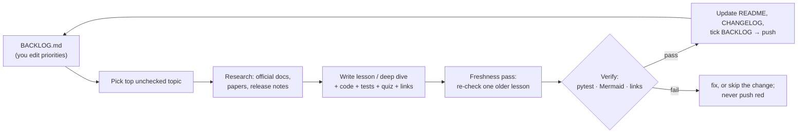

# 🌱 How this repo evolves (playbook for the weekly update)

This repo is updated **automatically every week** by a scheduled Claude session, and by you whenever you like. This file is the **contract** every update must follow, so the repo keeps getting better instead of just bigger.



## Each weekly run does
1. **One new topic**, the top unchecked item in [BACKLOG.md](BACKLOG.md) (🔥 Requested first, then 🧭 Planned). If the backlog is empty, it proposes 5 new topics, adds them to Planned, and builds the first.
2. **One freshness pass**: re-verify one existing lesson in rotation (`docs/01` → `10` → `deep-dives/01` → `07` → repeat; the last one checked is recorded in CHANGELOG). Fix renamed APIs, deprecated packages, dead links and outdated facts, and add a short "🆕 Updated <date>" note where something changed.
3. **On the first run of each month:** a **What's new** digest in `docs/whats-new/YYYY-MM.md`, covering the month's important releases and papers in LLMs, RAG, agents and tooling, written in your own words with links. Each item says why it matters for a data engineer or developer.
4. **Housekeeping:** update [CHANGELOG.md](CHANGELOG.md), tick the BACKLOG item (move it to ✅ Done with date + link), add the new page to the README curriculum table / deep-dives index, and update test counts.

## Quality bar for new content (same as the existing lessons)
- **Structure:** learning goals → explanation with **Mermaid diagrams** → worked examples → hands-on code → "✅ Check your understanding" (5+ questions with answers in `<details>`) → "🏋️ Exercises" → "📚 Go deeper" links.
- **Code:** runnable code in `src/ailearn/` (or `examples/`) with **pytest tests that run offline** (inject `ScriptedLLM`/`MockLLM`; fake clocks; in-memory DBs). Cloud-only code (Azure, Databricks) goes in `examples/` and is clearly labelled as not run in CI.
- **Accuracy:** verify every library API against current official docs before writing it, and note versions ("targets X ≥ 2.0"). If unsure, say so and link the doc. **Never invent links**: only use URLs found while researching or already in the repo.
- **Relevance:** where it fits, include an angle for **data engineers on Azure / Databricks / Fabric** and one for software developers.
- **Copyright:** explain in our own words; short quotes only, with attribution.
- **Tone:** clear, practical, plenty of examples, no filler.

## Verification (all must pass before pushing)
```bash
pip install -e ".[dev,graph]"
pytest -q                                    # all tests green
node tools/check_mermaid.mjs $(git ls-files '*.md')   # every diagram parses (cd tools && npm install first)
python tools/check_links.py --changed        # links in changed files resolve (best effort)
```
If something can't be made to pass, leave it out of the commit and record it in CHANGELOG under "Skipped / needs attention". **Never push a red build.**

## Commit convention
`weekly: <topic>` for the main change, plus `refresh: <lesson>` / `digest: YYYY-MM` when those happen. Pushed directly to `main` (private learning repo). History is the audit trail: `git revert` undoes any week.

## Steering the automation
- Change **what** gets written: edit [BACKLOG.md](BACKLOG.md).
- Change **how** it's written: edit this file.
- Pause or change the schedule: open Scheduled tasks in Claude and edit or pause **"Evolve AI learning repo"**.
