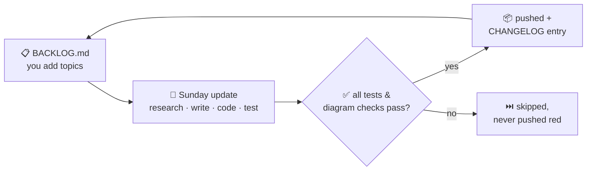

<p align="center">
  
</p>

<p align="center">
  <a href="https://github.com/alam0604/llm-rag-agentic-ai-learning/actions/workflows/tests.yml"></a>
  
  
  
  
  
  
  
</p>

<p align="center">
  <b>A hands-on path from "what is a token?" to shipping RAG systems and multi-agent workflows,</b><br/>
  built for <b>software developers</b> and <b>data engineers</b>. Every concept comes with a diagram, runnable code and a test.
</p>

<p align="center">
  <a href="#-pick-your-path">Pick your path</a> ·
  <a href="#-curriculum">Curriculum</a> ·
  <a href="#-quick-start">Quick start</a> ·
  <a href="projects/README.md">Projects</a> ·
  <a href="quizzes/README.md">Quizzes</a> ·
  <a href="resources/README.md">Resources</a> ·
  <a href="CHANGELOG.md">What's new</a>
</p>

---

<table align="center">
  <tr>
    <td align="center" width="16%">📘<br/><b><big>10</big></b><br/><sub>lessons</sub></td>
    <td align="center" width="16%">🔬<br/><b><big>7</big></b><br/><sub>deep dives</sub></td>
    <td align="center" width="16%">🧪<br/><b><big>112</big></b><br/><sub>tests</sub></td>
    <td align="center" width="16%">🛠️<br/><b><big>12</big></b><br/><sub>projects</sub></td>
    <td align="center" width="16%">📝<br/><b><big>34+</big></b><br/><sub>quiz Qs</sub></td>
    <td align="center" width="16%">🌱<br/><b><big>+1</big></b><br/><sub>topic / week</sub></td>
  </tr>
</table>

## 🧭 Pick your path

| If you are… | Start here | Then |
|---|---|---|
| 🐣 **New to LLMs** | [01 Foundations](docs/01-foundations.md) → [02 Working with LLMs](docs/02-working-with-llms.md) | [03 Vector DBs](docs/03-embeddings-and-vector-databases.md) → [04 RAG](docs/04-rag.md) |
| 🧱 **A data engineer** (Azure · Databricks · Fabric) | [08 For Data Engineers](docs/08-for-data-engineers.md) | [10 LangGraph → Databricks](docs/10-hands-on-langgraph-databricks.md) → [Azure deep dive](docs/deep-dives/04-azure-ai-foundry-and-ai-search.md) |
| 👩‍💻 **A software developer** | [07 For Developers](docs/07-for-software-developers.md) | [05 Agentic AI](docs/05-agentic-ai.md) → [Shipping apps](docs/deep-dives/03-shipping-apps.md) |
| 🚀 **Ready to ship an agent** | [LangGraph in depth](docs/deep-dives/01-langgraph-in-depth.md) | [Evals & observability](docs/deep-dives/05-evaluation-and-observability.md) → [MCP](docs/deep-dives/06-mcp-hands-on.md) |
| 🎯 **Preparing for interviews** | [Quizzes & system design](quizzes/README.md) | [Projects](projects/README.md) → [Real-world guide](docs/09-real-world-getting-started.md) |

Want a schedule? Follow the **[12-week roadmap](ROADMAP.md)** (~6–8 h/week).

## 🗺️ The journey

```mermaid
flowchart LR
    A["🧠 01 Foundations<br/>tokens · embeddings<br/>attention"] --> B["💬 02 LLMs<br/>APIs · prompting<br/>structured output"]
    B --> C["🧭 03 Vector DBs<br/>HNSW · IVF · PQ<br/>hybrid search"]
    C --> D["📚 04 RAG<br/>chunking · rerank<br/>evaluation"]
    D --> E["🤖 05 Agents<br/>ReAct · tools<br/>memory · MCP"]
    E --> F["⚡ 06 Advanced<br/>GraphRAG · LoRA<br/>LLMOps · security"]
    F --> G["🧱 07/08 Apply it<br/>devs & data<br/>engineers"]
    G --> H["🚀 10 Ship it<br/>LangGraph · FastAPI<br/>Databricks"]
    H --> I["🔬 Deep dives<br/>+ weekly new<br/>topics"]
    style A fill:#0c4a6e,color:#fff,stroke:#7dd3fc
    style D fill:#3b0764,color:#fff,stroke:#a78bfa
    style E fill:#4a044e,color:#fff,stroke:#f0abfc
    style H fill:#14532d,color:#fff,stroke:#86efac
```



## 📖 Curriculum

| # | Lesson | Level | What you'll learn |
|:-:|---|:-:|---|
| 01 | [**Foundations**](docs/01-foundations.md) | 🟢 | tokens & BPE, embeddings, self-attention (coded in NumPy), transformers, training (SFT → RLHF/DPO), decoding, hallucinations |
| 02 | [**Working with LLMs**](docs/02-working-with-llms.md) | 🟢 | model landscape, API calls (OpenAI, Claude, Ollama), prompting techniques, JSON output, cost & latency maths |
| 03 | [**Embeddings & Vector DBs**](docs/03-embeddings-and-vector-databases.md) | 🟢→🔴 | similarity metrics, Flat/IVF/HNSW/PQ with pictures, DB comparison, pgvector · Chroma · Databricks, filtering, hybrid |
| 04 | [**RAG**](docs/04-rag.md) | 🟡 | architecture, parsing, chunking, hybrid + reranking, query rewriting, debugging failures, evaluation |
| 05 | [**Agentic AI**](docs/05-agentic-ai.md) | 🟡→🔴 | workflows vs agents, ReAct, tool calling, memory, planning, multi-agent, MCP, frameworks, safety |
| 06 | [**Advanced Topics**](docs/06-advanced-topics.md) | 🔴 | contextual retrieval, GraphRAG, Self/Corrective RAG, LoRA/QLoRA/DPO, KV cache, quantization, LLMOps, OWASP LLM Top 10 |
| 07 | [**For Software Developers**](docs/07-for-software-developers.md) | 🟡 | codebase RAG, test generation, PR review bots, incident triage, AI product features |
| 08 | [**For Data Engineers**](docs/08-for-data-engineers.md) | 🟡 | RAG ingestion as a medallion pipeline (PySpark), `ai_query`, text-to-SQL agents, pipeline triage, embeddings at scale |
| 09 | [**Getting Started in Real Life**](docs/09-real-world-getting-started.md) | 🟢 | 7-day plan, setup, production checklist, portfolio, staying current |
| 10 | [**Hands-on: LangGraph → FastAPI → Databricks**](docs/10-hands-on-langgraph-databricks.md) | 🟡→🔴 | graph agent with routing, SQL self-correction and human approval; REST service; Vector Search + UC tools; MLflow eval |

### 🔬 Deep dives — the skills that turn learning into shipping

| | Deep dive | Highlights |
|:-:|---|---|
| 1 | [**LangGraph in depth**](docs/deep-dives/01-langgraph-in-depth.md) | state & reducers, `Send` map-reduce, `interrupt()`, streaming, checkpoints, subgraphs |
| 2 | [**Real models & resilience**](docs/deep-dives/02-real-models-and-embeddings.md) | Azure OpenAI, Ollama, retries with jitter, rate limits, fallbacks, messy PDFs |
| 3 | [**Shipping apps**](docs/deep-dives/03-shipping-apps.md) | async Python, FastAPI, streaming (SSE), Streamlit, Docker, deployment |
| 4 | [**Azure AI Foundry & AI Search**](docs/deep-dives/04-azure-ai-foundry-and-ai-search.md) | hybrid + semantic ranking, security trimming, Foundry agents (SDK 2.x) |
| 5 | [**Evaluation & observability**](docs/deep-dives/05-evaluation-and-observability.md) | LLM-as-judge, RAGAS, DeepEval, Langfuse, eval gates in CI |
| 6 | [**MCP hands-on**](docs/deep-dives/06-mcp-hands-on.md) | build, test and secure an MCP server (SDK 2.x) |
| 7 | [**Math & Python prerequisites**](docs/deep-dives/07-prerequisites-math-and-python.md) | vectors, cosine, softmax, sizing maths, Pydantic, async, pytest |

## 🧪 Learn from code that actually runs

Everything in [`src/ailearn/`](src/ailearn) is written from scratch to be **read**, and it all runs **offline with no API key**. Fake LLMs (`ScriptedLLM`, `MockLLM`) stand in for the real ones in tests, and you can swap in OpenAI, Azure OpenAI, Claude or Ollama with one line.

<table>
<tr><th>🔤 Foundations</th><th>🔎 Retrieval & RAG</th><th>🤖 Agents & serving</th><th>🛡️ Production</th></tr>
<tr valign="top">
<td>

`attention.py` — attention, causal mask, sampling<br/>
`tokenizer.py` — BPE tokenizer<br/>
`embeddings.py` — TF-IDF, hashing, cosine

</td>
<td>

`vectorstore.py` — Flat + IVF indexes<br/>
`chunking.py` — 4 chunkers<br/>
`bm25.py` · `hybrid.py` — BM25 + RRF<br/>
`rag.py` — full RAG pipeline

</td>
<td>

`agent.py` — ReAct + safe tools<br/>
`graph_agent.py` — LangGraph agent<br/>
`api.py` — FastAPI + SSE + approvals<br/>
`mcp_server.py` — MCP server

</td>
<td>

`resilience.py` — retry, rate limit, fallback<br/>
`structured.py` — Pydantic outputs<br/>
`evaluation.py` — retrieval metrics<br/>
`llm_judge.py` — LLM judge + CI gate

</td>
</tr>
</table>

## 🚀 Quick start

```bash
git clone https://github.com/alam0604/llm-rag-agentic-ai-learning && cd llm-rag-agentic-ai-learning
python -m venv .venv && source .venv/bin/activate        # Windows: .venv\Scripts\activate
pip install -e ".[dev,graph]"
pytest -q                                                 # ✅ every concept has a test
```

<details>
<summary><b>▶️ More things to run</b></summary>

```bash
python examples/01_offline_rag_demo.py      # RAG end-to-end, offline
python examples/02_text_to_sql_agent.py     # ReAct agent writing SQL, offline
uvicorn ailearn.api:app --app-dir src       # agent as a REST API → http://127.0.0.1:8000/docs
streamlit run apps/streamlit_app.py         # chat UI with live steps + approve/reject  (pip install -e ".[ui]")
docker compose up --build                   # API + UI in containers
python -m ailearn.mcp_server                # MCP server for Claude / IDE / agent clients
python examples/generate_images.py          # regenerate the figures in assets/images
```

**With a real model:** `pip install -e ".[real]"`, set `OPENAI_API_KEY` (or run [Ollama](https://ollama.com/) locally for free), then try `examples/03_real_rag_chroma_openai.py` and `examples/04_tool_calling_native.py`.
</details>

## 🖼️ A peek inside

| Attention: "it" looks back at "pipeline" | Similar meaning → nearby vectors | HNSW: search from coarse to fine |
|:-:|:-:|:-:|
|  |  |  |

## 🌱 This repo grows every week



- **Every Sunday** a scheduled update adds a **new topic**, re-checks an **older lesson** for outdated APIs and dead links, and on the first run of each month writes a **[What's new digest](docs/whats-new/README.md)**.
- **Steer it:** add a line under *🔥 Requested* in **[BACKLOG.md](BACKLOG.md)** and it's built next.
- **Follow along:** **[CHANGELOG.md](CHANGELOG.md)** · quality rules: **[EVOLUTION.md](EVOLUTION.md)**

<details>
<summary><b>🗂️ Repository layout</b></summary>

```
├── docs/                 # 10 lessons
│   ├── deep-dives/       # 7 in-depth guides
│   └── whats-new/        # monthly digests
├── src/ailearn/          # from-scratch library (read these!)
├── tests/                # pytest suite, all offline
├── examples/             # runnable demos + databricks/ notebooks
├── apps/                 # Streamlit chat UI
├── projects/             # 12 project specs with acceptance criteria
├── quizzes/              # quiz questions + system-design prompts
├── resources/            # curated articles, courses, videos, papers
├── assets/               # banner + generated figures
├── tools/                # Mermaid + link checkers
├── Dockerfile, docker-compose.yml
├── BACKLOG.md            # 👉 topic queue for weekly updates (you edit this)
├── EVOLUTION.md          # rules for how the repo grows
├── ROADMAP.md            # 12-week study plan
└── CHANGELOG.md          # what changed, week by week
```
</details>

<details>
<summary><b>🧠 How to study each lesson</b></summary>

1. Read the lesson and redraw the diagrams yourself.
2. Read the matching file in `src/ailearn/` and its tests.
3. Break something on purpose, watch a test fail, then fix it.
4. Answer "Check your understanding" without peeking.
5. Do one exercise, then one project.
6. Read or watch 1–2 links from "Go deeper".
</details>

---

<p align="center">
  <sub>Personal learning repository · implementations are educational; for production, use the libraries and services each lesson points to.</sub><br/>
  <sub>Built and grown with ❤️ by <a href="https://github.com/alam0604">@alam0604</a></sub>
</p>
