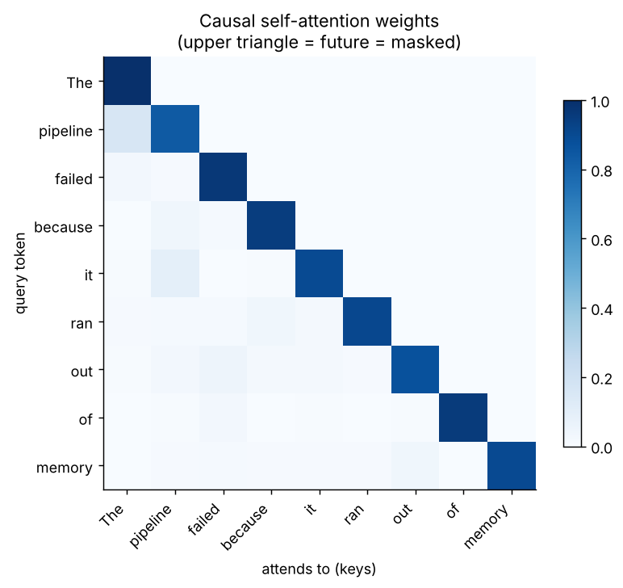
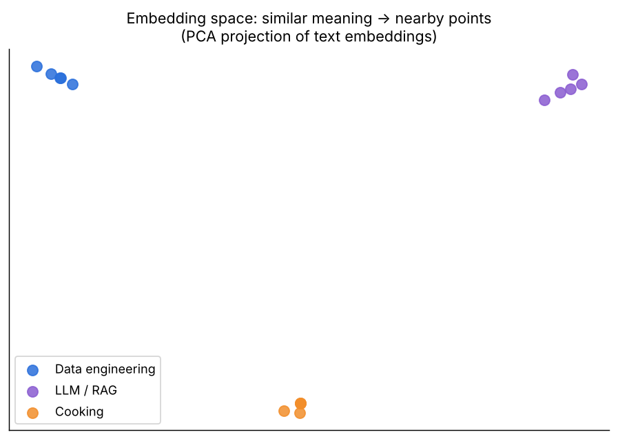
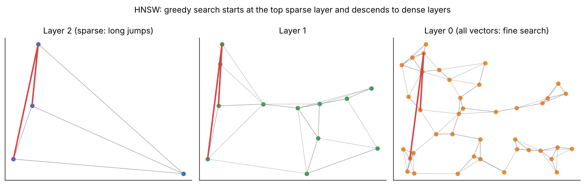

# 🧠 LLM · RAG · Agentic AI — Learn by Building

A complete, hands-on path from **"what is a token?"** to **production RAG systems and multi-agent workflows**, written for **software developers and data engineers**.

- 📘 **10 in-depth lessons** with diagrams, worked examples, quizzes and exercises
- 🧪 **A from-scratch Python library** (`src/ailearn`) — attention, BPE tokenizer, embeddings, vector indexes (Flat + IVF), chunkers, BM25, hybrid search, RAG pipeline, ReAct agent, eval metrics, plus a **LangGraph agent served with FastAPI (with streaming)**, an **MCP server**, **LLM-call resilience** (retries, rate limits, fallbacks), **structured output** and an **LLM-as-judge eval gate** — **112 pytest tests, runs offline, no API key**
- 🛠️ **12 projects** (basic → advanced) for devs and data engineers (Azure / Databricks / Spark)
- 📝 **34 quiz questions + system-design prompts**
- 📚 **Curated links** — articles, courses, videos, papers, example-project repos

```mermaid
flowchart LR
    A["01 Foundations<br/>tokens · embeddings<br/>attention · transformers"] --> B["02 Working with LLMs<br/>APIs · prompting<br/>structured output · cost"]
    B --> C["03 Embeddings &<br/>Vector DBs<br/>HNSW · IVF · PQ · hybrid"]
    C --> D["04 RAG<br/>chunking · retrieval<br/>rerank · evaluation"]
    D --> E["05 Agentic AI<br/>ReAct · tools · memory<br/>multi-agent · MCP"]
    E --> F["06 Advanced<br/>GraphRAG · fine-tuning<br/>serving · LLMOps · security"]
    F --> G["07/08 Apply it<br/>software dev &<br/>data engineering"]
    G --> H["09 Real world<br/>+ 12 projects"]
    H --> I["10 Hands-on<br/>LangGraph · FastAPI<br/>Databricks Mosaic AI"]
```



## 📖 Curriculum

| # | Module | Level | What you'll learn |
|---|---|---|---|
| 01 | [Foundations](docs/01-foundations.md) | 🟢 | AI→ML→DL→LLM, tokens & BPE, embeddings, self-attention (with code), transformer, training (pre-train → SFT → RLHF/DPO), decoding, hallucinations |
| 02 | [Working with LLMs](docs/02-working-with-llms.md) | 🟢 | model landscape, API calls (OpenAI, Claude, Ollama), prompt techniques, structured JSON output, cost & latency maths |
| 03 | [Embeddings & Vector Databases](docs/03-embeddings-and-vector-databases.md) | 🟢→🔴 | similarity metrics, ANN indexes (Flat/IVF/HNSW/PQ/DiskANN) with pictures, DB comparison, pgvector/Chroma/Databricks examples, filtering, hybrid search |
| 04 | [RAG](docs/04-rag.md) | 🟡 | architecture, parsing, chunking strategies, hybrid + reranking, query transformation, failure debugging, evaluation, RAG vs fine-tuning |
| 05 | [Agentic AI](docs/05-agentic-ai.md) | 🟡→🔴 | workflows vs agents, ReAct, tool calling, memory, planning, multi-agent, MCP, frameworks, safety & testing |
| 06 | [Advanced Topics](docs/06-advanced-topics.md) | 🔴 | parent-child, contextual retrieval, GraphRAG, Self/Corrective RAG, LoRA/QLoRA/DPO, KV cache, quantization, LLMOps, OWASP LLM Top 10, reference architecture |
| 07 | [For Software Developers](docs/07-for-software-developers.md) | 🟡 | codebase RAG, test generation, PR review, incident triage, AI product features |
| 08 | [For Data Engineers](docs/08-for-data-engineers.md) | 🟡 | RAG ingestion as medallion (PySpark), `ai_query`, text-to-SQL agents, pipeline triage, catalog enrichment, embeddings at scale |
| 09 | [Getting Started in Real Life](docs/09-real-world-getting-started.md) | 🟢 | 7-day plan, setup, production checklist, portfolio, staying current |
| 10 | [Hands-on: LangGraph → FastAPI → Databricks Mosaic AI](docs/10-hands-on-langgraph-databricks.md) | 🟡→🔴 | stateful graph agent (routing, SQL self-correction, RAG, human approval), offline agent tests, REST service, Vector Search + UC function tools, MLflow tracing/eval, deployment |
| 🔬 | [**Deep dives**](docs/deep-dives/README.md) — LangGraph in depth · real models & resilience · shipping apps (FastAPI, SSE, Streamlit, Docker) · Azure AI Foundry & AI Search · evaluation & observability (RAGAS, DeepEval, Langfuse) · MCP hands-on · math & Python prerequisites | 🟡→🔴 | the skills that turn learning into shipping, each with runnable code + tests |
| — | [Projects](projects/README.md) · [Quizzes](quizzes/README.md) · [Resources](resources/README.md) | | |

👉 Suggested pacing: [ROADMAP.md](ROADMAP.md) (12 weeks, ~6–8 h/week).

## 🚀 Quick start

```bash
git clone <this-repo> && cd llm-rag-agentic-ai-learning
python -m venv .venv && source .venv/bin/activate      # Windows: .venv\Scripts\activate
pip install -e ".[dev,graph]"

pytest -v                                   # 112 tests — every concept has a test
python examples/01_offline_rag_demo.py      # RAG end-to-end, offline
python examples/02_text_to_sql_agent.py     # ReAct agent writing SQL, offline
python examples/generate_images.py          # regenerate the pictures in assets/images
uvicorn ailearn.api:app --app-dir src       # LangGraph agent as a REST API → http://127.0.0.1:8000/docs
streamlit run apps/streamlit_app.py         # chat UI with live steps + approve/reject (pip install -e ".[ui]")
docker compose up --build                   # API + UI in containers
python -m ailearn.mcp_server                # MCP server (stdio) for Claude/IDE/agent clients
```

With a real model (optional): `pip install -e ".[real]"`, set `OPENAI_API_KEY` (or run [Ollama](https://ollama.com/) locally for free) and try `examples/03_real_rag_chroma_openai.py` and `examples/04_tool_calling_native.py`.

## 🗂️ Repository layout

```
├── docs/                 # 10 lessons (theory + diagrams + examples + quizzes + links)
│   └── deep-dives/       # 7 in-depth guides: LangGraph, real models, shipping, Azure, evals, MCP, prereqs
├── apps/                 # Streamlit chat UI
├── Dockerfile, docker-compose.yml
├── src/ailearn/          # from-scratch implementations (read these!)
│   ├── attention.py      # scaled dot-product, multi-head, causal mask, sampling
│   ├── tokenizer.py      # Byte-Pair Encoding
│   ├── embeddings.py     # TF-IDF & hashing embedders, cosine/dot/L2
│   ├── vectorstore.py    # FlatIndex (exact) + IVFIndex (approximate, k-means)
│   ├── chunking.py       # fixed, sentence, recursive, markdown-section
│   ├── bm25.py           # keyword retrieval
│   ├── hybrid.py         # Reciprocal Rank Fusion, weighted fusion
│   ├── rag.py            # RAG pipeline (dense/hybrid, filters, threshold, citations)
│   ├── agent.py          # ReAct agent, safe calculator, read-only SQL tool
│   ├── evaluation.py     # precision/recall@k, MRR, nDCG, F1, groundedness
│   ├── llm.py            # LLM interface, MockLLM, ScriptedLLM, OpenAI/Anthropic adapters
│   ├── graph_agent.py    # LangGraph agent: router, SQL retry loop, RAG, human approval
│   ├── api.py            # FastAPI service: /ask, /ask/stream (SSE), /approve
│   ├── mcp_server.py     # MCP server: warehouse tools, schema resource, prompt
│   ├── resilience.py     # retries+jitter, token-bucket rate limits, timeout, circuit breaker, fallback, cache
│   ├── structured.py     # Pydantic structured output with repair-retry
│   └── llm_judge.py      # LLM-as-judge rubrics + eval runner + CI regression gate
├── tests/                # pytest suite (the "proper test cases")
├── examples/             # runnable demos (offline + real-API) + databricks/ notebooks
├── assets/images/        # generated figures (attention, embeddings, HNSW, IVF…)
├── projects/             # 12 project specs with acceptance criteria
├── quizzes/              # graded questions + system-design prompts
└── resources/            # curated articles, courses, videos, repos, papers
```

## 🖼️ A peek at the pictures

| Attention | Embedding space | HNSW |
|---|---|---|
|  |  |  |

## 🧭 How to study each module
1. Read the lesson; draw the diagrams yourself.
2. Read the matching file in `src/ailearn/` and its tests.
3. Break something on purpose and watch a test fail — then fix it.
4. Answer the "Check your understanding" questions without peeking.
5. Do at least one exercise, then one project.
6. Watch/read 1–2 links from "Go deeper".

---
*Personal learning repository. Implementations are educational — for production use the libraries and services referenced in each lesson.*
