# 🗺️ 12-Week Roadmap (~6–8 hours/week)

```mermaid
gantt
    dateFormat  X
    axisFormat  W%s
    section Basics
    Python/maths refresh + 01 Foundations   :a1, 0, 2
    02 Working with LLMs + P1               :a2, 2, 3
    section Core
    03 Embeddings & Vector DBs + P2         :b1, 3, 4
    04 RAG + P3                             :b2, 4, 6
    05 Agents + P4                          :b3, 6, 8
    section Apply
    07/08 Domain use cases + P5/P7/P9       :c1, 8, 10
    section Advanced
    06 Advanced + P10–P12                   :d1, 10, 12
```

| Week | Focus | Deliverable | Self-check |
|---|---|---|---|
| 0 (prep) | Python, NumPy, vectors & dot products, softmax, basic probability | — | can you compute a cosine similarity by hand? |
| 1–2 | [01 Foundations](docs/01-foundations.md) — Karpathy *Intro to LLMs*, 3Blue1Brown GPT/attention videos | `pytest tests/test_attention.py` explained in your own words | quiz Q1–6, Q13 |
| 3 | [02 Working with LLMs](docs/02-working-with-llms.md) | **P1** CLI chatbot | quiz Q11–12 |
| 4 | [03 Embeddings & Vector DBs](docs/03-embeddings-and-vector-databases.md) | **P2** semantic table search; Flat vs IVF benchmark | quiz Q15–17, Q22, Q32 |
| 5–6 | [04 RAG](docs/04-rag.md) | **P3** chat-with-docs with eval table | quiz Q14, Q18–19, Q24 |
| 7–8 | [05 Agentic AI](docs/05-agentic-ai.md) | **P4** text-to-SQL agent with execution-accuracy eval | quiz Q20–23, Q30 |
| 9–10 | [07](docs/07-for-software-developers.md) / [08](docs/08-for-data-engineers.md) | **P5** RAG medallion pipeline, **P7** triage bot or **P9** enrichment | system-design prompt 1–2 |
| 11–12 | [10 Hands-on LangGraph + Databricks](docs/10-hands-on-langgraph-databricks.md), [06 Advanced](docs/06-advanced-topics.md) | **P12** production RAG with CI evals + tracing (or P10/P11) | quiz Q25–34, design prompts 3–5 |

**Rules that make this work:** build every week · measure everything (eval tables) · write a short README per project · revisit quizzes after 2 weeks (spaced repetition).

**Deep dives:** work through [docs/deep-dives](docs/deep-dives/README.md) alongside weeks 5–12. Suggested pairing: weeks 5–6 → Deep Dives 7 & 2 · weeks 7–8 → 1 & 6 · weeks 9–10 → 3 & 5 · weeks 11–12 → 4.
