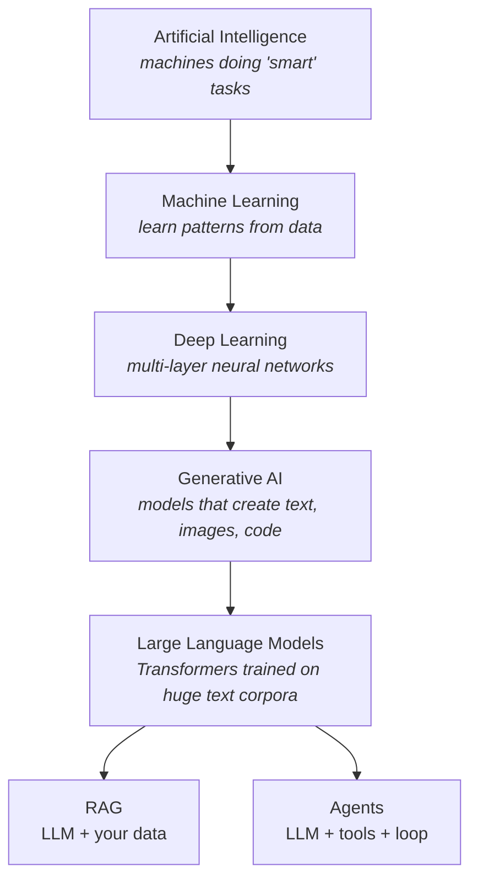
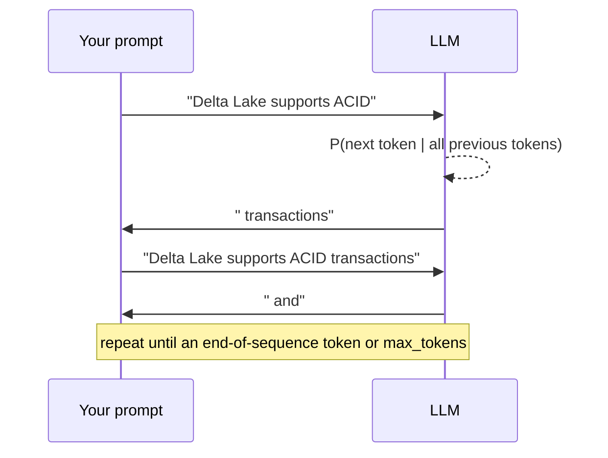
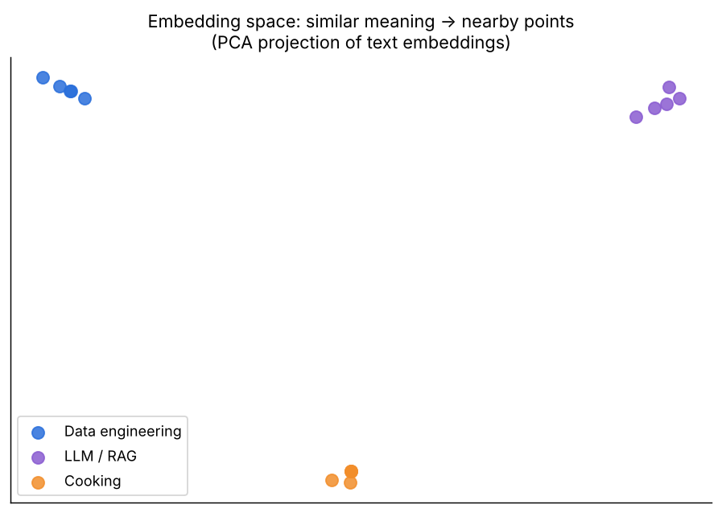
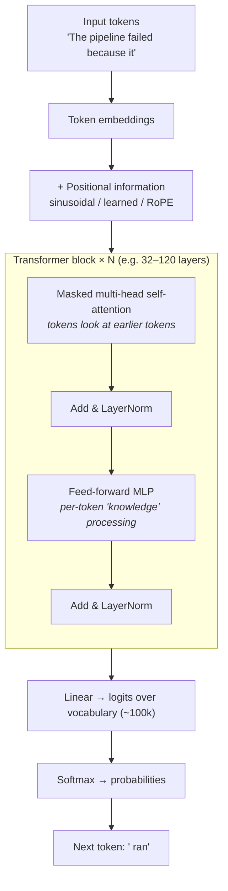
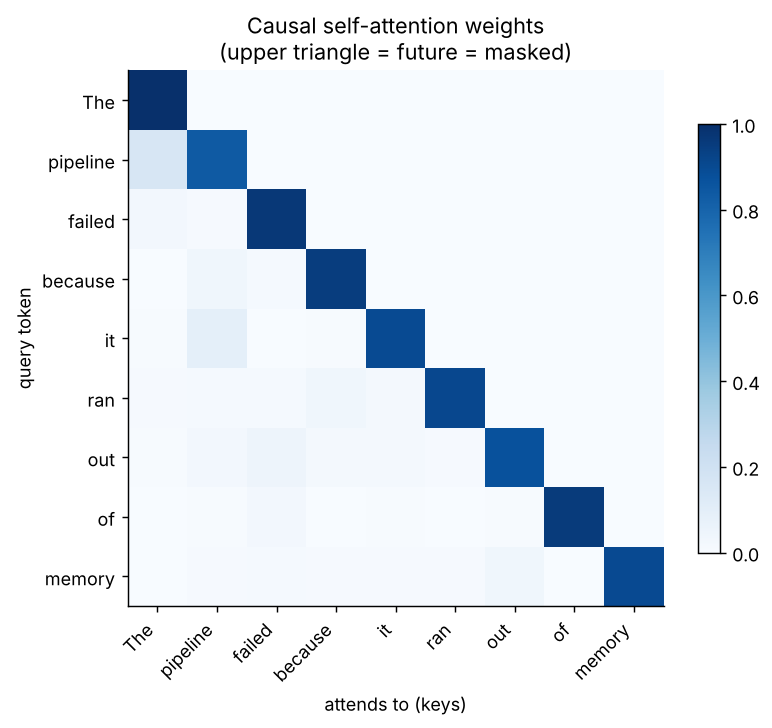
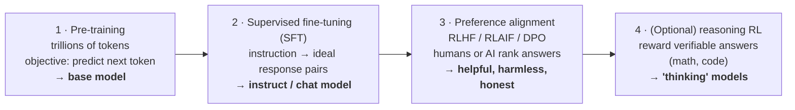
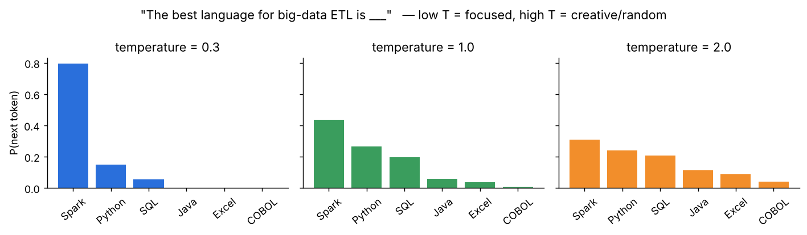

# 01 · Foundations — How LLMs Actually Work

> **Level:** Basic → Medium · **Time:** ~1 week · **Code:** [`src/ailearn/attention.py`](../src/ailearn/attention.py), [`src/ailearn/tokenizer.py`](../src/ailearn/tokenizer.py) · **Tests:** [`tests/test_attention.py`](../tests/test_attention.py)

## Learning goals
By the end of this module you can explain, *without hand-waving*:
1. Where LLMs sit inside AI / ML / Deep Learning.
2. What a token is, why tokenization affects cost and quality.
3. What an embedding is.
4. How self-attention and the Transformer work (and code it in NumPy).
5. How a model is pre-trained, instruction-tuned, and aligned (RLHF / DPO).
6. How text is generated (greedy, temperature, top-k, top-p) and why LLMs hallucinate.

---

## 1. The big picture



An **LLM is a next-token predictor.** Given `"The medallion architecture has bronze, silver and"`, it outputs a probability for every token in its vocabulary; `" gold"` gets a very high probability. Everything else — chat, coding, reasoning, agents — is built on top of that one capability, repeated token by token.



---

## 2. Tokens and tokenization

Models don't read characters or words — they read **tokens** (sub-word pieces). Most modern LLMs use **Byte-Pair Encoding (BPE)** or a close relative (SentencePiece, WordPiece).

**How BPE works** (implemented in [`tokenizer.py`](../src/ailearn/tokenizer.py)):
1. Start with the 256 possible bytes as the vocabulary.
2. Count every adjacent pair in the training text.
3. Merge the most frequent pair into a new token (`l` + `o` → `lo`).
4. Repeat until the vocabulary reaches the target size (e.g. 100k–200k).

```python
from ailearn.tokenizer import BPETokenizer
tok = BPETokenizer().train("low lower lowest newer newest " * 50, vocab_size=300)
tok.tokens("lowest")   # -> ['lowest'] or ['low', 'est'] depending on merges learnt
```

| Rule of thumb (English) | Value |
|---|---|
| 1 token | ≈ 4 characters ≈ ¾ word |
| 100 tokens | ≈ 75 words |
| 1 page of text | ≈ 500–700 tokens |

**Why you care:**
- 💰 **Cost** — APIs bill per input and output token.
- 📏 **Context window** — the maximum tokens per request (prompt + answer). Ranges from ~8k to 1M+ tokens depending on the model.
- 🐛 **Weird failures** — "how many r's in strawberry?" is hard because the model sees tokens like `str`/`awberry`, not letters. Code, numbers, and non-English languages often use more tokens.

👉 Try it: [Tiktokenizer playground](https://tiktokenizer.vercel.app/) — paste a SQL query and a Hindi sentence and compare token counts.

---

## 3. Embeddings — meaning as vectors

An **embedding** is a list of numbers (a vector, e.g. 384, 768, 1536 or 3072 dimensions) that represents meaning. Texts with similar meaning get vectors that point in similar directions.



Inside an LLM, every token is first turned into an embedding vector (a row lookup in an embedding matrix). For RAG we use separate **embedding models** that turn whole sentences/paragraphs into one vector — covered in depth in [03 · Embeddings & Vector DBs](03-embeddings-and-vector-databases.md).

---

## 4. The Transformer

Introduced in *[Attention Is All You Need](https://arxiv.org/abs/1706.03762)* (2017). GPT-style LLMs use the **decoder-only** variant:



| Architecture | Examples | Good at |
|---|---|---|
| **Encoder-only** | BERT, RoBERTa, most embedding models | Understanding: classification, embeddings, reranking |
| **Decoder-only** | GPT, Claude, Llama, Mistral, Gemma, Qwen | Generation: chat, code, agents |
| **Encoder-decoder** | T5, BART | Translation, summarisation |

### 4.1 Self-attention, step by step

Each token produces three vectors via learned weight matrices:
- **Query (Q)** — "what am I looking for?"
- **Key (K)** — "what do I contain?"
- **Value (V)** — "what will I hand over if you attend to me?"

$$\text{Attention}(Q,K,V) = \text{softmax}\left(\frac{QK^\top}{\sqrt{d_k}} + M\right)V$$

1. `QKᵀ` — score every query against every key (dot product = similarity).
2. `/ √d_k` — scale down so softmax doesn't saturate.
3. `+ M` — the **causal mask** sets future positions to −∞ so a token cannot "peek ahead".
4. `softmax` — turn scores into weights that sum to 1.
5. `× V` — each token's output is a weighted mix of the values it attends to.

```python
import numpy as np
from ailearn.attention import scaled_dot_product_attention, causal_mask

x = np.random.randn(5, 8)                       # 5 tokens, 8-dim
out, weights = scaled_dot_product_attention(x, x, x, causal_mask(5))
weights.round(2)    # lower-triangular; each row sums to 1
```



In the picture, the row for **"it"** puts weight on **"pipeline"** — that is how the model resolves what "it" refers to.

**Multi-head attention** runs several attention operations in parallel (heads), each with its own Q/K/V projections. One head may track syntax, another coreference, another long-range topic. Outputs are concatenated and projected (see `MultiHeadSelfAttention`).

### 4.2 Why Transformers won
- **Parallel training** — unlike RNNs, all positions are processed at once on GPUs.
- **Long-range dependencies** — any token can directly attend to any earlier token.
- **Scales predictably** — more data + parameters + compute → better models (*scaling laws*).

The cost: attention is **O(n²)** in sequence length. Long-context models use tricks such as FlashAttention, grouped-query attention, sliding windows, and the **KV cache** (see [06 · Advanced](06-advanced-topics.md)).

---

## 5. How an LLM is trained



- **Base model:** autocompletes text; doesn't follow instructions reliably.
- **Instruct/chat model:** follows instructions, uses roles (system / user / assistant).
- **Reasoning models:** trained to generate a long chain of thought before answering — better at maths, coding, planning; slower and more expensive.

---

## 6. Generating text: decoding strategies

The model outputs **logits** (raw scores). We convert them to probabilities and pick a token:

| Strategy | How | Use when |
|---|---|---|
| **Greedy** (`temperature=0`) | always pick the most likely token | extraction, SQL, classification — you want determinism |
| **Temperature** | divide logits by T before softmax. T<1 sharper, T>1 flatter | creativity control |
| **Top-k** | sample only from the k most likely tokens | cut off the long tail of nonsense |
| **Top-p (nucleus)** | sample from the smallest set whose probability ≥ p | adaptive version of top-k |



```python
from ailearn.attention import sample_next_token
sample_next_token([3.0, 2.5, 0.1], temperature=0)          # -> 0 (greedy)
sample_next_token([3.0, 2.5, 0.1], temperature=1, top_p=0.9)
```

---

## 7. Why LLMs hallucinate

An LLM is trained to produce **plausible** text, not **true** text. Hallucinations happen when:
- the fact wasn't in training data (or is newer than the **knowledge cut-off**),
- the fact is about **your private data** (your tables, your runbooks),
- the question presupposes something false,
- sampling picks a low-probability but fluent continuation.

Mitigations — and the motivation for the rest of this repo:

| Problem | Fix | Module |
|---|---|---|
| Model doesn't know your data | **RAG** — retrieve and paste relevant facts into the prompt | [04](04-rag.md) |
| Model needs live data / actions | **Tools & agents** | [05](05-agentic-ai.md) |
| Model needs a style/format/skill | **Prompting**, then **fine-tuning** | [02](02-working-with-llms.md), [06](06-advanced-topics.md) |
| Need to *know* it's right | **Evaluation** + citations + guardrails | [04](04-rag.md#8-evaluating-rag), [06](06-advanced-topics.md) |

---

## ✅ Check your understanding
<details><summary>1. Why do we divide by √d_k in attention?</summary>

Dot products grow with dimension; large values push softmax into regions where one weight ≈ 1 and gradients vanish. Scaling keeps the variance ~1.
</details>
<details><summary>2. What does the causal mask do, and which test proves it?</summary>

It adds −∞ to scores for future positions so their softmax weight is 0. `test_causal_mask_blocks_future_tokens` asserts the upper triangle of the weight matrix is exactly 0.
</details>
<details><summary>3. A prompt is 3,000 tokens and you request 1,000 output tokens on a model with an 8k context. Will it fit? What if you add 20 retrieved chunks of 300 tokens?</summary>

3,000 + 1,000 = 4,000 ≤ 8,192 ✅. Adding 6,000 tokens of context → 10,000 > 8,192 ❌. You must retrieve fewer/smaller chunks, compress, or use a longer-context model.
</details>
<details><summary>4. You need an LLM to output valid SQL. What temperature?</summary>

0 (or very low). You want the most likely, deterministic output, not creativity.
</details>
<details><summary>5. Encoder vs decoder models — which would you use to build an embedding for semantic search?</summary>

Encoder-style (bi-encoder) models such as sentence-transformers/BGE/E5 — they read the whole text bidirectionally and output one vector.
</details>

## 🏋️ Exercises
1. Run `pytest tests/test_attention.py -v` and read each test — each one is a property of attention.
2. Modify `MultiHeadSelfAttention` to return per-head outputs and plot head 0 vs head 3 weights.
3. Train `BPETokenizer` on a folder of your SQL files with `vocab_size=500`. Which merges appear first? (Hint: `SELECT`, `FROM`, whitespace.)
4. Implement **repetition penalty** in `sample_next_token` (divide logits of already-generated tokens by 1.2) and write a test for it.

## 📚 Go deeper
- 📖 [The Illustrated Transformer — Jay Alammar](https://jalammar.github.io/illustrated-transformer/) · [The Illustrated GPT-2](https://jalammar.github.io/illustrated-gpt2/)
- 🎥 [3Blue1Brown — But what is a GPT?](https://www.youtube.com/watch?v=wjZofJX0v4M) · [Attention in transformers, visually explained](https://www.youtube.com/watch?v=eMlx5fFNoYc)
- 🎥 [Andrej Karpathy — Intro to Large Language Models](https://www.youtube.com/watch?v=zjkBMFhNj_g) · [Let's build GPT from scratch](https://www.youtube.com/watch?v=kCc8FmEb1nY) · [Let's build the GPT tokenizer](https://www.youtube.com/watch?v=zduSFxRajkE) · [Deep Dive into LLMs like ChatGPT](https://www.youtube.com/watch?v=7xTGNNLPyMI)
- 🧪 [Transformer Explainer (interactive)](https://poloclub.github.io/transformer-explainer/) · [LLM Visualization in 3D — bbycroft](https://bbycroft.net/llm)
- 💻 [nanoGPT](https://github.com/karpathy/nanoGPT) · [rasbt/LLMs-from-scratch](https://github.com/rasbt/LLMs-from-scratch)
- 📄 [Attention Is All You Need](https://arxiv.org/abs/1706.03762) · [InstructGPT (RLHF)](https://arxiv.org/abs/2203.02155) · [DPO](https://arxiv.org/abs/2305.18290)
