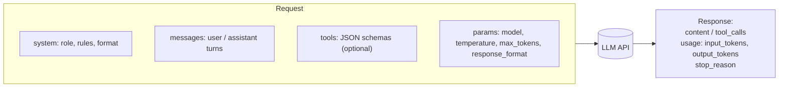

# 02 · Working with LLMs — APIs, Prompting, Structured Output

> **Level:** Basic → Medium · **Time:** ~1 week · **Code:** [`src/ailearn/llm.py`](../src/ailearn/llm.py), [`examples/04_tool_calling_native.py`](../examples/04_tool_calling_native.py)

## Learning goals
- Call hosted and local models through an API.
- Choose a model (closed vs open weights, size, cost, latency).
- Write prompts that are reliable, testable and safe.
- Get **structured JSON** out of a model.
- Estimate cost and latency.

---

## 1. The model landscape (how to think about it)

Model names change every few months — learn the **categories**, then check the current leaderboard.

| Category | Examples (families) | Pros | Cons |
|---|---|---|---|
| **Closed / hosted frontier** | OpenAI GPT, Anthropic Claude, Google Gemini | best quality, zero infra | cost per token, data leaves your network (unless enterprise/VNet) |
| **Cloud-hosted via your tenant** | Azure OpenAI / Azure AI Foundry, AWS Bedrock, Databricks Model Serving, Vertex AI | enterprise security, private networking, billing on your cloud | region/model availability varies |
| **Open-weights** | Llama, Mistral, Qwen, Gemma, DeepSeek, Phi | run anywhere, fine-tune, no per-token fee | you own GPUs, serving and safety |
| **Small / local** | 1–14B models via Ollama, LM Studio, llama.cpp | free, offline, private | weaker reasoning |

👉 Compare current models on [LMArena](https://lmarena.ai/) and [Artificial Analysis](https://artificialanalysis.ai/) (quality vs price vs speed).

**Practical selection checklist:** quality on *your* eval set → context length → latency → cost → data residency / compliance → tool-calling & JSON support.

---

## 2. Anatomy of an API call



**OpenAI-compatible (works with OpenAI, Azure OpenAI, Ollama, vLLM, Groq, Together…):**
```python
from openai import OpenAI
client = OpenAI()  # for Ollama: OpenAI(base_url="http://localhost:11434/v1", api_key="ollama")
r = client.chat.completions.create(
    model="gpt-4o-mini", temperature=0,
    messages=[
        {"role": "system", "content": "You are a senior data engineer. Answer in <=3 bullet points."},
        {"role": "user", "content": "When should I use a Delta MERGE instead of overwrite?"},
    ])
print(r.choices[0].message.content, r.usage)
```

**Anthropic (Claude):**
```python
import anthropic
client = anthropic.Anthropic()
r = client.messages.create(
    model="claude-sonnet-4-5", max_tokens=500,
    system="You are a senior data engineer. Answer in <=3 bullet points.",
    messages=[{"role": "user", "content": "When should I use a Delta MERGE instead of overwrite?"}])
print(r.content[0].text, r.usage)
```

**Run locally for free with [Ollama](https://ollama.com/):**
```bash
ollama pull llama3.1      # or qwen2.5, mistral, phi3...
ollama run llama3.1 "Explain Z-ordering in one paragraph"
```

> 💡 The `ailearn.llm` module wraps all of these behind `complete(prompt) -> str`, and provides a `MockLLM` so your **unit tests never call a paid API**.

---

## 3. Prompt engineering — the techniques that matter

### 3.1 Principles
1. **Be explicit** — say the task, audience, format, length, and what to do when unsure.
2. **Give context** — the model only knows what's in the prompt (and its training data).
3. **Separate instructions from data** using delimiters / XML tags: `<context>…</context>`.
4. **Show examples** (few-shot) for format-sensitive tasks.
5. **Ask for reasoning** before the answer on hard problems (or use a reasoning model).
6. **Specify the output format** (JSON schema) and validate it in code.
7. **Iterate against a test set**, not vibes.

### 3.2 Technique catalogue

| Technique | Template | When |
|---|---|---|
| **Zero-shot** | "Classify this log line as INFO/WARN/ERROR: …" | simple tasks |
| **Few-shot** | 2–5 input→output examples, then the new input | consistent formatting, edge cases |
| **Role / persona** | "You are a Spark performance expert…" | sets vocabulary and depth |
| **Chain-of-thought** | "Think step by step, then give the final answer after `ANSWER:`" | maths, multi-step logic |
| **Decomposition / prompt chaining** | step 1 extract → step 2 transform → step 3 validate | complex pipelines; each step testable |
| **Self-consistency** | sample N answers, take the majority | high-stakes reasoning |
| **ReAct** | Thought → Action → Observation loop | agents ([05](05-agentic-ai.md)) |
| **Structured output** | JSON schema / `response_format` | anything parsed by code |

### 3.3 Example — before & after

❌ **Weak:**
```
Write a SQL query for top customers.
```
✅ **Strong:**
```
You are an expert in Databricks SQL.
<schema>
gold.fact_orders(order_id BIGINT, customer_id BIGINT, order_ts TIMESTAMP, amount DECIMAL(18,2))
gold.dim_customer(customer_id BIGINT, name STRING, country STRING)
</schema>
Task: Return the top 10 customers by total amount in the last 90 days, with name and country.
Rules:
- Use only tables/columns in <schema>. If something is missing, reply exactly: MISSING: <what>
- Output only SQL in a ```sql block, no explanation.
```

### 3.4 Few-shot example (data-quality classification)
```text
Classify each data-quality issue. Labels: NULLS, DUPLICATES, SCHEMA_DRIFT, OUTLIER, FRESHNESS.

Issue: "customer_id is empty in 4% of rows" -> NULLS
Issue: "new column 'promo_code' appeared in source" -> SCHEMA_DRIFT
Issue: "table last updated 3 days ago, SLA is 24h" -> FRESHNESS

Issue: "order_amount has values of 9,999,999 in 12 rows" ->
```

---

## 4. Structured output (JSON) — critical for engineers

Never regex-parse free text if you can avoid it. Options, from strongest to weakest:
1. **Native structured outputs** with a JSON schema (OpenAI `response_format`, Anthropic tool-use schemas, Gemini `response_schema`).
2. **Tool calling** where the "tool" is just your schema.
3. **Prompted JSON** + validation + retry.

```python
from pydantic import BaseModel, Field
from openai import OpenAI

class DQIssue(BaseModel):
    column: str
    issue_type: str = Field(description="NULLS|DUPLICATES|SCHEMA_DRIFT|OUTLIER|FRESHNESS")
    severity: int = Field(ge=1, le=5)
    suggested_fix: str

client = OpenAI()
r = client.beta.chat.completions.parse(
    model="gpt-4o-mini",
    messages=[{"role": "user", "content": "orders.amount has negative values in 0.3% of rows"}],
    response_format=DQIssue)
issue: DQIssue = r.choices[0].message.parsed   # validated Python object
```

Library options: [Pydantic](https://docs.pydantic.dev/), [Instructor](https://python.useinstructor.com/), [Outlines](https://github.com/dottxt-ai/outlines) (constrained decoding for local models).

---

## 5. Cost & latency maths

```
cost = input_tokens × price_in + output_tokens × price_out
```
Example: a RAG call with 2,500 input tokens and 300 output tokens at $0.15 / $0.60 per 1M tokens
= 2,500×0.15/1e6 + 300×0.60/1e6 = **$0.000555** per question → ~$555 per 1M questions.

Latency ≈ *time-to-first-token* + output_tokens / tokens-per-second. **Output tokens dominate latency** — ask for concise answers.

**Cost levers:** smaller model for easy steps (routing) · prompt caching for repeated system prompts/context · semantic caching of answers · fewer/shorter retrieved chunks · batch APIs for offline jobs (often ~50% cheaper).

---

## 6. Safety basics you must know from day 1
- **Prompt injection:** untrusted text (a web page, a PDF, a user ticket) can contain "ignore previous instructions…". Treat retrieved text as *data*, isolate it in tags, and never give the model tools more powerful than the user is allowed.
- **Secrets:** never put API keys or PII in prompts or logs. Use a secrets manager (Azure Key Vault, Databricks secrets).
- **Validate outputs** before executing them (SQL, code, shell). See the read-only SQL tool in [`agent.py`](../src/ailearn/agent.py).

More in [06 · Advanced → Security](06-advanced-topics.md#6-security--owasp-top-10-for-llm-apps).

---

## ✅ Check your understanding
<details><summary>1. Why separate instructions and data with tags?</summary>
It reduces ambiguity about what is instruction vs content, makes prompts easier to template, and partially mitigates prompt injection (the model is told that tag contents are data).</details>
<details><summary>2. You need 50,000 table descriptions generated overnight. Which API features reduce cost?</summary>
Batch API (asynchronous, discounted), a smaller model, prompt caching for the shared instructions, and short outputs.</details>
<details><summary>3. Your JSON parse fails 2% of the time. What do you do?</summary>
Switch to native structured outputs / schema-constrained decoding; otherwise validate with Pydantic and retry with the validation error in the prompt; lower temperature.</details>
<details><summary>4. When is a small local model the right choice?</summary>
Simple classification/extraction, strict data-privacy requirements, offline environments, very high volume where cost dominates — after verifying quality on an eval set.</details>

## 🏋️ Exercises
1. Install Ollama, run a 3–8B model, and call it through `OpenAICompatibleLLM(base_url="http://localhost:11434/v1", api_key="ollama", model="llama3.1")`.
2. Write a prompt that converts an English request into Spark SQL for one of your real schemas. Create 10 test questions and measure how many queries run successfully.
3. Build a Pydantic schema that extracts `{table, owner, sla_hours, pii_columns}` from free-text dataset documentation.

## 📚 Go deeper
- 📖 [Prompt Engineering Guide (promptingguide.ai)](https://www.promptingguide.ai/)
- 📖 [Anthropic prompt engineering docs](https://docs.claude.com/en/docs/build-with-claude/prompt-engineering/overview) · [Anthropic interactive courses (GitHub)](https://github.com/anthropics/courses)
- 📖 [OpenAI Cookbook](https://cookbook.openai.com/)
- 🎓 [DeepLearning.AI — ChatGPT Prompt Engineering for Developers & other short courses](https://www.deeplearning.ai/short-courses/)
- 🎓 [Microsoft — Generative AI for Beginners (21 lessons)](https://github.com/microsoft/generative-ai-for-beginners)
