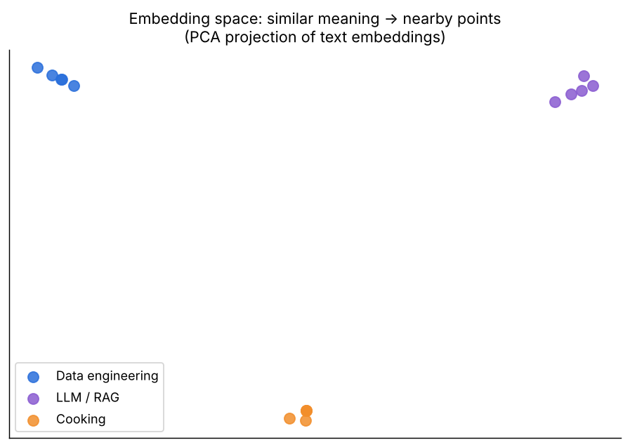
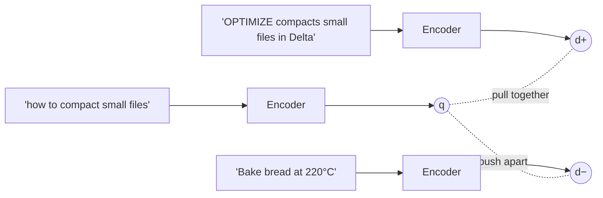
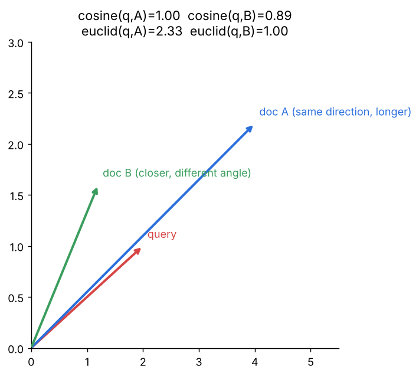
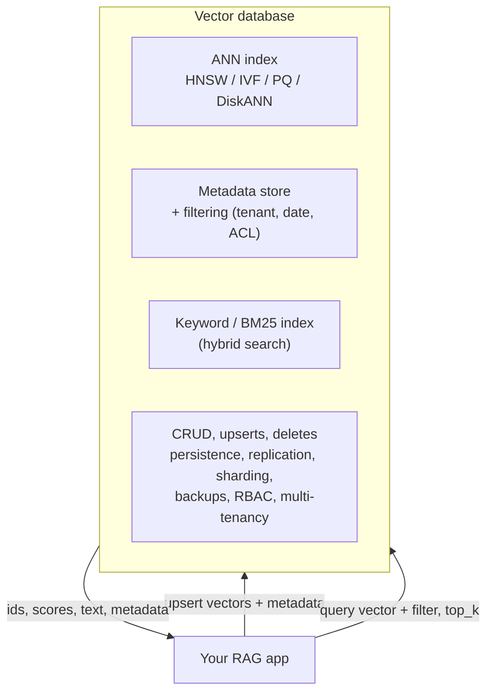
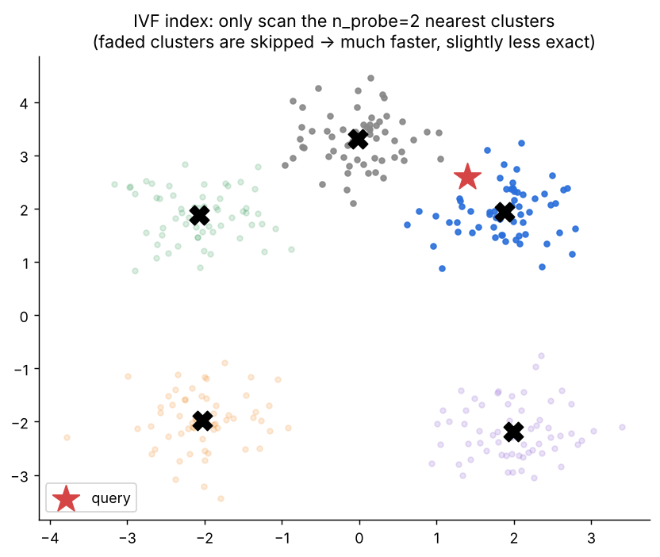
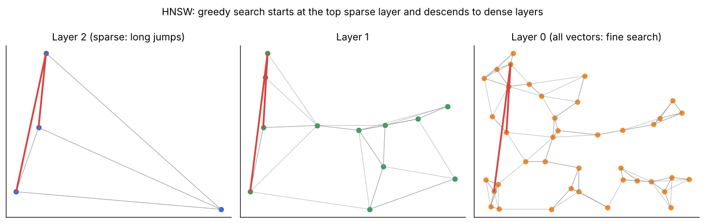
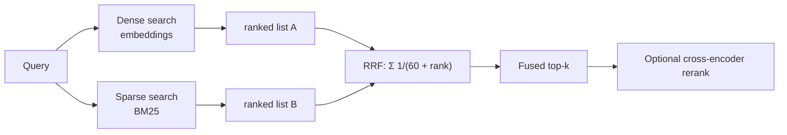

# 03 · Embeddings & Vector Databases — In Depth

> **Level:** Basic → Advanced · **Time:** ~1 week · **Code:** [`embeddings.py`](../src/ailearn/embeddings.py), [`vectorstore.py`](../src/ailearn/vectorstore.py), [`bm25.py`](../src/ailearn/bm25.py), [`hybrid.py`](../src/ailearn/hybrid.py) · **Tests:** [`test_tokenizer_embeddings.py`](../tests/test_tokenizer_embeddings.py), [`test_vectorstore_chunking.py`](../tests/test_vectorstore_chunking.py)

## Learning goals
- Explain embeddings and similarity metrics with pictures and numbers.
- Understand **why** vector databases exist and how ANN indexes (Flat, IVF, HNSW, PQ) work.
- Choose between Pinecone, Weaviate, Qdrant, Milvus, Chroma, pgvector, FAISS, Azure AI Search, Databricks Vector Search.
- Do metadata filtering and hybrid (dense + keyword) search.

---

## 1. What is an embedding?

An **embedding model** maps text (or images, audio, code) to a fixed-length vector:

```
"Delta Lake supports time travel"  →  [0.021, -0.113, 0.087, …, 0.004]   (e.g. 768 numbers)
```

Properties:
- **Same model, same space** — you must embed documents and queries with the *same* model.
- **Fixed dimension** — 384 (MiniLM), 768 (BGE-base / E5-base), 1024, 1536/3072 (OpenAI text-embedding-3).
- **Semantic** — "pipeline failed" and "job crashed" are close even with no shared words. Keyword search can't do that.



### How embedding models are trained (intuition)
**Contrastive learning:** show the model pairs that should be close (question ↔ its answer, title ↔ body) and pairs that shouldn't. The loss pulls positives together and pushes negatives apart.



### Choosing an embedding model
| Factor | Guidance |
|---|---|
| Quality | Check the [MTEB leaderboard](https://huggingface.co/spaces/mteb/leaderboard) → *Retrieval* tab, then test on **your** data |
| Language | Multilingual model if your docs aren't English-only |
| Dimension | Bigger ≈ better but more storage/RAM. Some models support **Matryoshka** truncation (e.g. 3072 → 256) |
| Max input length | 512 tokens for many open models; 8k for some API models — longer chunks get truncated silently! |
| Hosting | API (OpenAI, Cohere, Voyage, Azure) vs self-hosted ([sentence-transformers](https://www.sbert.net/), BGE, E5, GTE, Nomic) |
| Domain | Code, legal, medical → domain-specific or fine-tuned embedders win |

---

## 2. Measuring similarity

| Metric | Formula | Range | Notes |
|---|---|---|---|
| **Cosine similarity** | `a·b / (‖a‖‖b‖)` | −1 … 1 | angle only; ignores length. Default for text |
| **Dot product** | `a·b` | −∞ … ∞ | = cosine if vectors are normalised; fastest |
| **Euclidean (L2)** | `‖a − b‖` | 0 … ∞ | smaller = closer; sensitive to length |



In the picture, doc **A** points in the *same direction* as the query (cosine ≈ 1) but is far away in Euclidean terms. Most text embedding models are trained for cosine → **normalise your vectors and use dot product/cosine**. Our `FlatIndex` normalises on insert.

```python
from ailearn.embeddings import cosine_similarity, euclidean_distance, dot_product
import numpy as np
a = np.array([1, 0]); b = np.array([5, 0])
cosine_similarity(a, b)   # [[1.]]   same direction
dot_product(a, b)         # [[5.]]   magnitude matters
```

**Worked example (3-dim):** q = [1, 2, 0], d = [2, 3, 1]
- dot = 1·2 + 2·3 + 0·1 = 8
- ‖q‖ = √5 = 2.236, ‖d‖ = √14 = 3.742
- cosine = 8 / (2.236 × 3.742) = **0.956**

---

## 3. Why do we need a vector *database*?

Exact search compares the query to **every** vector: N × d multiplications.
10 M chunks × 1,536 dims ≈ 15 billion floating-point operations **per query** + 61 GB of float32 RAM. Too slow and too big at scale.

A vector database adds:



### ANN = Approximate Nearest Neighbour
Trade a tiny bit of accuracy (**recall**, e.g. 95–99%) for 100–1000× speed.

---

## 4. Index types (with pictures)

### 4.1 Flat (brute force) — exact
Compare against everything. Perfect recall. Fine up to ~100k vectors. → `FlatIndex` in our code, `IndexFlatIP` in FAISS.

### 4.2 IVF — Inverted File Index
1. **Train:** k-means clusters the vectors into `n_lists` clusters (centroids).
2. **Index:** each vector is stored in the list of its nearest centroid.
3. **Query:** find the `n_probe` nearest centroids, scan only those lists.



Knobs: more `n_lists` → smaller lists, faster; more `n_probe` → higher recall, slower. Rule of thumb: `n_lists ≈ √N`. → `IVFIndex` in our code (see `test_ivf_matches_flat_on_easy_queries` which measures recall vs exact search).

### 4.3 HNSW — Hierarchical Navigable Small World (the most popular)
A multi-layer **graph**. Top layers have few nodes and long edges ("highways"); layer 0 has every vector ("local streets"). Search greedily walks toward the query on each layer, then drops down.



| Param | Meaning | Effect |
|---|---|---|
| `M` | edges per node | ↑ recall, ↑ memory |
| `ef_construction` | candidate list size while building | ↑ quality, slower build |
| `ef_search` | candidate list size while querying | ↑ recall, ↑ latency (tune per query!) |

Pros: excellent recall/latency, supports incremental inserts. Cons: memory-hungry (graph + full vectors in RAM); deletes are tricky.

### 4.4 PQ — Product Quantization (compression)
Split each vector into m sub-vectors; replace each sub-vector with the id (1 byte) of its nearest code-book centroid. A 768-dim float32 vector (3,072 bytes) → e.g. 96 bytes (**32× smaller**). Often combined: **IVF-PQ**. Related: **scalar quantization** (float32 → int8, 4×) and **binary quantization** (→ 1 bit/dim, 32×, re-score top results with full vectors).

### 4.5 Others
- **DiskANN / Vamana** — graph index on SSD for billion-scale with little RAM.
- **LSH** — locality-sensitive hashing; historically important, rarely best today.
- **ScaNN** — Google's quantization-based ANN.

| Index | Recall | Speed | Memory | Best for |
|---|---|---|---|---|
| Flat | 100% | slow at scale | high | <100k vectors, ground truth for evals |
| IVF-Flat | 90–99% | fast | high | millions, batch-built |
| HNSW | 95–99%+ | very fast | highest | default for most apps |
| IVF-PQ / quantized | 80–95% (+ re-rank) | very fast | very low | 100M+ vectors, cost-sensitive |
| DiskANN | 95%+ | fast | low RAM | billion-scale |

---

## 5. Vector database landscape

| Database | Type | Highlights | Good fit |
|---|---|---|---|
| **[FAISS](https://github.com/facebookresearch/faiss)** | library | fastest building blocks (Flat, IVF, PQ, HNSW, GPU) | research, embedded in your service |
| **[Chroma](https://docs.trychroma.com/)** | embedded / server | dead-simple Python API | prototypes, local learning |
| **[pgvector](https://github.com/pgvector/pgvector)** | Postgres extension | SQL + vectors + joins + ACID; HNSW & IVFFlat | teams already on Postgres (Azure Database for PostgreSQL supports it) |
| **[Qdrant](https://qdrant.tech/documentation/)** | OSS + cloud | Rust, rich payload filtering, quantization | production self-hosted |
| **[Weaviate](https://weaviate.io/developers/weaviate)** | OSS + cloud | built-in hybrid search, modules for vectorisation | hybrid search out of the box |
| **[Milvus / Zilliz](https://milvus.io/docs)** | OSS + cloud | distributed, billion-scale, many index types | very large scale |
| **[Pinecone](https://docs.pinecone.io/)** | managed SaaS | serverless, zero-ops | teams that want no infra |
| **[Azure AI Search](https://learn.microsoft.com/en-us/azure/search/vector-search-overview)** | managed | hybrid + semantic ranker, Azure integration, security trimming | Azure shops / enterprise RAG |
| **[Databricks Vector Search](https://docs.databricks.com/en/generative-ai/vector-search.html)** | managed | auto-syncs from a **Delta table**, Unity Catalog governance | lakehouse / Databricks teams |
| **Elasticsearch / OpenSearch** | search engine + kNN | mature BM25 + vectors | existing search infra |
| **MongoDB Atlas, Redis, Cosmos DB, Snowflake, BigQuery** | DBs with vector support | keep vectors next to operational data | avoid another system |

**How to choose:** Already on Postgres → pgvector. On Databricks → Vector Search (Delta Sync). On Azure with enterprise needs → Azure AI Search. Want zero ops → Pinecone. Self-host at scale → Qdrant/Milvus/Weaviate. Learning → Chroma or our `FlatIndex`.

---

## 6. Hands-on examples

### 6.1 Our from-scratch store
```python
from ailearn.embeddings import HashingEmbedder
from ailearn.vectorstore import FlatIndex

emb = HashingEmbedder(dim=256)
docs = {"d1": "OPTIMIZE compacts small files", "d2": "VACUUM deletes old files", "d3": "ADF triggers schedule pipelines"}
idx = FlatIndex(256)
idx.add(list(docs), emb.embed(list(docs.values())), list(docs.values()),
        [{"tool": "delta"}, {"tool": "delta"}, {"tool": "adf"}])
idx.search(emb.embed(["compact small files"])[0], k=2, where=lambda m: m["tool"] == "delta")
```

### 6.2 pgvector (SQL!)
```sql
CREATE EXTENSION IF NOT EXISTS vector;
CREATE TABLE doc_chunks (
  id BIGSERIAL PRIMARY KEY, doc_id TEXT, content TEXT, team TEXT,
  embedding VECTOR(1536)
);
CREATE INDEX ON doc_chunks USING hnsw (embedding vector_cosine_ops);
-- <=> is cosine distance; filter + vector search in one query
SELECT doc_id, content, 1 - (embedding <=> $1) AS similarity
FROM doc_chunks
WHERE team = 'platform'
ORDER BY embedding <=> $1
LIMIT 5;
```

### 6.3 Databricks Vector Search (Delta Sync)
```python
from databricks.vector_search.client import VectorSearchClient
vsc = VectorSearchClient()
vsc.create_delta_sync_index(
    endpoint_name="vs_endpoint",
    index_name="main.rag.docs_index",
    source_table_name="main.rag.doc_chunks",      # Delta table with change data feed enabled
    pipeline_type="TRIGGERED",
    primary_key="chunk_id",
    embedding_source_column="content",            # Databricks computes embeddings for you
    embedding_model_endpoint_name="databricks-gte-large-en",
)
idx = vsc.get_index("vs_endpoint", "main.rag.docs_index")
idx.similarity_search(query_text="How do I fix error 2200?", columns=["chunk_id", "content"], num_results=5)
```

### 6.4 Chroma (local)
```python
import chromadb
col = chromadb.Client().create_collection("docs", metadata={"hnsw:space": "cosine"})
col.add(ids=["1", "2"], documents=["OPTIMIZE compacts files", "ADF schedules pipelines"],
        metadatas=[{"tool": "delta"}, {"tool": "adf"}])
col.query(query_texts=["merge small parquet files"], n_results=1, where={"tool": "delta"})
```

---

## 7. Metadata filtering

Real queries have constraints: *only this tenant*, *only docs the user can see*, *only 2026 runbooks*.

| Approach | How | Risk |
|---|---|---|
| **Pre-filter** | filter first, then vector search within the subset | slower if the filter is very selective on some indexes |
| **Post-filter** | vector search top-k, then drop non-matching | may return < k results (or 0!) |
| **Filtered ANN** (Qdrant, Weaviate, Pinecone, pgvector…) | filter integrated into graph traversal | best of both — use when available |

🔒 **Security:** enforce document-level ACLs at retrieval time (security trimming). Never rely on the LLM to "not mention" documents the user shouldn't see.

---

## 8. Hybrid search: dense + sparse

Dense vectors miss **exact tokens**: error codes (`DF-SYS-01`), IDs, SKUs, table names, acronyms. **BM25** (keyword) nails those but misses synonyms. Use both and fuse with **Reciprocal Rank Fusion**:



```python
from ailearn.hybrid import reciprocal_rank_fusion
reciprocal_rank_fusion([["d3", "d1", "d7"], ["d1", "d9", "d3"]])
# d1 and d3 rise to the top because both retrievers like them
```
See `test_hybrid_retrieval_finds_exact_error_codes`.

---

## ✅ Check your understanding
<details><summary>1. You embedded docs with model A and queries with model B. What happens?</summary>
Garbage results — the vectors live in different spaces. Always use the same model (and re-embed everything when you change models).</details>
<details><summary>2. HNSW recall is 88%; you need 97%. Which knob first?</summary>
Increase `ef_search` (query-time, no rebuild). If still insufficient, rebuild with higher `M` / `ef_construction`.</details>
<details><summary>3. Post-filtering returned 0 results for a tenant with few docs. Why and fix?</summary>
Top-k globally was dominated by other tenants' docs, all filtered out. Use pre-filtering / filtered ANN, a namespace/partition per tenant, or increase k before filtering.</details>
<details><summary>4. 50M chunks × 1024 dims float32 — how much RAM for raw vectors? How to reduce?</summary>
50e6 × 1024 × 4 B ≈ 205 GB. Reduce with int8 scalar quantization (~51 GB), PQ or binary quantization (+ re-scoring), Matryoshka truncation to fewer dimensions, or DiskANN.</details>
<details><summary>5. Users search "error 2200" and get generic ADF docs. Fix?</summary>
Add hybrid search (BM25 + dense with RRF) so exact tokens count; optionally a reranker.</details>

## 🏋️ Exercises
1. Benchmark `FlatIndex` vs `IVFIndex` on 50k random vectors: plot recall@10 and latency for `n_probe` = 1, 2, 4, 8.
2. Replace `HashingEmbedder` with `SentenceTransformerEmbedder` and re-run `examples/01_offline_rag_demo.py`. Ask a question using synonyms ("compress tiny files") — which embedder wins?
3. Load 1,000 rows into pgvector (Docker: `pgvector/pgvector:pg16`) and compare HNSW vs no index with `EXPLAIN ANALYZE`.

## 📚 Go deeper
- 📖 [Pinecone — What is a Vector Database?](https://www.pinecone.io/learn/vector-database/) · [Faiss: The Missing Manual (HNSW, IVF, PQ series)](https://www.pinecone.io/learn/series/faiss/)
- 📖 [Weaviate — Vector indexing concepts](https://weaviate.io/developers/weaviate/concepts/vector-index)
- 📖 [Qdrant — Filtering & quantization docs](https://qdrant.tech/documentation/)
- 📖 [Azure AI Search — Hybrid search overview](https://learn.microsoft.com/en-us/azure/search/hybrid-search-overview)
- 📄 [HNSW paper (Malkov & Yashunin)](https://arxiv.org/abs/1603.09320) · [Sentence-BERT](https://arxiv.org/abs/1908.10084) · [Matryoshka embeddings](https://arxiv.org/abs/2205.13147)
- 🏆 [MTEB leaderboard](https://huggingface.co/spaces/mteb/leaderboard) · [ANN-Benchmarks](https://ann-benchmarks.com/)
