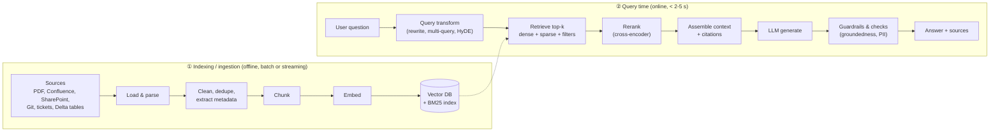
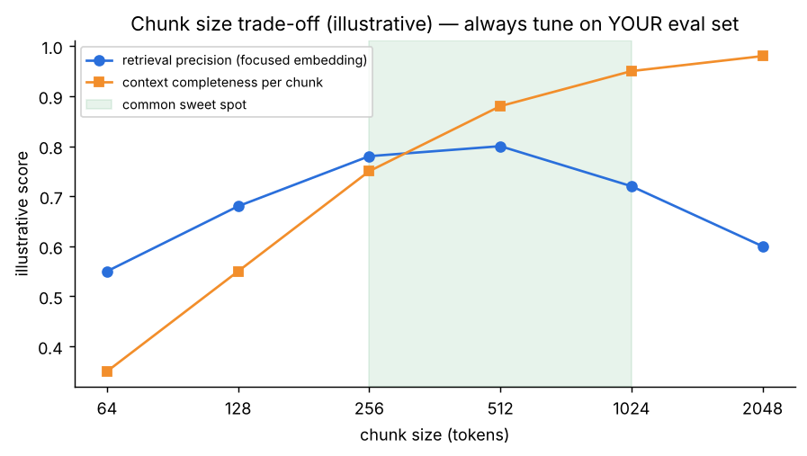
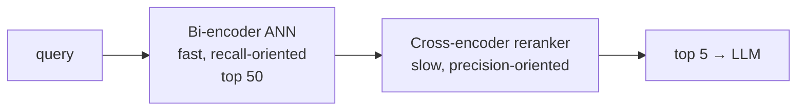
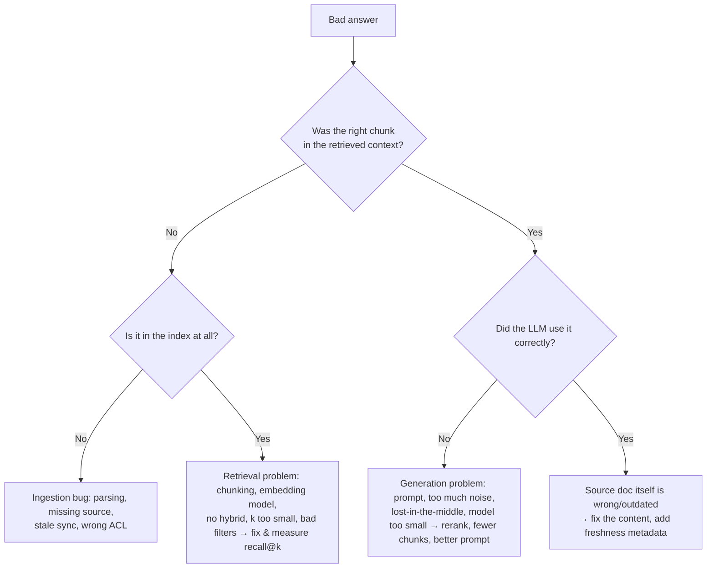

# 04 · Retrieval-Augmented Generation (RAG) — Basic to Production

> **Level:** Medium → Advanced · **Time:** ~2 weeks · **Code:** [`rag.py`](../src/ailearn/rag.py), [`chunking.py`](../src/ailearn/chunking.py), [`evaluation.py`](../src/ailearn/evaluation.py) · **Tests:** [`test_rag.py`](../tests/test_rag.py), [`test_agent_eval.py`](../tests/test_agent_eval.py) · **Demo:** `python examples/01_offline_rag_demo.py`

## Learning goals
- Build a RAG pipeline end-to-end and explain every stage.
- Choose a chunking strategy and justify chunk size.
- Improve retrieval with hybrid search, reranking and query transformation.
- Diagnose RAG failures and **evaluate** with metrics.
- Decide between RAG, fine-tuning and long-context prompting.

---

## 1. Why RAG?

LLMs don't know your **private, recent, or changing** data (runbooks, Confluence, table docs, tickets, contracts). Retraining for each change is impossible. RAG gives the model an **open-book exam**: retrieve the relevant pages, paste them into the prompt, instruct it to answer from them and cite.

Benefits: fresher answers · fewer hallucinations · citations/traceability · access control at retrieval time · no training cost.

Paper: *[Retrieval-Augmented Generation for Knowledge-Intensive NLP Tasks](https://arxiv.org/abs/2005.11401)* (Lewis et al., 2020).

---

## 2. Architecture



Our [`RAGPipeline`](../src/ailearn/rag.py) implements: chunk → embed → store → retrieve (dense or hybrid, with metadata filter and score threshold) → prompt → LLM → answer + sources.

```python
from ailearn.rag import RAGPipeline
rag = RAGPipeline(top_k=3, hybrid=True, min_score=0.1)
rag.add_documents({"runbook": open("runbook.md").read()}, metadata={"runbook": {"team": "platform"}})
ans = rag.ask("How do I restart the ingestion job?", where=lambda m: m["team"] == "platform")
print(ans.answer); [print(s.id, s.score) for s in ans.sources]
```

---

## 3. Ingestion: loading & parsing (where most real-world pain is)

| Source | Tools | Gotchas |
|---|---|---|
| PDF | `pypdf`, `pymupdf`, [Unstructured](https://docs.unstructured.io/), [Docling](https://github.com/docling-project/docling), Azure Document Intelligence | tables, multi-column, scanned (OCR), headers/footers repeated on every page |
| HTML / Confluence / SharePoint | BeautifulSoup, LlamaIndex/LangChain loaders, Graph API | navigation boilerplate, permissions |
| Office docs | `python-docx`, `openpyxl`, Unstructured | embedded images, tracked changes |
| Code | tree-sitter, language-aware splitters | split by function/class, keep file path |
| Tables / Delta | Spark → row-to-text templates or text-to-SQL instead | don't embed millions of rows; use SQL for numbers |

**Always store metadata:** source URL/path, title, section heading, last-modified, owner, ACL group, doc type. You'll need it for filtering, citations and freshness.

---

## 4. Chunking strategies



| Strategy | How | Pros | Cons | In repo |
|---|---|---|---|---|
| **Fixed-size** | N chars/tokens with overlap | simple, predictable | cuts sentences | `fixed_size_chunks` |
| **Sentence-based** | pack whole sentences | readable chunks | uneven sizes | `sentence_chunks` |
| **Recursive** | split by `\n\n` → `\n` → `. ` → ` ` until small enough | respects structure, the common default | needs tuning | `recursive_chunks` |
| **Structure-aware** | by Markdown/HTML headings, code functions, PDF sections | keeps semantic units; heading path as metadata | needs parser | `markdown_section_chunks` |
| **Semantic** | split where embedding similarity between sentences drops | topic-coherent chunks | slower, needs embeddings | exercise |
| **Parent-child / small-to-big** | embed small chunks, return their larger parent | precise retrieval + full context | more storage | [06](06-advanced-topics.md) |
| **Contextual chunks** | prepend an LLM-written summary of where the chunk sits in the doc | big recall gains | LLM cost at index time | [06](06-advanced-topics.md) |

**Starting defaults:** recursive, ~500–800 tokens, 10–15% overlap, prefix each chunk with its title/heading path. Then **measure** with an eval set and tune.

---

## 5. Retrieval — getting the right chunks

### 5.1 Top-k and thresholds
- `k` too low → miss the answer; too high → noise, cost, *lost-in-the-middle* (models attend less to the middle of long contexts — [paper](https://arxiv.org/abs/2307.03172)).
- Use a **similarity threshold** (`min_score`) to return "I don't know" instead of forcing irrelevant context (see `test_rag_says_i_dont_know_when_context_irrelevant`).

### 5.2 Hybrid search
Dense + BM25 fused with RRF — see [03 §8](03-embeddings-and-vector-databases.md#8-hybrid-search-dense--sparse). Almost always a win for technical/enterprise text.

### 5.3 Reranking
Bi-encoders (embeddings) are fast but encode query and doc **separately**. A **cross-encoder** reads `(query, chunk)` *together* and scores relevance much more accurately — too slow for millions of docs, perfect for re-ordering the top 20–50.


```python
from sentence_transformers import CrossEncoder
ce = CrossEncoder("cross-encoder/ms-marco-MiniLM-L-6-v2")
scores = ce.predict([(question, r.text) for r in candidates])
reranked = [c for _, c in sorted(zip(scores, candidates), key=lambda x: -x[0])][:5]
```
Hosted options: Cohere Rerank, Voyage rerank, Azure AI Search semantic ranker, Jina reranker, BGE-reranker.

### 5.4 Query transformation
| Technique | Idea |
|---|---|
| **Query rewriting** | LLM rewrites a vague/conversational question into a standalone search query ("what about the silver one?" → "What does the silver layer contain in the medallion architecture?") |
| **Multi-query** | generate 3–5 paraphrases, retrieve for each, fuse with RRF |
| **HyDE** | LLM writes a *hypothetical answer*; embed that instead of the question ([paper](https://arxiv.org/abs/2212.10496)) |
| **Decomposition** | split multi-part questions into sub-questions, retrieve each |
| **Step-back** | ask a more general question first to fetch background |
| **Routing** | classify the question → choose index / SQL / web / no retrieval |

---

## 6. Generation — the prompt

```text
You are a helpful assistant. Answer the question using ONLY the context below.
If the answer is not in the context, say "I don't know based on the provided context."
Cite the sources you used with their [number].

<context>
[1] (source: runbooks/adf.md > Errors) If an ADF copy activity fails with error 2200 ...
[2] (source: delta_guide.md > Maintenance) Run OPTIMIZE weekly ...
</context>

<question>What does error 2200 mean?</question>
```
Key ingredients: grounding instruction · explicit "I don't know" escape hatch · numbered sources for citations · question after context · temperature 0.

---

## 7. Why RAG fails — a debugging table



| Symptom | Likely cause | Fix |
|---|---|---|
| Right doc, wrong part | chunks too big / too small | tune chunk size, structure-aware chunking |
| Misses exact IDs/codes | dense only | hybrid search |
| Conversational follow-ups fail | question not standalone | query rewriting with chat history |
| Answers from old docs | stale index, no dates | incremental sync (CDC), freshness metadata, boost recent |
| "Confident but wrong" | no relevant context but model answers anyway | threshold + "I don't know" instruction + groundedness check |
| Numerical/aggregate questions wrong ("total sales last month") | RAG is not a calculator | route to **text-to-SQL** instead |
| Leaks restricted info | no ACL filtering | security trimming at retrieval |

---

## 8. Evaluating RAG

Build a **golden dataset** of 30–200 questions with: expected source chunk(s), reference answer, and tags (easy/hard, topic). Then measure separately:

| Layer | Metric | Meaning | In repo |
|---|---|---|---|
| Retrieval | **Hit rate@k / Recall@k** | was a relevant chunk in the top k? | `hit_rate_at_k`, `recall_at_k` |
| Retrieval | **Precision@k** | how much of the top k is relevant | `precision_at_k` |
| Retrieval | **MRR** | how high is the first relevant chunk | `mrr` |
| Retrieval | **nDCG@k** | graded relevance with position discount | `ndcg_at_k` |
| Generation | **Faithfulness / groundedness** | are claims supported by context? | `groundedness` (lexical proxy) |
| Generation | **Answer relevance / correctness** | does it answer the question / match reference? | `token_f1` |
| End-to-end | latency, cost/query, thumbs-up rate, "I don't know" rate | production health | your telemetry |

```python
from ailearn.evaluation import evaluate_retriever
report = evaluate_retriever(lambda q, k: [r.id for r in rag.retrieve(q, k)], golden_set, k=5)
# {'precision@k': 0.31, 'recall@k': 0.92, 'hit_rate@k': 0.95, 'mrr': 0.81}
```

**LLM-as-judge:** use a strong model with a rubric ("Score 1–5: is every claim supported by the context? Quote the unsupported claim.") — calibrate it against human labels on ~50 examples first. Frameworks: [RAGAS](https://docs.ragas.io/), [DeepEval](https://github.com/confident-ai/deepeval), [TruLens](https://www.trulens.org/), [promptfoo](https://www.promptfoo.dev/), [MLflow Evaluate](https://mlflow.org/docs/latest/llms/llm-evaluate/index.html).

➡️ Put the eval in **CI**: every change to chunking/prompt/model runs the golden set and fails the build if recall@5 or faithfulness drops.

---

## 9. RAG vs fine-tuning vs long context

| Need | Best tool |
|---|---|
| Knowledge that changes / private docs / citations | **RAG** |
| A behaviour, tone, format, or narrow skill (classify tickets in your taxonomy) | **Fine-tuning** (or few-shot first) |
| One-off analysis of a few documents that fit in context | **Long-context prompt** (just paste them) |
| Numbers, aggregates, joins over tables | **Text-to-SQL / tools** |
| Multi-step tasks needing decisions | **Agents** ([05](05-agentic-ai.md)), often with RAG as a tool |

They combine: a fine-tuned small model *plus* RAG is common in production.

---

## ✅ Check your understanding
<details><summary>1. Recall@5 = 0.95 but users still get wrong answers. Where do you look?</summary>
Retrieval is fine — the problem is generation: prompt, noise in context (try reranking/fewer chunks), lost-in-the-middle, model capability, or the source content itself.</details>
<details><summary>2. Why prefix each chunk with its document title/heading path?</summary>
Chunks lose context once split ("this setting" — which setting?). The prefix improves embedding quality, gives the LLM context, and supports citations.</details>
<details><summary>3. "What were total sales by region last quarter?" — RAG or something else?</summary>
Text-to-SQL / a SQL tool. Vector search retrieves passages; it can't aggregate millions of rows correctly.</details>
<details><summary>4. What is HyDE and when does it help?</summary>
Generate a hypothetical answer and embed it instead of the short question; helps when questions are short/vague and documents are long and answer-shaped.</details>
<details><summary>5. Your index has 3 versions of the same runbook. Problems and fixes?</summary>
Duplicate/contradictory context, wasted k slots. Dedupe at ingestion (hash, near-dup detection), keep only latest version (version metadata + filter), or boost recency.</details>

## 🏋️ Exercises
1. Write 15 golden questions for the docs in `tests/conftest.py`; run `evaluate_retriever` with `hybrid=False` vs `hybrid=True` and chunk sizes 100/200/400.
2. Implement **multi-query retrieval** in `RAGPipeline` (accept a list of query variants and fuse with RRF). Add a test.
3. Implement a **semantic chunker**: split where cosine similarity between consecutive sentence embeddings < threshold. Test that two unrelated paragraphs end up in different chunks.
4. Add conversation memory: rewrite follow-up questions with the last 3 turns before retrieval.

## 📚 Go deeper
- 📄 [RAG paper (Lewis et al.)](https://arxiv.org/abs/2005.11401) · [RAG survey (Gao et al.)](https://arxiv.org/abs/2312.10997) · [Lost in the Middle](https://arxiv.org/abs/2307.03172)
- 📖 [Anthropic — Contextual Retrieval](https://www.anthropic.com/news/contextual-retrieval)
- 📖 [Pinecone — Chunking strategies](https://www.pinecone.io/learn/chunking-strategies/) · [Rerankers](https://www.pinecone.io/learn/series/rag/rerankers/)
- 💻 [LangChain — RAG From Scratch (code + video series)](https://github.com/langchain-ai/rag-from-scratch) · [NirDiamant/RAG_Techniques (30+ notebooks)](https://github.com/NirDiamant/RAG_Techniques)
- 📖 [LlamaIndex docs — RAG concepts](https://docs.llamaindex.ai/) · [Azure AI Search — RAG overview](https://learn.microsoft.com/en-us/azure/search/retrieval-augmented-generation-overview)
- 🎓 [DeepLearning.AI short courses (search "RAG")](https://www.deeplearning.ai/short-courses/)
