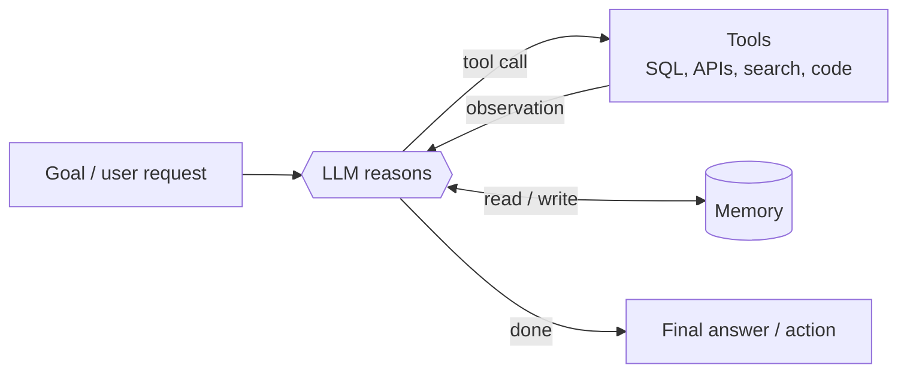
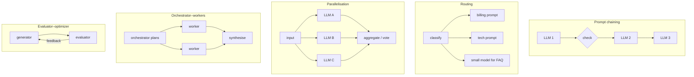
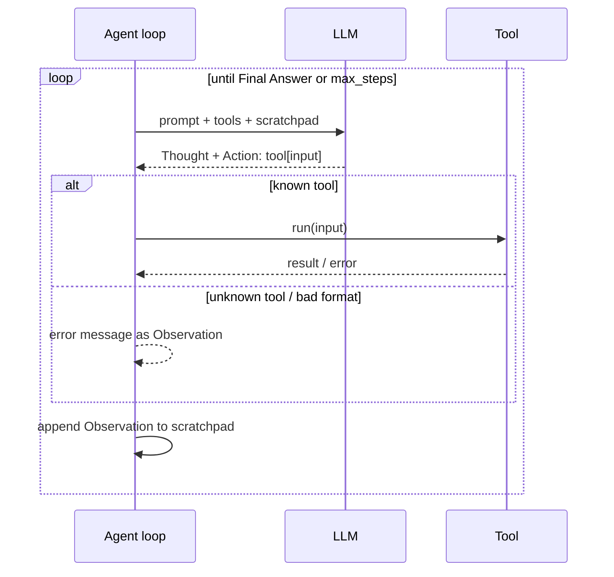
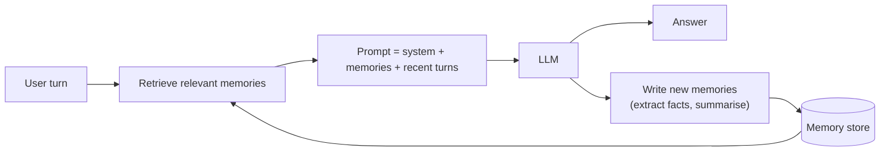
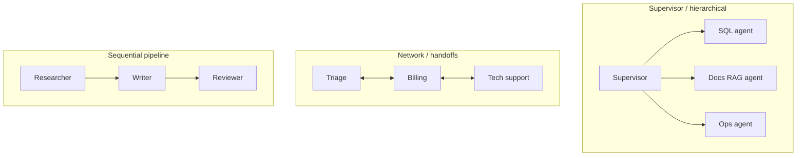
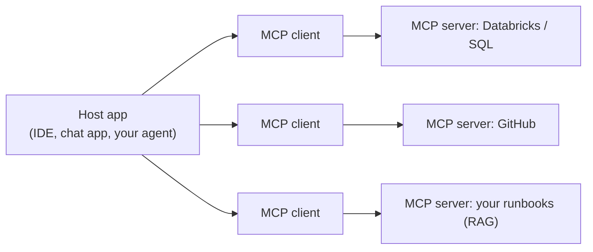

# 05 · Agentic AI — Tools, Memory, Planning, Multi-Agent Systems

> **Level:** Medium → Advanced · **Time:** ~2 weeks · **Code:** [`agent.py`](../src/ailearn/agent.py) · **Tests:** [`test_agent_eval.py`](../tests/test_agent_eval.py) · **Demos:** `python examples/02_text_to_sql_agent.py`, [`examples/04_tool_calling_native.py`](../examples/04_tool_calling_native.py)

## Learning goals
- Define an agent precisely and know when **not** to build one.
- Implement the ReAct loop and native tool calling.
- Design tools, memory, planning and reflection.
- Know the multi-agent patterns and frameworks (LangGraph, CrewAI, AutoGen, OpenAI Agents SDK, Semantic Kernel, LlamaIndex, Claude Agent SDK) and MCP.
- Make agents safe, observable and testable.

---

## 1. What is an agent?

> **Agent = LLM + tools + a loop + (memory) + a goal.** The LLM decides *what to do next* based on observations, instead of following a fixed script.



### Workflows vs agents (most important design decision)

| | **Workflow** (LLM in fixed steps) | **Agent** (LLM chooses steps) |
|---|---|---|
| Control flow | written by you | decided by the model |
| Predictability | high | lower |
| Cost / latency | low, bounded | higher, variable |
| Use when | task is well understood (extract → validate → load) | open-ended tasks, unknown number of steps (debug a failing pipeline) |

**Start with the simplest thing that works:** single LLM call → prompt chain → routing → workflow → agent. Anthropic's [Building effective agents](https://www.anthropic.com/engineering/building-effective-agents) describes these patterns:



---

## 2. ReAct — Reason + Act

From *[ReAct: Synergizing Reasoning and Acting](https://arxiv.org/abs/2210.03629)*. The model interleaves thoughts and tool actions:

```text
Question: Which region has the highest revenue and by how much?
Thought: I should inspect the schema first.
Action: schema[]
Observation: CREATE TABLE gold_daily_sales(sale_date, region, revenue, orders)
Thought: Sum revenue by region.
Action: sql[select region, sum(revenue) from gold_daily_sales group by region order by 2 desc]
Observation: [('north', 25500.0), ('south', 17100.0)]
Thought: Compute the gap.
Action: calculator[(25500-17100)/17100*100]
Observation: 49.122807
Thought: I now know the answer
Final Answer: North leads with 25,500 vs 17,100 (≈49% higher).
```

Our implementation ([`ReActAgent.run`](../src/ailearn/agent.py)):


Guardrails already in the code and **proved by tests**:
| Guardrail | Test |
|---|---|
| stop after `max_steps` | `test_agent_stops_at_max_steps` |
| unknown tool → helpful error, not crash | `test_agent_recovers_from_unknown_tool_and_tool_errors` |
| unparseable output → ask to follow format | `test_agent_handles_unparseable_output` |
| calculator without `eval()` | `test_safe_calculator_rejects_code` |
| SQL tool is read-only, single statement | `test_sql_tool_is_read_only` |

---

## 3. Native tool calling (function calling)

Modern APIs let you pass **JSON-schema tool definitions**; the model returns a structured `tool_call` instead of text you have to parse. Same loop, more reliable:

```python
tools = [{"type": "function", "function": {
    "name": "get_pipeline_status",
    "description": "Get the latest run status of a data pipeline by name",
    "parameters": {"type": "object", "properties": {"pipeline": {"type": "string"}}, "required": ["pipeline"]}}}]

while True:
    msg = client.chat.completions.create(model=MODEL, messages=messages, tools=tools).choices[0].message
    messages.append(msg)
    if not msg.tool_calls:
        break                                   # final answer
    for call in msg.tool_calls:
        result = TOOLS[call.function.name](**json.loads(call.function.arguments))
        messages.append({"role": "tool", "tool_call_id": call.id, "content": json.dumps(result)})
```
Full runnable file: [`examples/04_tool_calling_native.py`](../examples/04_tool_calling_native.py).

### Tool design checklist (tools are your agent's UI)
- **Clear names & descriptions** — the model picks tools from the description. Include *when to use* and *when not to*.
- **Few, well-scoped tools** beat many overlapping ones.
- **Typed, validated args** (Pydantic). Reject bad input with an actionable error message.
- **Return concise, structured results** (truncate 10,000-row outputs → summary + first 20 rows).
- **Idempotent and safe by default:** read-only first; destructive actions need confirmation (human-in-the-loop).
- **Least privilege:** the tool's credentials should allow only what the user is allowed.

---

## 4. Memory

| Type | What | Implementation |
|---|---|---|
| **Short-term / working** | the current conversation + scratchpad | the message list (watch the context window → summarise/trim) |
| **Long-term semantic** | facts about user/org ("prefers PySpark") | vector store / key-value store, retrieved per turn |
| **Episodic** | past task runs & outcomes ("last time job X failed due to schema drift") | logs + retrieval |
| **Procedural** | how to do things (skills, prompts, playbooks) | system prompt, tool docs, stored recipes |



---

## 5. Planning & reflection

- **Plan-and-execute:** first write a plan (list of steps), then execute each step (possibly with a cheaper model), re-plan on failure.
- **Reflection / self-critique:** after producing a result, a critic prompt checks it against requirements and the agent revises ([Reflexion](https://arxiv.org/abs/2303.11366)).
- **Tree-of-thoughts / search:** explore multiple reasoning branches — expensive, for hard problems.
- **Reasoning models** do much of this internally; with them, keep prompts simple and give good tools.

---

## 6. Multi-agent systems



Multi-agent helps when sub-tasks need **different tools/prompts/context** or can run **in parallel**. It costs more tokens and is harder to debug — split only when one agent with good tools is clearly not enough.

---

## 7. Model Context Protocol (MCP)

[MCP](https://modelcontextprotocol.io/) is an open protocol for connecting LLM apps to tools and data. Write a tool server **once**; any MCP-compatible client (Claude apps, IDEs, agent frameworks) can use it.


Servers expose **tools** (functions), **resources** (readable data) and **prompts** (templates).

```python
# pip install "mcp[cli]"   — a tiny MCP server exposing a tool (Python SDK 2.x)
from mcp.server.mcpserver import MCPServer      # SDK 1.x: from mcp.server.fastmcp import FastMCP
mcp = MCPServer("pipeline-tools")

@mcp.tool()
def pipeline_status(name: str) -> str:
    """Return the last run status of a data pipeline."""
    return {"pl_ingest_sales": "Failed: 2200 invalid credentials"}.get(name, "Unknown")

if __name__ == "__main__":
    mcp.run()        # stdio; mcp.run("streamable-http") for a network server
```
A complete, tested server (warehouse + docs search) lives in [`src/ailearn/mcp_server.py`](../src/ailearn/mcp_server.py). See the [MCP deep dive](deep-dives/06-mcp-hands-on.md).

---

## 8. Frameworks — what to use when

| Framework | Style | Good for |
|---|---|---|
| **Plain Python + SDK** (this repo) | you own the loop | learning, simple agents, full control |
| **[LangGraph](https://langchain-ai.github.io/langgraph/)** | explicit state graph, checkpoints, human-in-the-loop | production agents with complex control flow |
| **[LangChain](https://python.langchain.com/)** | components & integrations | quick RAG/tool integrations |
| **[LlamaIndex](https://docs.llamaindex.ai/)** | data/RAG-first, agents & workflows | document-heavy agents |
| **[CrewAI](https://docs.crewai.com/)** | role-based crews | multi-agent prototypes |
| **[AutoGen](https://microsoft.github.io/autogen/)** | conversational multi-agent | research, agent conversations |
| **[Semantic Kernel](https://learn.microsoft.com/en-us/semantic-kernel/)** | enterprise SDK (.NET/Python/Java) | Microsoft/Azure stacks |
| **[OpenAI Agents SDK](https://openai.github.io/openai-agents-python/)** | lightweight agents, handoffs, guardrails | OpenAI-centric apps |
| **[PydanticAI](https://ai.pydantic.dev/)** | type-safe agents | Python devs who like Pydantic |
| **[Claude Agent SDK](https://docs.claude.com/en/api/agent-sdk/overview)** | the harness behind Claude Code | coding/ops agents with file & shell tools |
| **Databricks Mosaic AI Agent Framework / Azure AI Foundry Agent Service** | managed platforms | enterprise deployment, eval, governance on your cloud |

Learn the concepts with plain Python first (this repo), then pick **one** framework.

---

## 9. Safety, reliability & testing of agents

- **Budgets:** max steps, max tokens, max cost, timeouts.
- **Human-in-the-loop** for irreversible actions (DROP, DELETE, sending email, payments, deploying).
- **Sandbox** code execution (containers, no network, resource limits).
- **Prompt injection via tools:** text returned by tools/webpages is untrusted — it must not be able to trigger privileged tools.
- **Observability:** trace every LLM call & tool call (inputs, outputs, latency, tokens) — [Langfuse](https://langfuse.com/), [LangSmith](https://docs.smith.langchain.com/), [Arize Phoenix](https://phoenix.arize.com/), MLflow Tracing.
- **Testing:** 
  - *Unit tests* with `ScriptedLLM` (deterministic trajectories) — see `tests/test_agent_eval.py`.
  - *Tool tests* — each tool is a normal function, test it normally.
  - *Trajectory evals* — did the agent call the right tools in a sensible order?
  - *Outcome evals* — task success rate on a benchmark of real tasks, run in CI.

---

## ✅ Check your understanding
<details><summary>1. A nightly job must extract fields from 10k invoices into a table. Agent or workflow?</summary>
Workflow: steps are known (parse → LLM extract with schema → validate → load). Cheaper, predictable, testable.</details>
<details><summary>2. The agent keeps calling the same tool in a loop. Causes and fixes?</summary>
Unclear tool output/error, missing info, ambiguous goal. Fix: better tool descriptions and error messages, include previous observations, max_steps, detect repeated identical calls, give a "finish/ask_user" tool.</details>
<details><summary>3. Why return errors to the model as observations instead of raising?</summary>
The model can self-correct (fix the SQL, choose another tool). Crashing loses the whole run. Still log them and cap retries.</details>
<details><summary>4. What does MCP standardise?</summary>
How hosts/clients discover and call tools, read resources and use prompts exposed by servers — so integrations are reusable across apps and models.</details>
<details><summary>5. How do you unit-test an agent without paying for LLM calls?</summary>
Inject a scripted/mock LLM that returns predetermined Thought/Action text (or tool_calls), and assert on the tools called, arguments, observations and the final answer.</details>

## 🏋️ Exercises
1. Add a `max_cost` budget to `ReActAgent` (estimate tokens per prompt with `estimate_tokens`).
2. Add a **human-approval tool wrapper**: `requires_approval(tool)` that returns "PENDING_APPROVAL" unless an `approve` callback returns True. Test both paths.
3. Detect loops: if the same `(action, input)` repeats 3×, stop with `stopped_reason="loop"`. Write the test first.
4. Build a 2-agent supervisor: a "router" decides whether a question goes to the RAG pipeline or the SQL agent.
5. Wrap `RAGPipeline.ask` as an MCP tool and use it from an MCP client.

## 📚 Go deeper
- 📖 [Anthropic — Building effective agents](https://www.anthropic.com/engineering/building-effective-agents)
- 📖 [Lilian Weng — LLM Powered Autonomous Agents](https://lilianweng.github.io/posts/2023-06-23-agent/)
- 📖 [Chip Huyen — Agents](https://huyenchip.com/2025/01/07/agents.html)
- 🎓 [Hugging Face Agents Course](https://huggingface.co/learn/agents-course) · [Microsoft — AI Agents for Beginners](https://github.com/microsoft/ai-agents-for-beginners) · [LangChain Academy (LangGraph)](https://academy.langchain.com/)
- 💻 [NirDiamant/GenAI_Agents](https://github.com/NirDiamant/GenAI_Agents) · [Shubhamsaboo/awesome-llm-apps](https://github.com/Shubhamsaboo/awesome-llm-apps)
- 📄 [ReAct](https://arxiv.org/abs/2210.03629) · [Toolformer](https://arxiv.org/abs/2302.04761) · [Reflexion](https://arxiv.org/abs/2303.11366)
- 🔌 [Model Context Protocol docs](https://modelcontextprotocol.io/)
