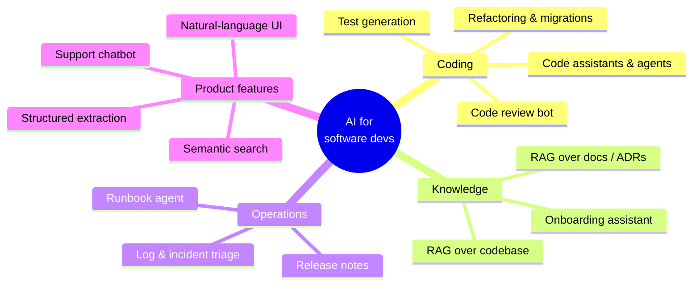
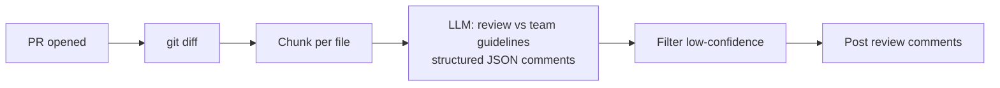

# 07 · LLMs, RAG & Agents for Software Developers

How these technologies help in day-to-day software engineering — with concrete, buildable examples.



## 1. Use cases with examples

### 1.1 Codebase Q&A (RAG over your repo)
"Where do we validate JWT tokens?" — chunk by **function/class** (tree-sitter), keep `file_path` + `symbol` metadata, use **hybrid** search (identifiers are exact tokens!).
```python
import ast, pathlib
def python_symbol_chunks(path):
    src = pathlib.Path(path).read_text()
    for node in ast.walk(ast.parse(src)):
        if isinstance(node, (ast.FunctionDef, ast.ClassDef, ast.AsyncFunctionDef)):
            yield {"text": ast.get_source_segment(src, node), "file": str(path), "symbol": node.name}
```

### 1.2 Test generation
Prompt: function source + existing test style + "write pytest tests covering edge cases; do not change the function". **Run the tests** in CI and keep only those that pass and add coverage → an evaluator-optimizer loop.

### 1.3 PR review assistant (workflow, not agent)


### 1.4 Log / incident triage agent
Tools: `search_logs(query, time_range)`, `get_recent_deploys()`, `search_runbooks(query)` (RAG), `create_ticket(...)` (approval required). The agent correlates the error spike with a deploy and suggests the runbook fix.

### 1.5 Natural-language features in your product
- Semantic search over products/help articles (embeddings + vector DB).
- Support bot with RAG + escalation to humans.
- Structured extraction from emails/invoices into your DB (Pydantic schemas).
- "Ask your data" analytics (text-to-SQL with a semantic layer).

### 1.6 Migrations & refactors at scale
Use a coding agent (Claude Code, Copilot agent mode, Cursor, Aider, OpenHands…) with a clear spec + a test suite as the oracle: "migrate all `requests` calls to `httpx`, keep tests green". The **test suite is what makes agents safe** — another reason the tests in this repo matter.

## 2. Engineering practices for AI features
- Treat prompts as **code**: version, review, test.
- Put the LLM behind an **interface** (`LLM.complete`) → swap providers, mock in tests (`MockLLM`, `ScriptedLLM`).
- **Validate** every output that drives code paths (Pydantic). Retry with the error message.
- **Timeouts, retries with backoff, fallbacks** (secondary model/provider).
- **Stream** responses for UX.
- Log **traces**, not just errors.
- Cost guardrails per user/tenant.

## 3. Starter projects for developers
See [`projects/`](../projects/README.md): **P1** CLI chat with memory · **P3** Docs/codebase Q&A bot · **P6** PR review bot · **P8** Log triage agent · **P10** MCP server for your service.

## 📚 Links
- [Anthropic — Claude Code best practices](https://www.anthropic.com/engineering/claude-code-best-practices)
- [GitHub — awesome-llm-apps](https://github.com/Shubhamsaboo/awesome-llm-apps)
- [OpenAI Cookbook](https://cookbook.openai.com/)
- [Aider](https://aider.chat/) · [OpenHands](https://github.com/All-Hands-AI/OpenHands) (open-source coding agents to study)
