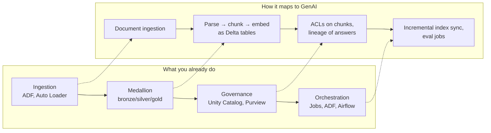
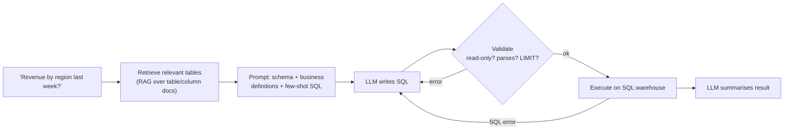

# 08 · LLMs, RAG & Agents for Data Engineers (Azure · Databricks · Spark)

Data engineers have a **huge advantage** in GenAI: RAG is 70% data pipeline (ingest → clean → chunk → embed → index → keep fresh), and agents need governed, well-modelled data to be useful.



---

## 1. Use case: RAG ingestion pipeline as a medallion (PySpark)

```python
# Databricks notebook — bronze: raw files with Auto Loader
raw = (spark.readStream.format("cloudFiles")
       .option("cloudFiles.format", "binaryFile")
       .load("abfss://docs@<storage>.dfs.core.windows.net/runbooks/"))
raw.writeStream.option("checkpointLocation", "/chk/docs_bronze").toTable("rag.bronze_docs")
```
```python
# silver: parse to text + metadata (pandas UDF so heavy libs run per batch)
import pandas as pd
from pyspark.sql.functions import pandas_udf, col, explode, sha2, concat_ws
from pyspark.sql.types import ArrayType, StringType

@pandas_udf(StringType())
def parse_doc(content: pd.Series) -> pd.Series:
    import io, pypdf
    def to_text(b):
        try:
            return "\n".join(p.extract_text() or "" for p in pypdf.PdfReader(io.BytesIO(b)).pages)
        except Exception:
            return b.decode("utf-8", errors="ignore")
    return content.apply(to_text)

silver = spark.table("rag.bronze_docs").withColumn("text", parse_doc(col("content"))) \
              .select("path", "modificationTime", "text")
silver.write.mode("overwrite").saveAsTable("rag.silver_docs")
```
```python
# gold: chunks with stable ids (hash → idempotent upserts) — reuse this repo's chunker
@pandas_udf(ArrayType(StringType()))
def chunk(text: pd.Series) -> pd.Series:
    from ailearn.chunking import recursive_chunks
    return text.apply(lambda t: recursive_chunks(t or "", max_chars=2000))

gold = (spark.table("rag.silver_docs")
        .withColumn("chunk", explode(chunk("text")))
        .withColumn("chunk_id", sha2(concat_ws("|", "path", "chunk"), 256))
        .select("chunk_id", "path", "modificationTime", "chunk"))
gold.write.mode("overwrite").option("delta.enableChangeDataFeed", "true").saveAsTable("rag.gold_chunks")
```
Then create a **Databricks Vector Search Delta Sync index** on `rag.gold_chunks` (see [03 §6.3](03-embeddings-and-vector-databases.md#63-databricks-vector-search-delta-sync)) or push to **Azure AI Search** with an indexer. Change Data Feed ⇒ only changed chunks are re-embedded.

---

## 2. Use case: LLM-powered transformations in SQL (`ai_query`, AI Functions)

Databricks SQL can call models row-by-row, at scale, inside your pipelines:
```sql
-- classify support tickets & extract fields directly in a gold table build
CREATE OR REPLACE TABLE gold.tickets_enriched AS
SELECT ticket_id, body,
       ai_classify(body, ARRAY('billing', 'bug', 'feature_request', 'outage')) AS category,
       ai_extract(body, ARRAY('product', 'customer_name'))                      AS entities,
       ai_query('databricks-meta-llama-3-3-70b-instruct',
                CONCAT('Summarise in 1 sentence: ', body))                      AS summary
FROM silver.tickets;
```
Equivalent on Azure: call Azure OpenAI from a pandas UDF / Synapse / Fabric notebook with batching and retries. Use **batch inference** for big tables and keep `temperature=0` for reproducibility. See [Databricks AI Functions](https://docs.databricks.com/en/large-language-models/ai-functions.html).

---

## 3. Use case: Text-to-SQL "talk to your warehouse" agent


Key ideas: **RAG over metadata** (table comments, column descriptions, sample queries) when you have hundreds of tables; a **semantic layer**/metric definitions so "revenue" means one thing; **read-only service principal**; row limits; show the SQL to the user. Runnable demo: `python examples/02_text_to_sql_agent.py`; read-only guard: `make_sql_tool` + `test_sql_tool_is_read_only`. Managed versions: Databricks AI/BI Genie, Fabric Copilot / data agents.

---

## 4. Use case: Pipeline failure triage agent
Tools: `get_failed_runs()` (ADF/Databricks Jobs REST API), `get_run_logs(run_id)`, `search_runbooks(query)` (RAG), `query_table_freshness(table)`, `create_incident(...)` (approval).
Output: probable root cause + runbook link + suggested fix, posted to Teams/Slack. Start as a **workflow** (fetch failure → summarise logs → RAG runbook → post), graduate to an agent when it needs to explore.

## 5. Use case: Auto-documentation & data catalog enrichment
For each table: sample rows + schema + lineage → LLM drafts table/column descriptions and PII tags → human review → write back as Unity Catalog comments/tags. Improves your text-to-SQL agent too.

## 6. Use case: Data-quality copilot
- Generate expectation rules (Great Expectations / DLT expectations) from profiling stats.
- Explain anomalies in plain English.
- Classify DQ incidents (the few-shot example in [02](02-working-with-llms.md#34-few-shot-example-data-quality-classification)).

## 7. Use case: Unstructured → structured ETL
Invoices, contracts, emails → JSON schema extraction → validate → Delta table. LLMs replace brittle regex parsers. Always keep `source_uri`, `model_version`, `extracted_at`, and a confidence/validation flag.

## 8. Use case: SQL / Spark code assistant
Convert legacy SQL (T-SQL, Oracle PL/SQL, Informatica mappings) to Spark SQL/PySpark; explain query plans; suggest partitioning/Z-order. **Validate by running both versions on sample data and diffing the outputs** — an ideal evaluator loop.

---

## Embeddings at scale with Spark
```python
@pandas_udf("array<float>")
def embed(texts: pd.Series) -> pd.Series:
    from sentence_transformers import SentenceTransformer
    model = SentenceTransformer("BAAI/bge-small-en-v1.5")       # loaded once per executor batch
    return pd.Series(list(model.encode(texts.tolist(), batch_size=64, normalize_embeddings=True)))

spark.table("rag.gold_chunks").repartition(64).withColumn("embedding", embed("chunk")) \
     .write.mode("overwrite").saveAsTable("rag.gold_chunk_embeddings")
```
Tips: GPU cluster for large corpora; cache the model per executor; batch API calls (rate limits!); store `embedding_model` + `embedding_version` columns; re-embed everything when the model changes.

## Projects for data engineers
See [`projects/`](../projects/README.md): **P2** Semantic search over table docs · **P4** Text-to-SQL agent · **P5** RAG ingestion medallion pipeline · **P7** Pipeline failure triage bot · **P9** LLM enrichment of a Delta table · **P11** Data-catalog copilot.

## 📚 Links
- [Databricks Vector Search docs](https://docs.databricks.com/en/generative-ai/vector-search.html) · [Databricks AI Functions](https://docs.databricks.com/en/large-language-models/ai-functions.html)
- [Azure AI Search — RAG overview](https://learn.microsoft.com/en-us/azure/search/retrieval-augmented-generation-overview) · [Azure OpenAI docs](https://learn.microsoft.com/en-us/azure/ai-services/openai/)
- [Microsoft Fabric — AI functions & Copilot docs](https://learn.microsoft.com/en-us/fabric/)
- [pathwaycom/llm-app (real-time RAG pipelines)](https://github.com/pathwaycom/llm-app)
- [Unstructured docs (document parsing)](https://docs.unstructured.io/) · [Docling](https://github.com/docling-project/docling)
