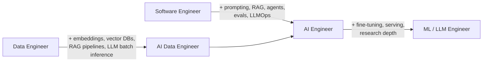

# 09 · Getting Started in Real Life

## 1. Your first 7 days (practical)
| Day | Do this | Output |
|---|---|---|
| 1 | Clone this repo, `pip install -e ".[dev,graph]"`, `pytest -v`. Read `docs/01`. | all 112 tests green |
| 2 | Get an API key (OpenAI / Anthropic / Azure OpenAI) **or** install [Ollama](https://ollama.com/). Make one API call from Python. | `hello_llm.py` |
| 3 | Prompting: build a prompt that turns English into SQL for one of your schemas; test on 10 questions. | prompt + test results |
| 4 | Embeddings: embed 20 sentences, find nearest neighbours, plot them. | notebook |
| 5 | RAG: run `examples/03_real_rag_chroma_openai.py` over a folder of your own notes/runbooks. | working Q&A bot |
| 6 | Eval: write 15 golden questions; measure hit-rate@k; change chunk size; measure again. | eval table |
| 7 | Agent: give the bot a SQL tool + calculator; trace each step. | mini agent |

## 2. Recommended dev setup
```bash
python -m venv .venv && source .venv/bin/activate
pip install -e ".[dev]"            # this repo
pip install openai anthropic chromadb sentence-transformers pydantic python-dotenv
# optional: langgraph llama-index ragas langfuse "mcp[cli]"
```
- `.env` for keys (never commit — `.gitignore` is set up) · Jupyter / Databricks notebooks for exploration · `pytest` for everything you keep.

## 3. Production readiness checklist
**Data & retrieval**
- [ ] Sources inventoried, owners known, refresh schedule defined
- [ ] Parsing quality checked on real documents (tables, scans)
- [ ] Chunk metadata: source, section, date, ACL, version
- [ ] Hybrid search + reranker evaluated
- [ ] Incremental indexing (CDC) and deletion handling

**Quality**
- [ ] Golden eval set (≥50 Qs) with retrieval + answer metrics, in CI
- [ ] "I don't know" behaviour tested
- [ ] Citations shown to users
- [ ] Human feedback captured (👍/👎 + comments)

**Safety & security**
- [ ] Document-level access control at retrieval
- [ ] Prompt-injection tests (malicious docs in the index)
- [ ] Tools least-privilege; destructive actions need approval
- [ ] PII handling & logging policy; no secrets in prompts

**Operations**
- [ ] Tracing of every LLM/tool call; cost & latency dashboards
- [ ] Timeouts, retries, fallbacks, rate limits, budgets
- [ ] Versioned prompts/models/index; rollback plan

## 4. Building a portfolio that gets interviews
1. **3 projects, done well > 10 tutorials.** Each with: README + architecture diagram, eval results table, tests, a short demo GIF/video.
2. Pick projects in your domain — for a data engineer: *RAG ingestion medallion*, *text-to-SQL agent with eval*, *pipeline-failure triage bot*.
3. Write a blog post per project: problem → design → what failed → metrics.
4. Show you understand **evaluation, cost and security** — that's what separates "tutorial" from "engineer".

## 5. Roles & skills map


## 6. Staying current (the field moves monthly)
- Newsletters/blogs: [Simon Willison's blog](https://simonwillison.net/), [Latent Space](https://www.latent.space/), [The Batch (DeepLearning.AI)](https://www.deeplearning.ai/the-batch/), [Interconnects](https://www.interconnects.ai/), [Ahead of AI (Sebastian Raschka)](https://magazine.sebastianraschka.com/)
- Papers: [Hugging Face Daily Papers](https://huggingface.co/papers), [arXiv cs.CL](https://arxiv.org/list/cs.CL/recent)
- Leaderboards: [LMArena](https://lmarena.ai/), [MTEB](https://huggingface.co/spaces/mteb/leaderboard), [Artificial Analysis](https://artificialanalysis.ai/)
