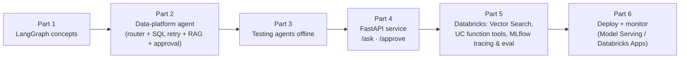
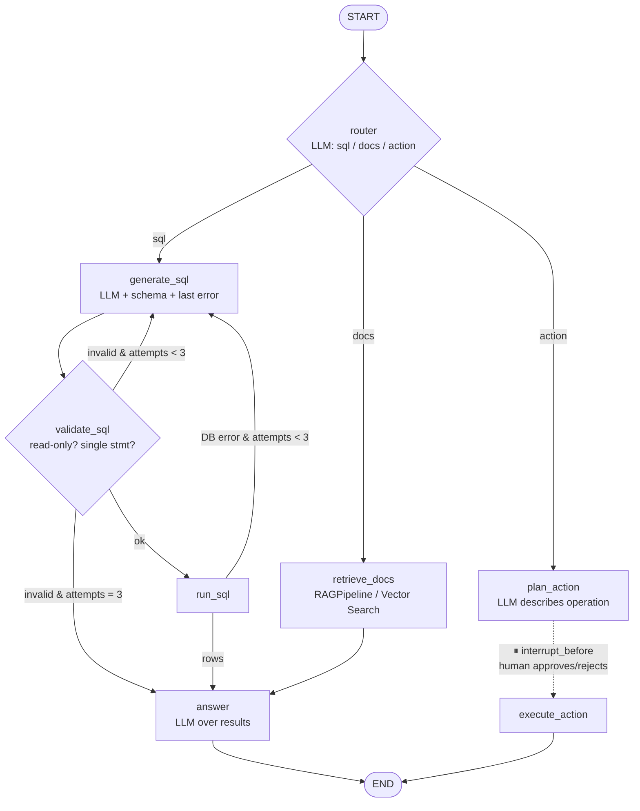
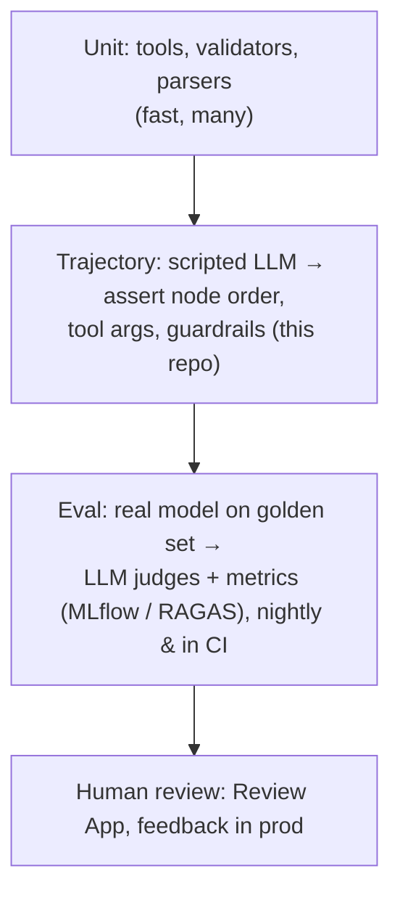
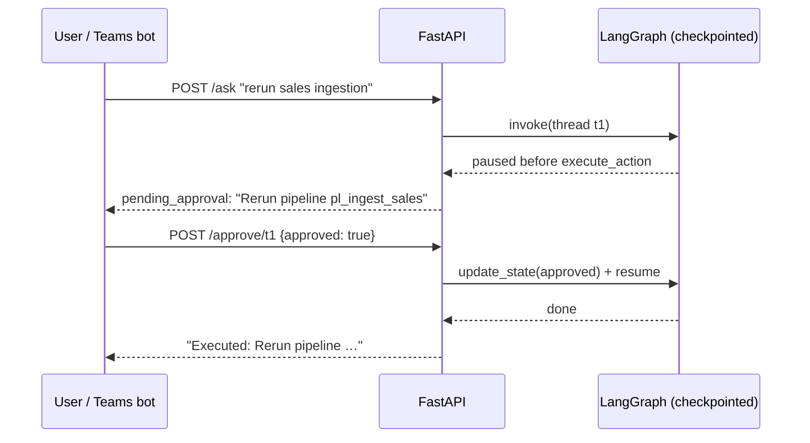
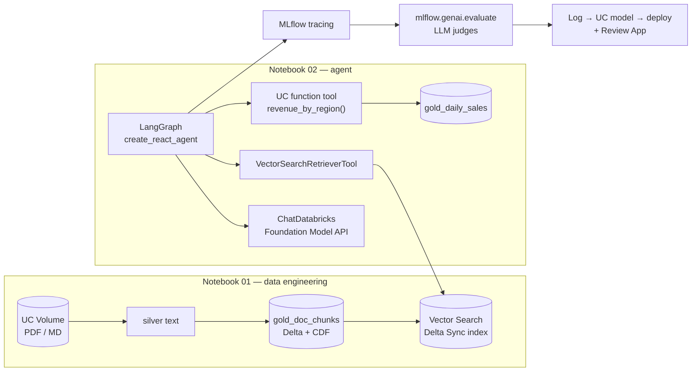

# 10 · Hands-on: LangGraph Agents → FastAPI Service → Databricks Mosaic AI

> **Level:** Medium → Advanced · **Time:** ~2–3 weeks
> **Code:** [`src/ailearn/graph_agent.py`](../src/ailearn/graph_agent.py), [`src/ailearn/api.py`](../src/ailearn/api.py), [`examples/databricks/`](../examples/databricks/)
> **Tests:** [`tests/test_graph_agent.py`](../tests/test_graph_agent.py) (12), [`tests/test_api.py`](../tests/test_api.py) (5) · run offline, no API key

Modules 01–09 explain the ideas, and their code builds each piece from scratch. This module is about **shipping**. You build a real agent with a real framework, wrap it in a service with human approval, test it, and then rebuild it on the platform you use at work.



---

## Part 1 · LangGraph in 10 minutes

[LangGraph](https://langchain-ai.github.io/langgraph/) models an agent as a **state machine**. In the plain ReAct loop from module 05, the model decides everything. Here you draw the boundaries yourself: the model decides **inside** a node, and your graph decides **what may happen next**.

| Concept | What it is | In our agent |
|---|---|---|
| **State** | a typed dict passed between nodes; each node returns a *partial update* | `AgentState` — question, route, sql, sql_error, attempts, context, answer, trace |
| **Node** | a Python function `state -> update` (may call an LLM, a tool, anything) | `router`, `generate_sql`, `run_sql`, `answer`… |
| **Edge** | fixed transition | `generate_sql → validate_sql` |
| **Conditional edge** | a function that picks the next node from state | `after_validate`: run, retry or give up |
| **Checkpointer** | saves state after every step under a `thread_id` | `MemorySaver` (use Postgres/SQLite/Redis in prod) |
| **Interrupt** | pause before/after a node, so a human can inspect or edit state, then resume | `interrupt_before=["execute_action"]` |

```python
from langgraph.graph import StateGraph, START, END
g = StateGraph(MyState)
g.add_node("step_a", step_a)
g.add_edge(START, "step_a")
g.add_conditional_edges("step_a", choose_next, ["step_b", END])
app = g.compile(checkpointer=MemorySaver())
app.invoke({"question": "..."}, {"configurable": {"thread_id": "user-42"}})
```

> **Prebuilt or custom?** `langgraph.prebuilt.create_react_agent(llm, tools)` builds a standard tool-calling loop in one line, and Part 5 uses it. Write a custom graph, as in Part 2, when you need guaranteed steps: validation, retry limits, approvals or routing.

---

## Part 2 · The data-platform agent we build



Why this design is production-minded:
- **Routing:** numeric questions go to SQL, conceptual ones go to RAG. This avoids the classic "RAG can't do sums" failure from module 04 §7.
- **Self-correction with a budget:** when SQL fails, the DB error goes back into the prompt (`"The previous query failed with: …"`), with at most 3 attempts.
- **Code-level guardrails:** `validate_readonly_sql` runs *before* execution. Never rely on the prompt alone to block a `DROP`.
- **Human-in-the-loop:** any side effect (rerun a pipeline, grant access) **pauses** the graph. The checkpointer saves the state, a human decides, and the graph resumes.
- **Trace:** every node appends to `state["trace"]`, so you can see exactly what happened.

Run it:
```python
import sqlite3
from ailearn.graph_agent import build_graph
from ailearn.llm import OpenAICompatibleLLM          # or ScriptedLLM / MockLLM offline

conn = sqlite3.connect("warehouse.db", check_same_thread=False)
graph = build_graph(OpenAICompatibleLLM(model="gpt-4o-mini"), conn)
out = graph.invoke({"question": "Total revenue by region?"}, {"configurable": {"thread_id": "1"}})
print(out["answer"]); print("\n".join(out["trace"]))
```

Use a real model for free with **Ollama**: `OpenAICompatibleLLM(model="llama3.1", base_url="http://localhost:11434/v1", api_key="ollama")`.

---

## Part 3 · Testing agents without paying for tokens

The trick is **dependency injection**. The graph takes any object with `complete(prompt)`, so tests pass in a `ScriptedLLM` that plays the model's part line by line. Each test proves one behaviour:

| Test | Proves |
|---|---|
| `test_sql_route_happy_path` | routing → SQL → correct rows → answer in 1 attempt |
| `test_sql_self_corrects_after_db_error` | DB error is fed back and the 2nd query succeeds |
| `test_destructive_sql_is_blocked_and_gives_up` | `DROP`/`DELETE`/stacked statements never run; table intact; stops at 3 |
| `test_docs_route_uses_rag` | retrieved context really reaches the LLM prompt |
| `test_action_pauses_for_human_approval_then_executes` | graph stops at `execute_action`, nothing runs until approved, then resumes from checkpoint |
| `test_action_rejected_by_human` | rejection means no side effect |
| `test_router_falls_back_to_docs_on_garbage` | unparseable router output has a safe default |

```bash
pip install -e ".[dev,graph]"
pytest tests/test_graph_agent.py tests/test_api.py -v
```

**Testing pyramid for agents**


---

## Part 4 · Serving it: FastAPI + approvals

[`ailearn/api.py`](../src/ailearn/api.py) wraps the graph in a REST service:

| Endpoint | Purpose |
|---|---|
| `POST /ask` `{question, thread_id?}` | runs the graph; returns `done` + answer, or `pending_approval` + the planned action |
| `POST /approve/{thread_id}` `{approved}` | resumes a paused thread; returns 409 if nothing is pending |
| `GET /threads/{thread_id}` | inspect state/trace |
| `GET /health` | liveness |

```bash
pip install -e ".[graph]" uvicorn
uvicorn ailearn.api:app --reload --app-dir src        # offline demo LLM
# open http://127.0.0.1:8000/docs  (Swagger UI)
curl -s -X POST localhost:8000/ask -H 'content-type: application/json' \
     -d '{"question":"rerun the sales ingestion pipeline","thread_id":"t1"}'
curl -s -X POST localhost:8000/approve/t1 -H 'content-type: application/json' -d '{"approved":true}'
```



**Before production:** use a persistent checkpointer (Postgres), add auth (Entra ID / OAuth) and check **who** may approve, set request timeouts, put the LLM call behind retries with backoff, add rate limits, stream tokens (SSE), add OpenTelemetry/MLflow tracing, and package it with Docker.

---

## Part 5 · The same agent on Databricks (Mosaic AI)

Notebooks: [`examples/databricks/01_build_vector_index.py`](../examples/databricks/01_build_vector_index.py) and [`02_langgraph_agent_mosaic.py`](../examples/databricks/02_langgraph_agent_mosaic.py). Import them into a workspace with Unity Catalog. They don't run outside Databricks.



What maps to what:

| Concept from this repo | Databricks equivalent |
|---|---|
| `recursive_chunks` + embeddings + `FlatIndex` | Delta chunks table → **Vector Search Delta Sync index** (managed embeddings, `query_type="HYBRID"`) |
| `make_sql_tool` with read-only guard | **Unity Catalog SQL function** as a tool: the agent can only run *that* governed query, with UC permissions |
| `OpenAICompatibleLLM` | `ChatDatabricks(endpoint=...)` on Foundation Model APIs / external models via AI Gateway |
| `state["trace"]` | **MLflow Tracing** (`mlflow.langchain.autolog()`) |
| `evaluate_retriever`, `groundedness` | **`mlflow.genai.evaluate`** with judges: `Correctness`, `RelevanceToQuery`, `Safety`, `RetrievalGroundedness`… |
| FastAPI `/ask` | **Model Serving** endpoint (`agents.deploy`) or **Databricks Apps** (Databricks' newer recommended route, with the agent wrapped in MLflow `ResponsesAgent`) |
| human approval | Review App feedback + your app-level approval step |

Key snippets (full versions are in the notebooks):
```python
# governed tools
docs_tool = VectorSearchRetrieverTool(index_name=INDEX_NAME, num_results=4,
                                      tool_name="search_runbooks", tool_description="Search runbooks…")
sql_tools = UCFunctionToolkit(function_names=["main.rag_demo.revenue_by_region"]).tools
agent = create_react_agent(ChatDatabricks(endpoint=LLM_ENDPOINT), tools=[docs_tool, *sql_tools], prompt=SYSTEM)

# evaluation with LLM judges
mlflow.genai.evaluate(data=eval_data, predict_fn=predict_fn,
                      scorers=[Correctness(), RelevanceToQuery(), Safety(), RetrievalGroundedness()])
```

> ⚠️ Databricks GenAI APIs change quickly. Package names, `ResponsesAgent`, and the deploy path (Model Serving vs Databricks Apps) have all moved in the last year. If a call fails, check the current docs linked below first.

**Azure-native alternative:** Azure AI Search (index + hybrid + semantic ranker) + Azure OpenAI + the same LangGraph code + **Azure AI Foundry Agent Service** or Container Apps for hosting. The graph code stays the same; only the LLM client and tools change. That's the payoff of the `LLM` interface.

---

## Part 6 · Production checklist for this agent
- [ ] Golden set of 50+ questions (SQL + docs + action), run with `mlflow.genai.evaluate` on every change
- [ ] Execution accuracy for SQL questions ≥ target; groundedness ≥ target for docs
- [ ] Tools are least-privilege: UC functions or a read-only service principal; actions need approval
- [ ] Persistent checkpointer, so threads survive restarts
- [ ] Tracing on, with cost and latency dashboards and alerts on error rate
- [ ] Prompt-injection test docs in the index; confirm they can't trigger actions
- [ ] Rollback: versioned model in Unity Catalog, deploy previous version

---

## ✅ Check your understanding
<details><summary>1. Why validate SQL in a node instead of telling the model "only write SELECT"?</summary>Prompts are suggestions, and the model (or injected text) can ignore them. Code validation is a hard guarantee, and `test_destructive_sql_is_blocked_and_gives_up` proves it.</details>
<details><summary>2. What does the checkpointer give you besides human-in-the-loop?</summary>Conversation memory per thread, resuming after crashes, time-travel debugging (inspecting or replaying earlier states), and the ability to edit state before continuing.</details>
<details><summary>3. When would you replace the custom graph with create_react_agent?</summary>When the tools are safe and the steps are open-ended, so you don't need guaranteed validation, retry or approval stages. Many teams combine both: a custom outer graph with a ReAct sub-agent inside one node.</details>
<details><summary>4. Why expose revenue as a UC function instead of letting the agent write arbitrary SQL?</summary>Governance and correctness. The metric definition is fixed and reviewed, permissions are enforced by Unity Catalog, and there's no SQL injection risk. Use free-form text-to-SQL only where flexibility is worth that risk.</details>
<details><summary>5. RetrievalGroundedness is low but Correctness is high. What does it mean?</summary>The answers are right but not supported by the retrieved context, so the model is answering from its own training data. That's risky for private or changing facts. Improve retrieval and tighten the grounding instruction.</details>

## 🏋️ Exercises
1. Add a `clarify` route: if the question is ambiguous, the graph returns a clarifying question instead of guessing. Test it.
2. Replace `MemorySaver` with `langgraph-checkpoint-sqlite` and show a thread surviving an API restart.
3. Add an `/ask/stream` endpoint that streams node-by-node progress with `graph.stream(..., stream_mode="updates")`.
4. Add a fourth route, `docs+sql`, for "why did revenue drop in the south last week?". Run SQL for the numbers and RAG for incident notes, and combine both in `answer`.
5. On Databricks: build the golden set as a Delta table, run `mlflow.genai.evaluate` in a scheduled Job, and alert when a metric drops.

## 📚 Go deeper
- 📖 [LangGraph docs](https://langchain-ai.github.io/langgraph/) · [LangGraph tutorials](https://langchain-ai.github.io/langgraph/tutorials/) · 🎓 [LangChain Academy: Intro to LangGraph (free)](https://academy.langchain.com/)
- 📖 [FastAPI docs](https://fastapi.tiangolo.com/)
- 📖 [Databricks — Connect agents to unstructured data (VectorSearchRetrieverTool)](https://docs.databricks.com/aws/en/generative-ai/agent-framework/unstructured-retrieval-tools)
- 📖 [Databricks — Unity Catalog functions as LangChain/LangGraph tools](https://docs.databricks.com/aws/generative-ai/agent-framework/langchain-uc-integration)
- 📖 [Databricks — Author an agent (ResponsesAgent, Databricks Apps)](https://docs.databricks.com/gcp/en/generative-ai/agent-framework/author-agent)
- 📖 [Databricks — Built-in LLM judges / predefined scorers (MLflow 3)](https://docs.databricks.com/aws/mlflow3/genai/eval-monitor/predefined-judge-scorers) · [MLflow predefined scorers](https://mlflow.org/docs/latest/genai/eval-monitor/scorers/llm-judge/predefined)
- 📖 [Databricks — Vector Search](https://docs.databricks.com/en/generative-ai/vector-search.html)
- 📖 [Azure AI Foundry Agent Service](https://learn.microsoft.com/en-us/azure/ai-foundry/agents/overview)
