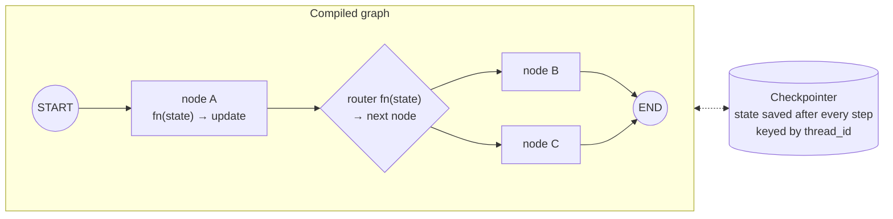
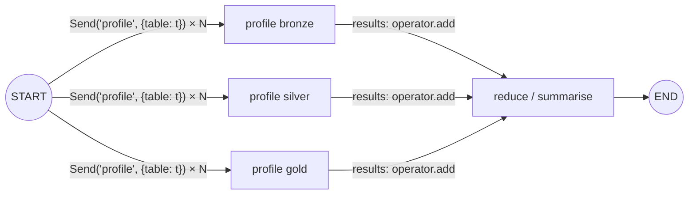
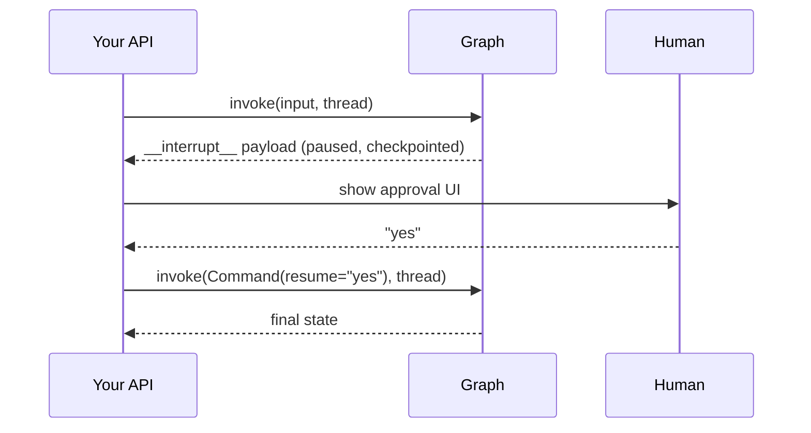
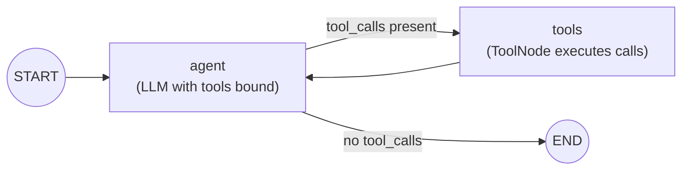
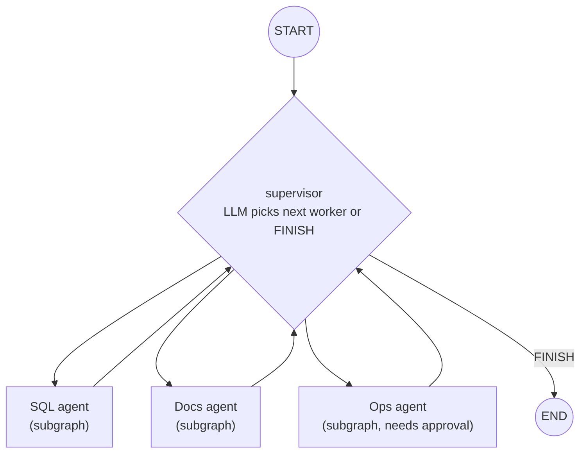

# Deep Dive 1 · LangGraph in Depth

> **Prereq:** [Lesson 05](../05-agentic-ai.md) and [Lesson 10](../10-hands-on-langgraph-databricks.md) · **Learning tests:** [`tests/test_langgraph_concepts.py`](../../tests/test_langgraph_concepts.py) · **Real agent:** [`src/ailearn/graph_agent.py`](../../src/ailearn/graph_agent.py)
> Code targets LangGraph 1.x (`pip install langgraph`). Every concept below has a passing test you can run and change.

## Contents
1. [Mental model](#1-mental-model)
2. [State & reducers](#2-state--reducers)
3. [Nodes, edges, conditional edges, `Command`](#3-nodes-edges-conditional-edges-command)
4. [Parallelism & map-reduce with `Send`](#4-parallelism--map-reduce-with-send)
5. [Checkpointers: memory, threads, time travel](#5-checkpointers-memory-threads-time-travel)
6. [Human-in-the-loop: `interrupt()` and `interrupt_before`](#6-human-in-the-loop)
7. [Streaming](#7-streaming)
8. [Tool-calling agents with messages (the ReAct loop in LangGraph)](#8-tool-calling-agents-with-messages)
9. [Subgraphs & multi-agent](#9-subgraphs--multi-agent)
10. [Long-term memory (Store)](#10-long-term-memory-store)
11. [Production concerns](#11-production-concerns)

---

## 1. Mental model



- A **graph** is a state machine. **State** is a typed dict. **Nodes** are plain functions that read state and return a **partial update**. **Edges** decide what runs next.
- Execution happens in **super-steps**. All nodes scheduled for a step run (in parallel when there are several), their updates are merged with the **reducers**, and the result is checkpointed.
- The LLM is just something a node *may* call. That's the key difference from "let the LLM drive everything": you decide where the model is free and where your code is in control.

---

## 2. State & reducers

```python
import operator
from typing import Annotated, TypedDict

class State(TypedDict):
    question: str                                  # no reducer → last write wins
    log: Annotated[list[str], operator.add]        # reducer → updates are appended
```

| Pattern | Reducer | Use for |
|---|---|---|
| overwrite (default) | none | current values: `route`, `sql`, `answer` |
| append list | `operator.add` | logs, results from parallel workers |
| chat history | `langgraph.graph.message.add_messages` | messages: appends, and updates a message with the same id |
| custom | any `fn(old, new) -> merged` | counters (`lambda a, b: a + b`), dict merges, dedup |

✅ Test: `test_reducers_overwrite_vs_append`.

**Design tips**
- Keep state **small and serialisable**, because it's checkpointed every step. Store big blobs (documents, DataFrames) elsewhere and keep a reference in state.
- Use separate keys for separate concerns, rather than one big `data` dict.
- You can use input/output schemas (`StateGraph(State, input_schema=In, output_schema=Out)`) to hide internal keys from callers.

---

## 3. Nodes, edges, conditional edges, `Command`

```python
g = StateGraph(State)
g.add_node("router", router)
g.add_edge(START, "router")
g.add_conditional_edges("router", lambda s: s["route"], {"sql": "generate_sql", "docs": "retrieve"})
```

`Command` lets a node update state **and** choose the next node in a single return value. It's useful when the routing decision is made inside the node (for example, from the LLM's output):

```python
from langgraph.types import Command

def router(state) -> Command:
    return Command(update={"path": ["router"]}, goto="sql" if "total" in state["q"] else "docs")

g.add_node("router", router, destinations=("sql", "docs"))   # destinations: for graph drawing/validation
```
✅ Test: `test_command_goto_routing`.

**Loops** are just edges that point backwards, like `validate_sql → generate_sql` in our agent. **Always bound them**: keep an attempt counter in state, and set `recursion_limit` in config as a last-resort stop: `app.invoke(x, {"recursion_limit": 25})`.

---

## 4. Parallelism & map-reduce with `Send`

Profile 50 tables, summarise 20 documents, or call 3 retrievers at once:


```python
from langgraph.types import Send

def fan_out(state):
    return [Send("profile", {"table": t}) for t in state["tables"]]   # one task per item, own input

g.add_conditional_edges(START, fan_out, ["profile"])
```
Each `Send` runs the target node with its **own private input**. The outputs are merged into the shared state through the reducer. ✅ Test: `test_send_map_reduce_in_parallel`.

You can also get static parallelism by adding several edges out of one node. Their branches run in the same super-step.

---

## 5. Checkpointers: memory, threads, time travel

```python
from langgraph.checkpoint.memory import MemorySaver        # dev / tests
# prod: langgraph-checkpoint-postgres (PostgresSaver), -sqlite (SqliteSaver), Redis, etc.
app = g.compile(checkpointer=MemorySaver())
app.invoke(inp, {"configurable": {"thread_id": "user-42"}})
```

What you get:
| Capability | How |
|---|---|
| **Conversation memory** | invoke again with the same `thread_id`; state continues |
| **Isolation** | a different `thread_id` gives fresh state |
| **Crash recovery** | resume from the last checkpoint |
| **Inspection** | `app.get_state(cfg)` → `.values`, `.next` (what runs next) |
| **Time travel / debugging** | `app.get_state_history(cfg)` → replay or fork from any earlier checkpoint |
| **Edit state** | `app.update_state(cfg, {"approved": True})` |

✅ Test: `test_checkpointer_gives_memory_and_history`.

---

## 6. Human-in-the-loop

Two styles:

**(a) Static breakpoints:** `compile(interrupt_before=["execute_action"])`. The graph pauses before that node. A human inspects the state, can `update_state`, and resumes with `invoke(None, cfg)`. This is what [`graph_agent.py`](../../src/ailearn/graph_agent.py) and the FastAPI `/approve` endpoint use.

**(b) Dynamic `interrupt()` inside a node** (the newer, more flexible style):
```python
from langgraph.types import interrupt, Command

def approve(state):
    decision = interrupt({"question": f"Approve '{state['action']}'?"})   # pauses here, payload goes to the caller
    return {"status": "done" if decision == "yes" else "rejected"}

first = app.invoke({"action": "rerun pipeline"}, cfg)       # first["__interrupt__"][0].value == {...}
app.invoke(Command(resume="yes"), cfg)                       # the value becomes interrupt()'s return
```
✅ Test: `test_interrupt_and_resume_with_command`.



⚠️ **Gotcha:** when the graph resumes, the node that called `interrupt()` **re-runs from its start**. Put side effects *after* the interrupt, or in a separate node, so they don't run twice.

Common HITL patterns: approve/reject an action · edit a draft (SQL, email) before it's used · answer a clarifying question · review a tool call's arguments before execution.

---

## 7. Streaming

| `stream_mode` | Yields | Use for |
|---|---|---|
| `"values"` | full state after each step | debugging, simple UIs |
| `"updates"` | `{node: delta}` per step | progress UIs ("✅ retrieved docs…") — used by `/ask/stream` |
| `"messages"` | LLM **tokens** + metadata as they're generated | ChatGPT-style typing effect |
| `"custom"` | anything you emit from a node via a stream writer | progress bars, partial results |
| `"debug"` | everything | deep debugging |

```python
for chunk in app.stream(inp, cfg, stream_mode="updates"):
    print(chunk)                          # {'router': {...}} then {'generate_sql': {...}} ...
for mode, chunk in app.stream(inp, cfg, stream_mode=["updates", "messages"]):
    ...                                   # several modes at once
async for chunk in app.astream(inp, cfg, stream_mode="messages"):
    ...                                   # async version for FastAPI
```
✅ Test: `test_stream_modes` · Endpoint: `POST /ask/stream` in [`api.py`](../../src/ailearn/api.py).

---

## 8. Tool-calling agents with messages

When your tools are safe and the steps are open-ended, use the prebuilt ReAct agent with a real chat model:

```python
from langchain_core.tools import tool
from langchain_openai import ChatOpenAI              # or AzureChatOpenAI, ChatOllama, ChatDatabricks, ChatAnthropic
from langgraph.prebuilt import create_react_agent
from langgraph.checkpoint.memory import MemorySaver

@tool
def row_count(table: str) -> int:
    """Return the number of rows in a warehouse table."""
    return {"bronze_orders": 1200, "silver_orders": 1180}.get(table, 0)

agent = create_react_agent(ChatOpenAI(model="gpt-4o-mini", temperature=0), tools=[row_count],
                           prompt="You are a data-platform assistant.", checkpointer=MemorySaver())
out = agent.invoke({"messages": [("user", "How many rows were dropped between bronze and silver orders?")]},
                   {"configurable": {"thread_id": "1"}})
print(out["messages"][-1].content)
```

Under the hood it's a two-node graph, which is worth building once by hand:

```python
from langgraph.graph import MessagesState
from langgraph.prebuilt import ToolNode, tools_condition

llm_with_tools = ChatOpenAI(model="gpt-4o-mini").bind_tools([row_count])
def agent_node(state: MessagesState):
    return {"messages": [llm_with_tools.invoke(state["messages"])]}

g = StateGraph(MessagesState)
g.add_node("agent", agent_node)
g.add_node("tools", ToolNode([row_count]))
g.add_edge(START, "agent")
g.add_conditional_edges("agent", tools_condition)   # → "tools" or END
g.add_edge("tools", "agent")
```

**Context window management:** long conversations overflow the context window. Trim (`langchain_core.messages.trim_messages`), summarise older turns into a `summary` state key, or remove messages with `RemoveMessage`.

---

## 9. Subgraphs & multi-agent

A compiled graph can be a node of another graph. That's how you build **teams**: a supervisor graph whose nodes are specialised agents (SQL agent, docs agent, ops agent), each with its own prompt, tools and state.



⚠️ **Gotcha (proved by `test_subgraph_as_node`):** if parent and subgraph share an append-reducer key, adding the subgraph directly as a node returns its **whole** list, and the parent appends it again, causing duplicates. Fix: call the subgraph inside a wrapper node and return only the new items, or give the subgraph its own state schema and map keys in and out.

Handoffs: worker agents can return `Command(goto="other_agent", graph=Command.PARENT)` to pass control to a sibling. Packages like `langgraph-supervisor` / `langgraph-swarm` provide ready-made patterns. Learn the manual version first.

---

## 10. Long-term memory (Store)

Checkpointers remember **one thread**. A **Store** remembers facts **across threads** (user preferences, learned facts), namespaced by user:

```python
from langgraph.store.memory import InMemoryStore      # prod: Postgres store
store = InMemoryStore()
app = g.compile(checkpointer=MemorySaver(), store=store)

def node(state, *, store):                            # the store is injected into nodes that ask for it
    ns = ("users", state["user_id"])
    prefs = store.search(ns)                          # read memories (can be semantic search with an index)
    store.put(ns, "lang", {"value": "prefers PySpark"})
    ...
```

---

## 11. Production concerns

| Concern | Practice |
|---|---|
| Persistence | Postgres checkpointer + store; set retention / TTL |
| Concurrency | one active run per `thread_id` (lock it, or reject concurrent requests) |
| Bounded loops | attempt counters + `recursion_limit`; per-run token/cost budget |
| Errors | catch in nodes and write the error into state (like `sql_error`); node-level retry policies (`add_node(..., retry_policy=RetryPolicy(max_attempts=3))`) for flaky tools |
| Observability | LangSmith, Langfuse (`CallbackHandler`), or MLflow autolog. See [Deep Dive 5](05-evaluation-and-observability.md) |
| Testing | inject fake models (our `ScriptedLLM`); assert node order with `stream_mode="updates"`; snapshot final state |
| Visualisation | `app.get_graph().draw_mermaid()` returns Mermaid for your README |
| Deployment | your own FastAPI ([Deep Dive 3](03-shipping-apps.md)), LangGraph Platform, Databricks Model Serving/Apps, Azure Container Apps |

---

## ✅ Quiz
<details><summary>1. Two parallel nodes both write to key `results` with no reducer. What happens?</summary>LangGraph raises an error (`InvalidUpdateError`), because concurrent writes to a last-write-wins key are ambiguous. Add a reducer such as <code>operator.add</code>.</details>
<details><summary>2. What's the difference between `interrupt_before` and `interrupt()`?</summary><code>interrupt_before</code> is a static breakpoint set at compile time before named nodes. You resume with <code>invoke(None)</code>, optionally after <code>update_state</code>. <code>interrupt(payload)</code> is called inside a node, sends a payload to the caller, and returns whatever you resume with via <code>Command(resume=...)</code>.</details>
<details><summary>3. Why might a side effect run twice with `interrupt()`?</summary>When the graph resumes, the interrupted node re-runs from its beginning. Code before the <code>interrupt()</code> call runs again. Put side effects after it, or in another node.</details>
<details><summary>4. Which stream mode gives token-by-token output?</summary><code>"messages"</code>.</details>
<details><summary>5. Checkpointer vs Store?</summary>Checkpointer: per-thread state snapshots (short-term memory, resume, time travel). Store: cross-thread key-value/semantic memory (long-term facts per user or org).</details>
<details><summary>6. How do you stop a looping agent from burning money?</summary>An attempt counter in state checked by conditional edges, a <code>recursion_limit</code> in config, a token/cost budget, and alerts from tracing.</details>

## 🏋️ Exercises
1. Rewrite `graph_agent.py`'s approval step using `interrupt()` + `Command(resume=...)` instead of `interrupt_before`. Keep the tests green.
2. Add a `profile_tables` route that fans out with `Send` over every table and merges row counts.
3. Swap `MemorySaver` for `SqliteSaver` and prove a thread survives a process restart.
4. Build the supervisor pattern from §9 with three subgraphs and a scripted LLM, and test the handoff order.
5. Add `stream_mode="messages"` token streaming to `/ask/stream` with a real model.

## 📚 Links
- 📖 [LangGraph docs](https://langchain-ai.github.io/langgraph/) — concepts: low-level, persistence, human-in-the-loop, streaming, memory, multi-agent
- 🎓 [LangChain Academy — Introduction to LangGraph (free course with videos)](https://academy.langchain.com/)
- 💻 [LangGraph GitHub examples](https://github.com/langchain-ai/langgraph/tree/main/examples)
- 📖 [Anthropic — Building effective agents](https://www.anthropic.com/engineering/building-effective-agents) (read again after this deep dive)
