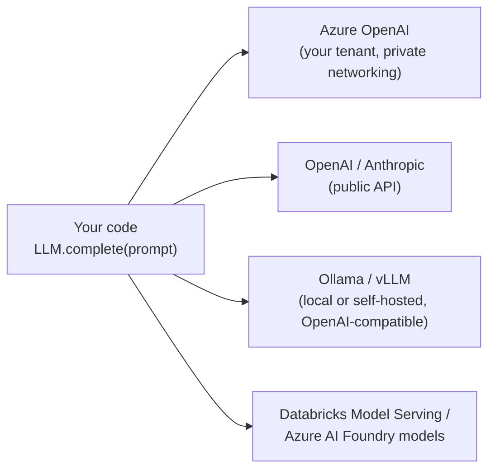
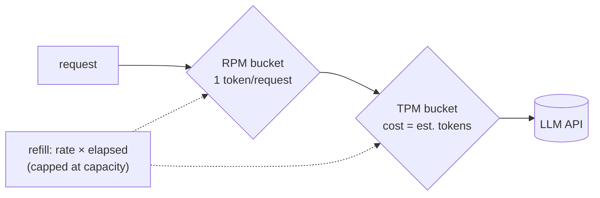
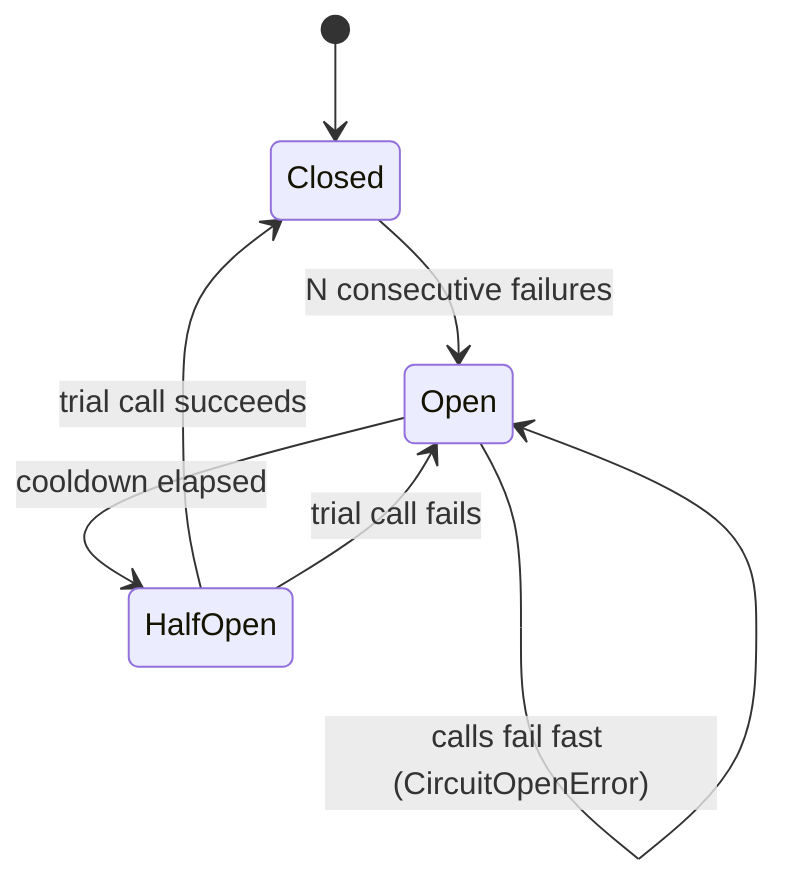
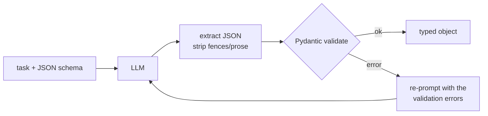

# Deep Dive 2 · Real Models & Embeddings in Production

> **Code:** [`resilience.py`](../../src/ailearn/resilience.py) (retry/backoff, rate limiting, timeout, circuit breaker, fallback, cache), [`structured.py`](../../src/ailearn/structured.py) (Pydantic output + repair) · **Tests:** [`test_resilience_structured.py`](../../tests/test_resilience_structured.py) — 20 tests, instant (fake clocks)

## Contents
1. [Connecting to real models: Azure OpenAI, OpenAI, Ollama, Anthropic](#1-connecting-to-real-models)
2. [Real embeddings: sentence-transformers, Azure OpenAI, batching, caching](#2-real-embeddings)
3. [How LLM APIs fail, and what to do about each failure](#3-how-llm-apis-fail)
4. [Retries with exponential backoff + jitter](#4-retries-with-exponential-backoff--jitter)
5. [Rate limiting: RPM & TPM token buckets](#5-rate-limiting)
6. [Timeouts, circuit breakers, fallbacks, caching](#6-timeouts-circuit-breakers-fallbacks-caching)
7. [Structured output that never breaks your pipeline](#7-structured-output)
8. [Messy PDFs and documents](#8-messy-pdfs-and-documents)
9. [Batch & async throughput](#9-batch--async-throughput)

---

## 1. Connecting to real models



### Azure OpenAI (most relevant for Azure shops)
Key differences from OpenAI: you call **your deployment name** (not the model name), you pass an **API version**, and you should authenticate with **Entra ID** instead of keys in production.

```python
from openai import AzureOpenAI
from azure.identity import DefaultAzureCredential, get_bearer_token_provider

token_provider = get_bearer_token_provider(DefaultAzureCredential(),
                                           "https://cognitiveservices.azure.com/.default")
client = AzureOpenAI(
    azure_endpoint="https://<your-resource>.openai.azure.com/",
    azure_ad_token_provider=token_provider,     # keyless: managed identity in Azure, `az login` locally
    api_version="2024-10-21",                   # check the docs for the current GA version
    timeout=30, max_retries=3,                  # the SDK already retries 429/5xx with backoff!
)
r = client.chat.completions.create(
    model="gpt-4o-mini-prod",                   # ← YOUR deployment name
    messages=[{"role": "user", "content": "Explain Delta Lake time travel in 2 lines."}],
    temperature=0)
print(r.choices[0].message.content, r.usage.total_tokens)
```
Setup checklist: create an Azure OpenAI (or Foundry) resource → deploy a model → grant your identity the **Cognitive Services OpenAI User** role → note the endpoint and deployment name. Quotas are set per deployment in **TPM** (tokens per minute).

> Newer Foundry projects also expose an OpenAI-compatible `/openai/v1` endpoint, so the plain `OpenAI(base_url=..., api_key=...)` client works too. See [Deep Dive 4](04-azure-ai-foundry-and-ai-search.md).

### Ollama (free, local, private)
```bash
ollama pull llama3.1 && ollama pull nomic-embed-text
```
```python
from openai import OpenAI
local = OpenAI(base_url="http://localhost:11434/v1", api_key="ollama")
local.chat.completions.create(model="llama3.1", messages=[{"role": "user", "content": "hi"}])
```
Use it for development, offline work, privacy-sensitive experiments and cheap bulk jobs. Always measure quality against a hosted model on your eval set.

### Plugging into this repo
```python
from ailearn.llm import OpenAICompatibleLLM
from ailearn.resilience import ResilientLLM, TokenBucket

primary = OpenAICompatibleLLM(model="gpt-4o-mini")
backup = OpenAICompatibleLLM(model="llama3.1", base_url="http://localhost:11434/v1", api_key="ollama")
llm = ResilientLLM([primary, backup], max_retries=3, timeout=30,
                   limiter=TokenBucket(rate=50/60, capacity=10))   # ≈50 requests/minute
# llm.complete(...) now drops into RAGPipeline, ReActAgent, build_graph, run_eval...
```

---

## 2. Real embeddings

| Option | Example | Dim | Notes |
|---|---|---|---|
| Local, small, fast | `sentence-transformers/all-MiniLM-L6-v2` | 384 | great for learning; English |
| Local, strong | `BAAI/bge-base-en-v1.5`, `intfloat/e5-base-v2`, `nomic-embed-text` | 768 | check MTEB; some need a **query prefix** (e.g. `"query: "` for E5) |
| Multilingual | `BAAI/bge-m3`, `intfloat/multilingual-e5-base` | 768–1024 | Hindi + English docs |
| Azure OpenAI | `text-embedding-3-small` / `-large` | 1536 / 3072 | supports `dimensions=` to shorten (Matryoshka) |
| Databricks | `databricks-gte-large-en`, `databricks-bge-large-en` | 1024 | managed in Vector Search |

```python
from sentence_transformers import SentenceTransformer
model = SentenceTransformer("BAAI/bge-small-en-v1.5")
vecs = model.encode(["OPTIMIZE compacts small files", "VACUUM removes old files"],
                    batch_size=64, normalize_embeddings=True, show_progress_bar=True)
vecs.shape   # (2, 384)
```
```python
# Azure OpenAI embeddings in batches (API max ~2048 inputs/request; stay well below the token limit)
def embed_all(texts, batch=256):
    out = []
    for i in range(0, len(texts), batch):
        r = client.embeddings.create(model="text-embedding-3-small-deploy", input=texts[i:i+batch])
        out.extend(d.embedding for d in r.data)
    return out
```

**Production rules for embeddings**
1. **Same model and version for documents and queries.** Store `embedding_model` and `embedding_version` next to every vector.
2. **Respect max input length** (often 512 tokens for local models). Longer text is silently truncated, so check your chunk sizes.
3. **Cache by content hash**: `sha256(model + text) → vector`. Re-indexing unchanged chunks then costs nothing.
4. **Normalise** if you use dot product.
5. **Re-embed everything** when you change models. Plan it as a backfill job (Spark + pandas UDF, see [lesson 08](../08-for-data-engineers.md#embeddings-at-scale-with-spark)).

---

## 3. How LLM APIs fail

| Failure | Typical signal | Retry? | Action |
|---|---|---|---|
| Rate limit | HTTP **429**, `Retry-After` header | ✅ | back off (respect `Retry-After`), client-side rate limiting, request a quota increase |
| Overloaded / server error | **500/502/503/529** | ✅ | backoff + jitter; fall back to another region or model |
| Timeout / connection reset | client timeout | ✅ (if idempotent) | set explicit timeouts; retry |
| Bad request | **400** (invalid params, **context length exceeded**) | ❌ | fix the request: trim context, smaller chunks |
| Auth | **401/403** | ❌ | fix credentials or roles; alert |
| Content filter | 400 with a filter code (Azure) | ❌ | handle gracefully; review the prompt |
| Bad output | 200 but invalid JSON or wrong schema | ✅ (repair) | validate + retry with the error ([§7](#7-structured-output)) |

Our `resilience.py` mirrors this taxonomy: `RateLimitError`, `ServerError`, `LLMTimeoutError` (retryable) and `BadRequestError` (never retried, never falls back). ✅ `test_bad_request_is_never_retried`, `test_resilient_llm_does_not_fall_back_on_bad_request`.

---

## 4. Retries with exponential backoff + jitter

```
delay_i = uniform(0, min(cap, base × 2^i))        ← "full jitter"
attempt 1 fails → wait ~0–1s → attempt 2 fails → wait ~0–2s → … → give up after max_retries
```


Without jitter, 1,000 clients that hit a 429 at the same moment all retry at exactly 1s, 2s, 4s… and keep colliding. Random delays spread them out.

```python
from ailearn.resilience import retry, RateLimitError

@retry(max_retries=4, base=1.0, cap=30.0)
def call_llm(prompt):
    ...   # raise RateLimitError(retry_after=float(resp.headers["retry-after"])) on 429
```
✅ Tests: `test_backoff_grows_exponentially_and_is_capped`, `test_full_jitter_stays_within_ceiling`, `test_retry_honours_retry_after_header`.

In real projects: the OpenAI/Azure SDKs already retry (`max_retries=`), so don't stack your retries on top of theirs without thinking, or you'll multiply attempts. For other code, use [tenacity](https://tenacity.readthedocs.io/): `@retry(wait=wait_random_exponential(1, 30), stop=stop_after_attempt(5), retry=retry_if_exception_type(...))`.

---

## 5. Rate limiting

Providers limit **requests per minute (RPM)** *and* **tokens per minute (TPM)**. If you limit yourself on the client side, you avoid 429s instead of only reacting to them.


```python
from ailearn.resilience import TokenBucket
from ailearn.tokenizer import estimate_tokens
rpm = TokenBucket(rate=300/60, capacity=20)           # 300 RPM, bursts of 20
tpm = TokenBucket(rate=200_000/60, capacity=20_000)   # 200k TPM
def guarded_call(prompt):
    rpm.acquire(); tpm.acquire(estimate_tokens(prompt) + 500)   # + expected output
    return client.chat.completions.create(...)
```
✅ Tests: `test_token_bucket_blocks_until_refilled`, `test_token_bucket_tpm_style_cost`.
For multiple processes or pods, keep the bucket in **Redis**, or put an **API gateway** in front (Azure API Management has token-limit policies for Azure OpenAI; Databricks AI Gateway has rate limits).

---

## 6. Timeouts, circuit breakers, fallbacks, caching



| Technique | Why | In repo |
|---|---|---|
| **Timeout** | a hung call blocks a worker forever; set it on the SDK (`timeout=30`) | `call_with_timeout` |
| **Circuit breaker** | stop hammering a failing provider; fail fast and let a fallback take over | `CircuitBreaker` |
| **Fallback chain** | primary model → another region/deployment → smaller/local model → cached or graceful answer | `ResilientLLM([...])` |
| **Exact cache** | identical prompt gives a stored answer (temperature 0 only!) | `ResilientLLM(cache=True)` |
| **Semantic cache** | similar question gives a stored answer (embedding similarity > 0.95); beware personalised or ACL'd answers | exercise |
| **Provider prompt caching** | repeated long prefixes are cheaper and faster; put static content first | provider feature |

✅ Tests: `test_circuit_breaker_opens_then_half_opens`, `test_resilient_llm_falls_back_and_caches`.

---

## 7. Structured output


```python
from pydantic import BaseModel, Field
from ailearn.structured import generate_structured

class DQIssue(BaseModel):
    column: str
    issue_type: str = Field(pattern="^(NULLS|DUPLICATES|SCHEMA_DRIFT|OUTLIER|FRESHNESS)$")
    severity: int = Field(ge=1, le=5)

issue = generate_structured(llm, "orders.amount has 9,999,999 in 12 rows", DQIssue)
```
✅ Tests: `test_structured_output_retries_with_validation_error`, `test_structured_output_gives_up`.

**Prefer native features when available:** OpenAI/Azure `response_format={"type": "json_schema", ...}` or `client.beta.chat.completions.parse(response_format=DQIssue)`, Anthropic tool schemas, Ollama `format=<schema>`, or constrained decoding (Outlines, vLLM guided decoding). Keep the validate step anyway.

---

## 8. Messy PDFs and documents

| Problem | Symptom | Fix |
|---|---|---|
| Scanned PDFs | `extract_text()` returns `""` | OCR: Azure **Document Intelligence**, Tesseract, Docling/Unstructured with OCR |
| Tables | rows flattened into word soup | layout-aware parsers (Document Intelligence *layout* model, Docling, `pdfplumber`); convert tables to Markdown |
| Multi-column layouts | sentences interleaved across columns | layout parser; check reading order |
| Repeated headers/footers | "Confidential – Page 3" in every chunk | detect lines repeated across pages and strip them |
| Hyphenation & line breaks | "trans-\nformation" | normalise whitespace; join hyphenated words |
| Images/diagrams | information lost | caption with a vision model; or page-image retrieval |
| Encoding junk | `\x00`, mojibake | `ftfy`, unicode normalisation |

```python
# a pragmatic parsing ladder: cheap first, escalate when quality is poor
import pypdf, re
def parse_pdf(path):
    pages = [p.extract_text() or "" for p in pypdf.PdfReader(path).pages]
    text = "\n".join(pages)
    if len(text.strip()) < 100 * len(pages):           # very little text → probably scanned
        return ocr_with_document_intelligence(path)     # escalate
    text = re.sub(r"-\n(\w)", r"\1", text)              # join hyphenated words
    return re.sub(r"[ \t]+", " ", text)
```
**Always eyeball 20 parsed documents** before tuning chunking or embeddings. Parsing bugs look like retrieval bugs.

---

## 9. Batch & async throughput

```python
import asyncio
from openai import AsyncOpenAI
client = AsyncOpenAI()
sem = asyncio.Semaphore(8)                      # max 8 requests in flight

async def classify(text):
    async with sem:
        r = await client.chat.completions.create(model="gpt-4o-mini", temperature=0,
                                                 messages=[{"role": "user", "content": f"Classify: {text}"}])
        return r.choices[0].message.content

results = asyncio.run(asyncio.gather(*(classify(t) for t in texts)))   # wrap: return_exceptions=True
```
- For **offline** jobs with thousands to millions of rows, use the provider's **Batch API** (asynchronous, usually discounted) or Databricks `ai_query` / Spark pandas UDFs.
- Make jobs **idempotent**: key results by `sha256(model + prompt_version + input)`, so re-runs skip completed rows.

---

## ✅ Quiz
<details><summary>1. You get 400 "context_length_exceeded". Retry?</summary>No. It's a bad request. Reduce input: fewer or smaller chunks, summarise history, or use a longer-context model.</details>
<details><summary>2. Why add jitter to backoff?</summary>To de-synchronise clients that failed at the same moment, so their retries don't collide again (the thundering herd).</details>
<details><summary>3. Your Azure deployment has 30k TPM. Each request is ~2k input + 500 output tokens. Max sustained requests/min?</summary>30,000 / 2,500 = 12 requests per minute.</details>
<details><summary>4. When is response caching dangerous?</summary>With temperature > 0 if variety is expected, with personalised or permissioned answers (one user's answer served to another), and with time-sensitive data. Include user/ACL scope and a TTL in the cache key.</details>
<details><summary>5. Why store embedding_model with every vector?</summary>Vectors from different models aren't comparable. You need to know which rows to re-embed, and to prevent mixing during a migration.</details>

## 🏋️ Exercises
1. Wrap `OpenAICompatibleLLM` so that it maps real SDK exceptions (`openai.RateLimitError`, `APITimeoutError`, `InternalServerError`, `BadRequestError`) onto our error classes, and use it inside `ResilientLLM`.
2. Implement a **semantic cache** class with the `LLM` interface, using `HashingEmbedder` and a 0.95 threshold, plus tests for a hit, a miss, and an ACL-scope miss.
3. Parse 10 of your real PDFs with pypdf vs Docling or Document Intelligence and compare the output side by side.
4. Embed 1,000 chunks with MiniLM vs BGE-small, run your golden set through `evaluate_retriever`, and record hit-rate@5.

## 📚 Links
- 📖 [Azure OpenAI documentation](https://learn.microsoft.com/en-us/azure/ai-services/openai/) — quotas, keyless auth, structured outputs
- 📖 [OpenAI — Rate limits guide](https://platform.openai.com/docs/guides/rate-limits) · [Structured outputs](https://platform.openai.com/docs/guides/structured-outputs)
- 📖 [AWS Architecture Blog — Exponential backoff and jitter](https://aws.amazon.com/blogs/architecture/exponential-backoff-and-jitter/) (the classic explanation)
- 📖 [tenacity](https://tenacity.readthedocs.io/) · [Sentence-Transformers](https://www.sbert.net/) · [Ollama](https://ollama.com/)
- 📖 [Azure AI Document Intelligence](https://learn.microsoft.com/en-us/azure/ai-services/document-intelligence/) · [Docling](https://github.com/docling-project/docling) · [Unstructured](https://docs.unstructured.io/)
