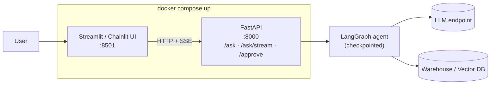

# Deep Dive 3 · Shipping It as an App — async Python, FastAPI, Streaming, UI, Docker

> **Code:** [`src/ailearn/api.py`](../../src/ailearn/api.py) (REST + SSE streaming + approvals), [`apps/streamlit_app.py`](../../apps/streamlit_app.py) (chat UI), [`Dockerfile`](../../Dockerfile), [`docker-compose.yml`](../../docker-compose.yml) · **Tests:** [`test_api.py`](../../tests/test_api.py), `test_ask_stream_emits_node_events`

An agent that only runs in a notebook is a demo. This guide turns it into a service with a UI that you can run with one command and deploy.



## Contents
1. [Async Python in 15 minutes](#1-async-python-in-15-minutes)
2. [FastAPI essentials](#2-fastapi-essentials)
3. [Streaming responses (SSE)](#3-streaming-responses-sse)
4. [UI: Streamlit vs Chainlit vs Gradio](#4-ui-streamlit-vs-chainlit-vs-gradio)
5. [Configuration & secrets](#5-configuration--secrets)
6. [Docker & docker compose](#6-docker--docker-compose)
7. [Deploying](#7-deploying)
8. [Production checklist](#8-production-checklist)

---

## 1. Async Python in 15 minutes

LLM apps spend most of their time **waiting**: on the model, the vector DB, the warehouse. `async` lets one process handle many requests while they wait.

```mermaid
gantt
    title 3 LLM calls of 3 s each
    dateFormat X
    axisFormat %s s
    section Sync - one after another
    LLM request 1 :s1, 0, 3
    LLM request 2 :s2, 3, 6
    LLM request 3 :s3, 6, 9
    section Async - gather
    LLM request 1 :a1, 0, 3
    LLM request 2 :a2, 0, 3
    LLM request 3 :a3, 0, 3
```



```python
import asyncio, time

async def fake_llm(i):
    await asyncio.sleep(1)          # network wait, NOT time.sleep (that blocks the event loop!)
    return f"answer {i}"

async def main():
    t = time.perf_counter()
    results = await asyncio.gather(*(fake_llm(i) for i in range(10)))   # 10 calls concurrently
    print(results[:2], f"{time.perf_counter() - t:.1f}s")               # ~1s, not 10s

asyncio.run(main())
```

| Concept | Meaning |
|---|---|
| `async def` | defines a coroutine; calling it returns an awaitable, not the result |
| `await x` | pause here until `x` finishes; other tasks run meanwhile |
| `asyncio.gather(*aws)` | run concurrently and collect results (`return_exceptions=True` to keep going on errors) |
| `asyncio.Semaphore(n)` | cap concurrency (respect rate limits!) |
| `asyncio.wait_for(aw, timeout)` | timeout for any awaitable |
| `asyncio.to_thread(fn, ...)` | run blocking code (pandas, a sync SDK) without freezing the loop |

**Rules:** never call blocking I/O (`requests`, `time.sleep`, a sync DB driver) inside `async def`. Use async clients (`httpx.AsyncClient`, `AsyncOpenAI`, `asyncpg`) or `asyncio.to_thread`. In FastAPI, a plain `def` endpoint runs in a thread pool automatically, which is fine for sync code like our graph.

---

## 2. FastAPI essentials

```python
from fastapi import FastAPI, HTTPException, Depends
from pydantic import BaseModel, Field

app = FastAPI(title="Data Platform Agent")

class AskRequest(BaseModel):                      # request validation for free (422 on bad input)
    question: str = Field(min_length=3, max_length=2000)
    thread_id: str | None = None

class AskResponse(BaseModel):                     # documented, validated response
    thread_id: str
    status: str
    answer: str | None = None

@app.post("/ask", response_model=AskResponse)
def ask(req: AskRequest):
    ...
```

| Feature | What you get |
|---|---|
| Pydantic models | validation, 422 errors, JSON schema |
| `/docs` | interactive Swagger UI — try every endpoint in the browser |
| `Depends(...)` | dependency injection: auth, DB sessions, per-request config |
| `lifespan` | load models/clients once at startup, close them at shutdown |
| `TestClient` | test endpoints in-process without a server (see [`test_api.py`](../../tests/test_api.py)) |

```python
# lifespan: create expensive clients ONCE
from contextlib import asynccontextmanager
@asynccontextmanager
async def lifespan(app):
    app.state.graph = build_graph(make_llm(), make_conn())
    yield
    # close connections here
app = FastAPI(lifespan=lifespan)
```
```python
# simple API-key auth as a dependency (use Entra ID / OAuth2 in real deployments)
from fastapi import Header
def require_key(x_api_key: str = Header(...)):
    if x_api_key != settings.api_key:
        raise HTTPException(401, "invalid key")

@app.post("/ask", dependencies=[Depends(require_key)])
```

Run it: `uvicorn ailearn.api:app --app-dir src --reload` → open `http://127.0.0.1:8000/docs`.

---

## 3. Streaming responses (SSE)

Users abandon apps that show a spinner for 15 seconds. Stream **progress** (which step is running) and/or **tokens**.

**Server-Sent Events** is a plain HTTP response with `Content-Type: text/event-stream` and lines like:
```
event: node
data: {"node": "retrieve_docs", "trace": ["retrieve_docs: 3 chunks"]}

event: result
data: {"status": "done", "answer": "..."}
```

Our endpoint ([`api.py`](../../src/ailearn/api.py)):
```python
@app.post("/ask/stream")
def ask_stream(req: AskRequest):
    def events():
        for update in graph.stream({"question": req.question}, config, stream_mode="updates"):
            for node, delta in update.items():
                yield f"event: node\ndata: {json.dumps({'node': node})}\n\n"
        yield f"event: result\ndata: {final.model_dump_json()}\n\n"
    return StreamingResponse(events(), media_type="text/event-stream",
                             headers={"Cache-Control": "no-cache", "X-Accel-Buffering": "no"})
```
Try it:
```bash
curl -N -X POST localhost:8000/ask/stream -H 'content-type: application/json' \
     -d '{"question":"total revenue by region"}'
```
✅ Test: `test_ask_stream_emits_node_events` asserts the exact node order `router → generate_sql → validate_sql → run_sql → answer`.

**Token streaming** with a real model: use `graph.astream(..., stream_mode="messages")` inside an `async def` generator, or with plain OpenAI `stream=True`:
```python
stream = client.chat.completions.create(model=..., messages=..., stream=True)
for chunk in stream:
    delta = chunk.choices[0].delta.content or ""
    yield f"data: {json.dumps({'token': delta})}\n\n"
```
Gotchas: proxies buffer output (hence `X-Accel-Buffering: no`), clients must read incrementally (`httpx.stream`, `fetch` + `ReadableStream`), and WebSockets are an alternative when you need two-way communication.

---

## 4. UI: Streamlit vs Chainlit vs Gradio

| | **Streamlit** | **Chainlit** | **Gradio** |
|---|---|---|---|
| Best for | data apps + chat, dashboards | chat-first agent UIs (shows steps/tools natively) | ML demos, Hugging Face Spaces |
| Chat widgets | `st.chat_input`, `st.chat_message`, `st.status` | built in, plus step visualisation, feedback, auth | `gr.ChatInterface` |
| Effort | very low | low | very low |

Our [`apps/streamlit_app.py`](../../apps/streamlit_app.py) consumes `/ask/stream`, shows each graph node live in `st.status`, and renders **Approve/Reject** buttons for paused actions:
```bash
uvicorn ailearn.api:app --app-dir src &        # API
streamlit run apps/streamlit_app.py            # UI → http://localhost:8501
```
Streamlit re-runs the script top to bottom on every interaction, so keep conversation state in `st.session_state`.

Chainlit sketch (shows tool steps automatically with its LangChain callback):
```python
import chainlit as cl
@cl.on_message
async def on_message(msg: cl.Message):
    async with cl.Step(name="agent") as step:
        result = await call_agent(msg.content)
        step.output = result["trace"]
    await cl.Message(content=result["answer"]).send()
```

---

## 5. Configuration & secrets

```python
# pip install pydantic-settings
from pydantic_settings import BaseSettings, SettingsConfigDict

class Settings(BaseSettings):
    model_config = SettingsConfigDict(env_file=".env")
    openai_api_key: str | None = None
    model: str = "gpt-4o-mini"
    warehouse_url: str
    max_sql_attempts: int = 3

settings = Settings()          # reads env vars / .env, validates types, fails fast at startup
```
- `.env` is for local development only and stays in `.gitignore` (already set up here).
- In Azure, use **Key Vault** + **managed identity**. In Databricks, use **secret scopes** (`dbutils.secrets.get`). In CI, use **GitHub Actions secrets**.
- Never log prompts that contain secrets or PII. Redact before logging.

---

## 6. Docker & docker compose

[`Dockerfile`](../../Dockerfile) highlights:
```dockerfile
FROM python:3.12-slim AS build                 # 1) build stage installs deps
RUN pip install --prefix=/install ".[graph]"
FROM python:3.12-slim                          # 2) slim runtime copies only what's needed
COPY --from=build /install /usr/local
RUN useradd --create-home appuser
USER appuser                                   # don't run as root
HEALTHCHECK ... /health                        # orchestrators restart unhealthy containers
CMD ["uvicorn", "ailearn.api:app", "--host", "0.0.0.0", "--port", "8000", "--workers", "2"]
```
```bash
docker build -t dp-agent .
docker run -p 8000:8000 --env-file .env dp-agent
docker compose up --build        # API :8000 + Streamlit UI :8501 (docker-compose.yml)
```
| Concept | Why |
|---|---|
| multi-stage build | smaller, safer image (no compilers) |
| `.dockerignore` | keeps `.git`, `.env`, caches out of the image |
| non-root user | limits damage if compromised |
| env vars for config | same image runs in dev/test/prod |
| healthcheck | auto-restart and safe rollouts |
| pinned versions | reproducible builds (`pip freeze`, or `uv lock`) |

---

## 7. Deploying

| Target | Good for | Notes |
|---|---|---|
| **Azure Container Apps** | Azure shops; scale-to-zero; managed identity → Azure OpenAI/Key Vault | `az containerapp up --source .` builds and deploys from the Dockerfile |
| **Azure App Service (containers)** | simple web apps | built-in auth (Entra ID) |
| **Databricks Apps** | apps next to your lakehouse data, Unity Catalog permissions | supports FastAPI/Streamlit; the recommended home for Databricks agents |
| **AKS / Kubernetes** | large platforms | more ops work |
| **Hugging Face Spaces / Streamlit Community Cloud** | free public demos for your portfolio | no private data! |

CI/CD sketch: GitHub Actions → run `pytest` + the eval gate ([Deep Dive 5](05-evaluation-and-observability.md)) → build image → push to Azure Container Registry → deploy a new revision → smoke-test `/health` → shift traffic.

---

## 8. Production checklist
- [ ] Input validation & size limits (Pydantic) · request timeouts · rate limiting per user
- [ ] AuthN (Entra ID/OAuth) and AuthZ: **who may approve actions?**
- [ ] Persistent checkpointer (Postgres) · one active run per thread
- [ ] Streaming for long answers · graceful error messages (no stack traces to users)
- [ ] Structured logs with request id/thread id · tracing · metrics (latency p50/p95, tokens, cost)
- [ ] Secrets from Key Vault / env, never in code or images
- [ ] Container: non-root, healthcheck, pinned deps, small image
- [ ] Load test (`locust`/`k6`) at the expected concurrency and watch for 429s

## ✅ Quiz
<details><summary>1. You call `time.sleep(2)` inside an `async def` endpoint. What happens under load?</summary>It blocks the whole event loop, so every other request on that worker stalls. Use <code>await asyncio.sleep</code> or move blocking work to <code>asyncio.to_thread</code> (or use a sync <code>def</code> endpoint).</details>
<details><summary>2. Why does FastAPI return 422?</summary>The request body or params failed Pydantic validation.</details>
<details><summary>3. SSE vs WebSockets for an LLM chat?</summary>SSE: simple one-way server→client stream over plain HTTP, which is enough for streaming answers. WebSockets: two-way, persistent, needed for things like interrupting generation mid-stream or real-time collaboration.</details>
<details><summary>4. Why a multi-stage Docker build?</summary>The final image contains only runtime files: it's smaller, faster to pull, and exposes less attack surface.</details>
<details><summary>5. Where do secrets go in Azure Container Apps?</summary>Key Vault references or Container Apps secrets, accessed through managed identity, injected as env vars. Never baked into the image or committed to Git.</details>

## 🏋️ Exercises
1. Add `GET /ask/stream?q=...` so a browser `EventSource` can consume it, and build a 30-line HTML page that streams node events.
2. Convert `/ask` to `async def` using `graph.ainvoke`, and add `asyncio.wait_for` with a 60 s timeout that returns HTTP 504.
3. Add API-key auth via `Depends` and a test that a missing key returns 401.
4. `docker compose up`, then deploy the API to Azure Container Apps with managed identity to Azure OpenAI (`USE_REAL_LLM=1`).
5. Port the UI to Chainlit and show each node as a `cl.Step`.

## 📚 Links
- 📖 [FastAPI tutorial](https://fastapi.tiangolo.com/tutorial/) · [FastAPI — async & concurrency explained](https://fastapi.tiangolo.com/async/)
- 📖 [Python asyncio docs](https://docs.python.org/3/library/asyncio.html) · [Real Python — Async IO in Python](https://realpython.com/async-io-python/)
- 📖 [MDN — Server-sent events](https://developer.mozilla.org/en-US/docs/Web/API/Server-sent_events)
- 📖 [Streamlit — Build a basic LLM chat app](https://docs.streamlit.io/develop/tutorials/chat-and-llm-apps/build-conversational-apps) · [Chainlit docs](https://docs.chainlit.io/) · [Gradio](https://www.gradio.app/)
- 📖 [Docker — Python guide](https://docs.docker.com/guides/python/) · [Azure Container Apps docs](https://learn.microsoft.com/en-us/azure/container-apps/) · [Databricks Apps](https://docs.databricks.com/en/dev-tools/databricks-apps/index.html)
- 📖 [pydantic-settings](https://docs.pydantic.dev/latest/concepts/pydantic_settings/)
