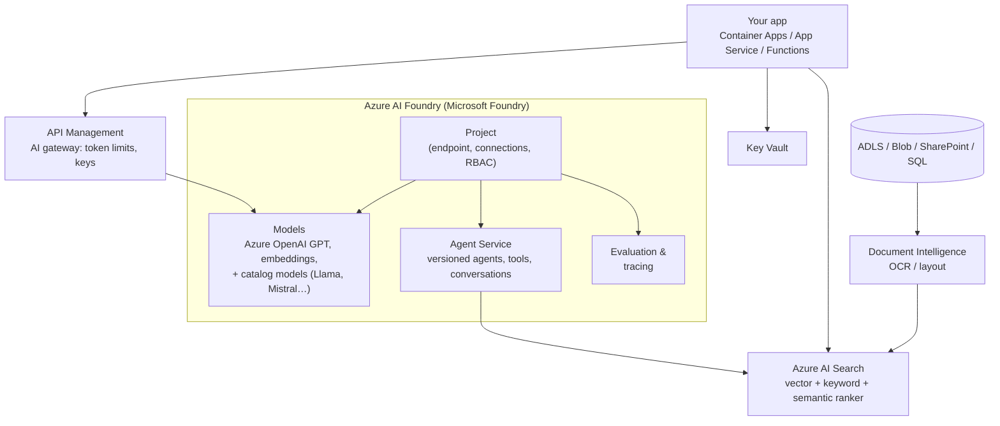
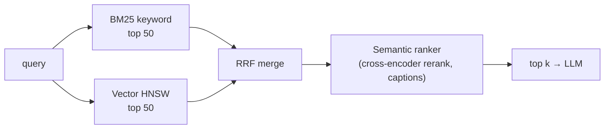
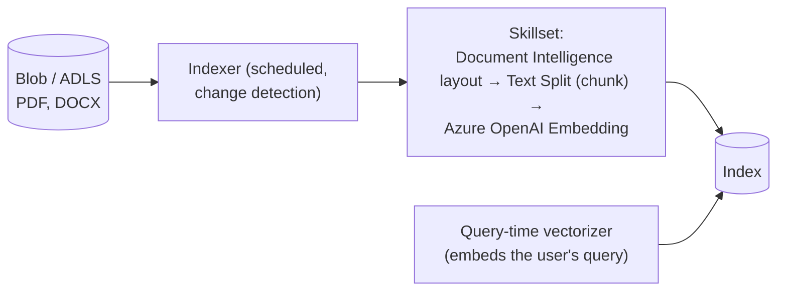
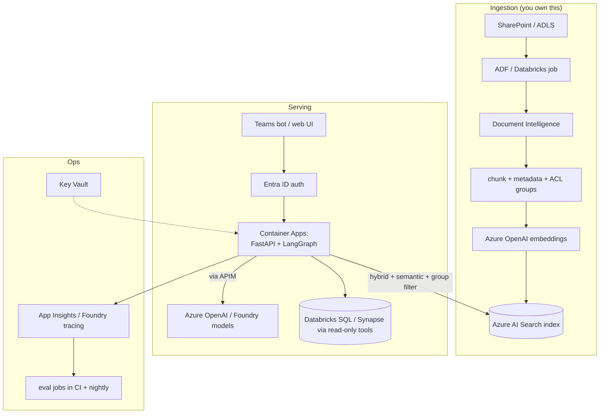

# Deep Dive 4 · Your Cloud Stack: Azure AI Foundry, Azure AI Search (+ Databricks recap)

> These examples need an Azure subscription; they can't run in this repo's offline tests. **Azure GenAI SDKs change fast.** The Foundry agents SDK was redesigned in `azure-ai-projects` 2.x, so code written for 1.x (`create_agent`, threads, runs) no longer works there. Always compare with the linked quickstarts.

## Contents
1. [The Azure GenAI map](#1-the-azure-genai-map)
2. [Azure AI Search for RAG — concepts](#2-azure-ai-search-for-rag--concepts)
3. [Azure AI Search — build an index & query it (Python)](#3-azure-ai-search--build-an-index--query-it)
4. [Integrated vectorization & indexers (no-code ingestion)](#4-integrated-vectorization--indexers)
5. [Azure AI Foundry: projects, models, agents](#5-azure-ai-foundry-projects-models-agents)
6. [Security & networking for enterprise RAG](#6-security--networking)
7. [Azure vs Databricks — which to use when](#7-azure-vs-databricks)
8. [Reference architecture on Azure](#8-reference-architecture-on-azure)

---

## 1. The Azure GenAI map



| Service | Role in an LLM/RAG/agent system |
|---|---|
| **Azure OpenAI / Foundry models** | chat and embedding models deployed in your tenant, with quotas in TPM |
| **Azure AI Search** | the retrieval engine: vector + BM25 hybrid, filters, semantic reranker, security trimming |
| **Azure AI Foundry** | the umbrella: projects, model catalog, agent service, evaluations, tracing, content safety |
| **Document Intelligence** | parse PDFs/scans/tables before indexing |
| **API Management** | gateway in front of models: auth, token-rate limits, load-balancing across deployments |
| **Container Apps / Functions** | host your FastAPI/LangGraph app ([Deep Dive 3](03-shipping-apps.md)) |

---

## 2. Azure AI Search for RAG — concepts

| Concept | Meaning |
|---|---|
| **Index** | schema of fields: key, text (searchable), filterable/facetable fields, **vector fields** (with dimensions + vector profile) |
| **Vector profile** | links a vector field to an algorithm config (**HNSW** or exhaustive KNN) and optionally a **vectorizer** (embeds queries for you) |
| **Hybrid query** | `search_text` (BM25) + `vector_queries` in the same request, merged with **RRF** |
| **Semantic ranker** | a Microsoft cross-encoder that reranks the top 50 results; adds captions and answers. Needs a *semantic configuration* |
| **Filters** | OData `$filter` (e.g. `team eq 'platform' and year ge 2025`); vector filter mode pre/post |
| **Security trimming** | filter on a `group_ids` field using the caller's groups, so users only retrieve what they may see |
| **Indexer + skillset** | pull from Blob/ADLS/SQL/SharePoint on a schedule, chunk ("split"), embed, write to the index |


Microsoft's guidance is to give the semantic ranker the maximum number of input documents (50). Filters that are too selective leave the ranker with fewer documents to work with.

---

## 3. Azure AI Search — build an index & query it

```bash
pip install azure-search-documents azure-identity openai
```
```python
import os
from azure.identity import DefaultAzureCredential
from azure.search.documents import SearchClient
from azure.search.documents.indexes import SearchIndexClient
from azure.search.documents.indexes.models import (
    SearchIndex, SimpleField, SearchableField, SearchField, SearchFieldDataType,
    VectorSearch, HnswAlgorithmConfiguration, VectorSearchProfile,
    SemanticSearch, SemanticConfiguration, SemanticPrioritizedFields, SemanticField)

ENDPOINT, INDEX = os.environ["SEARCH_ENDPOINT"], "runbooks"
cred = DefaultAzureCredential()                       # needs "Search Index Data Contributor" + "Search Service Contributor"

fields = [
    SimpleField(name="id", type=SearchFieldDataType.String, key=True),
    SearchableField(name="title", type=SearchFieldDataType.String),
    SearchableField(name="content", type=SearchFieldDataType.String),
    SimpleField(name="team", type=SearchFieldDataType.String, filterable=True, facetable=True),
    SimpleField(name="group_ids", type=SearchFieldDataType.Collection(SearchFieldDataType.String), filterable=True),
    SearchField(name="content_vector", type=SearchFieldDataType.Collection(SearchFieldDataType.Single),
                searchable=True, vector_search_dimensions=1536, vector_search_profile_name="hnsw-profile"),
]
index = SearchIndex(
    name=INDEX, fields=fields,
    vector_search=VectorSearch(
        algorithms=[HnswAlgorithmConfiguration(name="hnsw")],
        profiles=[VectorSearchProfile(name="hnsw-profile", algorithm_configuration_name="hnsw")]),
    semantic_search=SemanticSearch(configurations=[SemanticConfiguration(
        name="default", prioritized_fields=SemanticPrioritizedFields(
            title_field=SemanticField(field_name="title"),
            content_fields=[SemanticField(field_name="content")]))]))
SearchIndexClient(ENDPOINT, cred).create_or_update_index(index)
```
```python
# upload chunks (embeddings from Azure OpenAI; see Deep Dive 2 for batching)
search = SearchClient(ENDPOINT, INDEX, cred)
docs = [{"id": "adf-0", "title": "ADF errors", "team": "platform", "group_ids": ["de-team"],
         "content": "Error 2200 in a copy activity means a user configuration problem...",
         "content_vector": embed("Error 2200 in a copy activity means...")}]
search.merge_or_upload_documents(docs)       # idempotent upsert by key
```
```python
# HYBRID + SEMANTIC query with security trimming
from azure.search.documents.models import VectorizedQuery

q = "what does copy activity error 2200 mean?"
results = search.search(
    search_text=q,                                                        # BM25
    vector_queries=[VectorizedQuery(vector=embed(q), k_nearest_neighbors=50, fields="content_vector")],
    filter="group_ids/any(g: search.in(g, 'de-team,all-staff'))",          # caller's groups
    query_type="semantic", semantic_configuration_name="default",          # rerank top 50
    select=["id", "title", "content"], top=5)
for r in results:
    print(r["@search.reranker_score"], r["title"])
```
Then feed the top 5 into the RAG prompt from [lesson 04](../04-rag.md#6-generation--the-prompt). For a LangGraph agent, wrap this function as a tool or as a retrieve node.

---

## 4. Integrated vectorization & indexers

For many enterprise sources you don't have to write the ingestion pipeline yourself:


- The **Import and vectorize data** wizard in the portal builds this end to end (data source, skillset, index, indexer).
- **Trade-off:** fast to set up, with fewer moving parts. Custom pipelines (Databricks/Spark, [lesson 08](../08-for-data-engineers.md)) give more control over parsing, chunking, metadata and testing. As a data engineer you'll often run custom ingestion and push documents to the index.

---

## 5. Azure AI Foundry: projects, models, agents

### 5.1 Call a model through a Foundry project (SDK 2.x)
```bash
pip install "azure-ai-projects>=2.0.0" azure-identity
az login
```
```python
from azure.identity import DefaultAzureCredential
from azure.ai.projects import AIProjectClient

project = AIProjectClient(endpoint="https://<resource>.services.ai.azure.com/api/projects/<project>",
                          credential=DefaultAzureCredential())
openai = project.get_openai_client()                 # an OpenAI-compatible client for this project
r = openai.responses.create(model="gpt-5-mini",       # your deployment name
                            input="Explain Z-ordering in two sentences.")
print(r.output_text)
```

### 5.2 Create a versioned prompt agent and chat with it
```python
from azure.ai.projects.models import PromptAgentDefinition

agent = project.agents.create_version(
    agent_name="dp-assistant",
    definition=PromptAgentDefinition(
        model="gpt-5-mini",
        instructions="You are a data-platform assistant. Answer concisely; say when you don't know."))

conversation = openai.conversations.create()          # multi-turn state lives server-side
resp = openai.responses.create(
    conversation=conversation.id,
    extra_body={"agent_reference": {"name": "dp-assistant", "type": "agent_reference"}},
    input="What's the difference between OPTIMIZE and VACUUM?")
print(resp.output_text)
```
Agents in Foundry are **versioned**: you create versions and route traffic to them. Tools (Azure AI Search, code interpreter, function tools, MCP servers, Bing grounding) are added to the agent definition. Follow the current "tools" docs for the exact classes, because they're still changing.

### 5.3 Hosted agent vs your own LangGraph app
| | Foundry Agent Service | Your LangGraph app (Container Apps) |
|---|---|---|
| Control flow | model-driven tool loop | your graph: routing, retries, approvals |
| State | conversations stored by the service | your checkpointer |
| Ops | managed, versioned, built-in eval and tracing | you run it (more control, more work) |
| Best for | assistants with standard tools, fast delivery | complex workflows, strict guardrails, custom UI |

They also combine: a LangGraph app can call Foundry models and Azure AI Search, or a Foundry agent can call your MCP server ([Deep Dive 6](06-mcp-hands-on.md)) as a tool.

### 5.4 Evaluation & safety in Foundry
Foundry provides built-in evaluators (groundedness, relevance, coherence, safety), red-teaming, tracing to Application Insights, and **Azure AI Content Safety** (prompt shields against prompt injection and jailbreaks, harmful-content filters). Use them alongside the code-level evals in [Deep Dive 5](05-evaluation-and-observability.md).

---

## 6. Security & networking

- **Keyless auth everywhere:** managed identity + RBAC (Cognitive Services OpenAI User, Search Index Data Reader). Disable API keys where possible.
- **Private endpoints** for Azure OpenAI, AI Search and Storage; turn off public network access.
- **Security trimming** in AI Search (the `group_ids` filter above), fed from the user's Entra ID groups.
- **Content filters + prompt shields** on model deployments.
- **APIM AI gateway:** token-limit policies per app or team, load-balancing across regional deployments, logging.
- **Data residency:** pick regions and deployment types (standard vs global) to match your compliance needs.

---

## 7. Azure vs Databricks

| Need | Prefer |
|---|---|
| Docs in SharePoint/Blob, Microsoft-centric enterprise, M365/Teams integration | **Azure AI Search + Foundry** |
| Data already in Delta/Unity Catalog, lineage & governance on the lakehouse, Spark ingestion | **Databricks Vector Search + Mosaic AI** ([lesson 10](../10-hands-on-langgraph-databricks.md)) |
| Strongest hybrid + semantic reranking out of the box | Azure AI Search |
| Agents that query governed tables via UC functions | Databricks |
| Both | common: ingest with Databricks → push chunks to Azure AI Search, **or** use Azure OpenAI models from Databricks via external model endpoints |

Your edge as an Azure + Databricks data engineer: you can own the **whole pipeline** — ADF/Databricks ingestion, Delta medallion, an index in either platform, an agent on top, and evals in CI.

---

## 8. Reference architecture on Azure



## ✅ Quiz
<details><summary>1. In Azure AI Search, what does the semantic ranker rerank?</summary>The top results (up to 50) of the keyword, vector or hybrid query, re-scored by a cross-encoder model. It doesn't search the whole index itself.</details>
<details><summary>2. How do you stop a user retrieving HR documents they can't access?</summary>Store allowed group ids on each chunk and apply a filter with the caller's Entra ID groups on every query (security trimming). Never rely on the LLM to hide content.</details>
<details><summary>3. Your Foundry code calls client.agents.create_agent and threads.create and fails on azure-ai-projects 2.x. Why?</summary>The 2.x SDK replaced that 1.x/classic API with versioned agents (<code>create_version</code>) and OpenAI-compatible conversations/responses.</details>
<details><summary>4. When choose the Indexer + skillset over a custom Spark pipeline?</summary>For standard document sources where built-in parsing and chunking are good enough and you want minimal code. Choose custom pipelines when you need control over parsing, metadata, testing or complex transformations.</details>
<details><summary>5. Why put API Management in front of Azure OpenAI?</summary>Central auth, per-consumer token limits, load-balancing and failover across deployments and regions, usage logging and chargeback.</details>

## 🏋️ Exercises
1. Create a free-tier Azure AI Search service, index the docs from `tests/conftest.py` with embeddings, and compare keyword vs vector vs hybrid vs hybrid+semantic on 10 questions using `evaluate_retriever`.
2. Write `AzureSearchRetriever` with the same `retrieve(question, k)` interface as `RAGPipeline`, and plug it into `build_graph`.
3. Create a Foundry prompt agent and call it from the FastAPI app as a fallback model.
4. Add security trimming: two users with different groups get different answers to the same question. Write the test.

## 📚 Links
- 📖 [Azure AI Search — RAG overview](https://learn.microsoft.com/en-us/azure/search/retrieval-augmented-generation-overview) · [Hybrid search](https://learn.microsoft.com/en-us/azure/search/hybrid-search-overview) · [Semantic ranking query how-to](https://learn.microsoft.com/en-us/azure/search/semantic-how-to-query-request) · [Vector search overview](https://learn.microsoft.com/en-us/azure/search/vector-search-overview)
- 📖 [azure-search-documents Python reference](https://learn.microsoft.com/en-us/python/api/azure-search-documents/azure.search.documents.models?view=azure-python)
- 📖 [Microsoft Foundry — Get started with code](https://learn.microsoft.com/azure/foundry/quickstarts/get-started-code) · [Prompt agent quickstart](https://learn.microsoft.com/azure/foundry/agents/quickstarts/prompt-agent)
- 📖 [Azure OpenAI docs](https://learn.microsoft.com/en-us/azure/ai-services/openai/) · [Azure AI Document Intelligence](https://learn.microsoft.com/en-us/azure/ai-services/document-intelligence/)
- 💻 [Azure-Samples/azure-search-openai-demo (reference RAG app)](https://github.com/Azure-Samples/azure-search-openai-demo)
- 🎓 [Microsoft Learn — Azure AI Engineer certification & learning paths](https://learn.microsoft.com/en-us/credentials/) (check the current exam code; Microsoft refreshes AI exams often)
