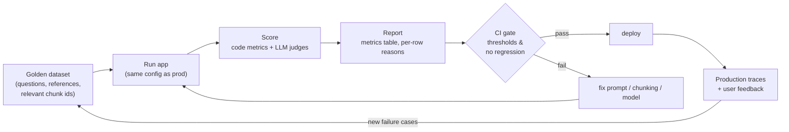
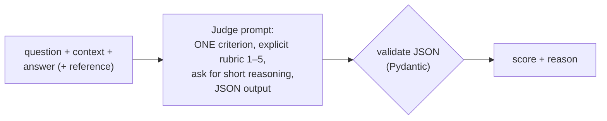
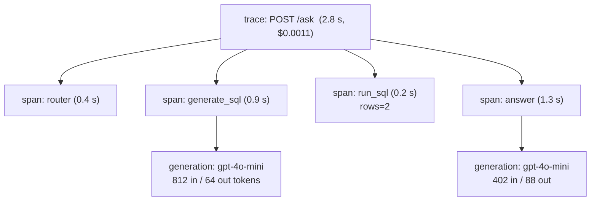

# Deep Dive 5 · Evaluation & Observability in Practice

> **Code:** [`src/ailearn/llm_judge.py`](../../src/ailearn/llm_judge.py) (LLM-as-judge with rubrics + eval runner + CI gate), [`src/ailearn/evaluation.py`](../../src/ailearn/evaluation.py) (retrieval metrics) · **Tests:** `test_llm_judge_parses_verdict`, `test_run_eval_aggregates_and_gates_regressions`

> "If you can't measure it, you can't improve it." In interviews, the people who stand out answer *"how do you know it works?"* with numbers.

## Contents
1. [The evaluation loop](#1-the-evaluation-loop)
2. [Building a golden dataset](#2-building-a-golden-dataset)
3. [Metric menu: what to measure at each layer](#3-metric-menu)
4. [LLM-as-a-judge done right](#4-llm-as-a-judge-done-right)
5. [Our eval runner + CI gate](#5-our-eval-runner--ci-gate)
6. [RAGAS](#6-ragas)
7. [DeepEval (pytest-style)](#7-deepeval)
8. [Observability: traces with Langfuse (and alternatives)](#8-observability-traces)
9. [Online evaluation, feedback & monitoring](#9-online-evaluation-feedback--monitoring)
10. [Putting numbers in your README](#10-putting-numbers-in-your-readme)

---

## 1. The evaluation loop



Three kinds of evaluation:
| Kind | When | What |
|---|---|---|
| **Offline** | every change (CI), nightly | golden set → metrics → gate |
| **Online** | continuously in prod | sample traces → LLM judges; dashboards; alerts |
| **Human** | weekly / before launches | review queues, side-by-side comparisons, label disagreements |

---

## 2. Building a golden dataset

| Source | How |
|---|---|
| Real user questions | export from logs or support tickets (anonymise!) — the most valuable source |
| Domain experts | ask the data platform team for 20 "questions we get every week" + correct answers |
| Synthetic | LLM generates Q&A pairs from your chunks (RAGAS/DeepEval synthesizers) — then **human-review** them |
| Failure cases | every bug report and 👎 becomes a new row |

Row shape (JSONL):
```json
{"id": "q017", "question": "What does ADF copy error 2200 mean?", "reference": "A user configuration problem with the source or sink.", "relevant_chunks": ["adf#0"], "tags": ["errors", "easy"], "route": "docs"}
```
Tips: 50–200 rows is enough to start · cover every route (SQL/docs/action) and the "I don't know" case · include adversarial rows (prompt injection, out-of-scope) · version the dataset in Git · keep a hold-out set you don't tune against.

---

## 3. Metric menu

| Layer | Metric | Needs | How |
|---|---|---|---|
| Retrieval | hit-rate@k, recall@k, MRR, nDCG | relevant chunk ids | code ([`evaluation.py`](../../src/ailearn/evaluation.py)) |
| Retrieval | context precision / recall | reference answer | LLM judge (RAGAS) |
| Generation | **faithfulness / groundedness** | answer + context | LLM judge (or NLI model) |
| Generation | answer relevance | question + answer | LLM judge / embeddings |
| Generation | correctness | reference | LLM judge, token F1, exact match |
| SQL agent | **execution accuracy** | gold SQL | run both, compare result sets |
| Agent | task success, tool-call correctness, steps, trajectory | expected tools/outcome | code + judge |
| Safety | toxicity, PII leakage, prompt-injection resistance | adversarial rows | classifiers, judges, red-teaming |
| System | latency p50/p95, tokens & cost per query, error rate | traces | observability tools |

Rule of thumb: **use code metrics wherever possible** (cheap, deterministic) and LLM judges for the semantic parts.

---

## 4. LLM-as-a-judge done right



**Rules**
1. **One criterion per judge call.** "Rate quality" is vague. "Is every claim supported by the context?" is measurable.
2. **Explicit rubric anchors** (what a 1, 3 and 5 mean). See `RUBRICS` in [`llm_judge.py`](../../src/ailearn/llm_judge.py).
3. **Structured output** with validation (we reuse `generate_structured`).
4. **Calibrate:** label 30–50 rows yourself, compare with the judge, and iterate on the rubric until agreement is high. Report the agreement.
5. **Use a strong judge, temperature 0**, and ideally a different model family from the one being judged (reduces self-preference bias).
6. Know the biases: **position bias** (in A-vs-B, swap the order and average), **verbosity bias** (longer answers look better), **self-preference**.
7. Binary pass/fail is often more reliable than 1–10 scales.

```python
from ailearn.llm_judge import llm_judge
v = llm_judge(judge_llm, "faithfulness", question, answer, context=ctx)
print(v.score, v.reasoning)     # 2 "Claims Snowflake invented gold layers; the context does not say so."
```

---

## 5. Our eval runner + CI gate

```python
from ailearn.llm_judge import run_eval
from ailearn.rag import RAGPipeline

rag = RAGPipeline(top_k=3, hybrid=True); rag.add_documents(DOCS)
def app(q):
    ans = rag.ask(q)
    return ans.answer, "\n".join(s.text for s in ans.sources)

report = run_eval(app, golden_rows, judge=judge_llm,
                  criteria=("faithfulness", "answer_relevance", "correctness"),
                  thresholds={"faithfulness": 0.8, "answer_relevance": 0.7},
                  baseline=json.load(open("eval/baseline.json")))   # last accepted run
print(report.to_markdown())
assert report.passed, report.failures                               # fails CI on regression
```

GitHub Actions job (runs with a real judge model when the secret exists):
```yaml
  eval:
    runs-on: ubuntu-latest
    env:
      OPENAI_API_KEY: ${{ secrets.OPENAI_API_KEY }}            # `secrets` can't be used in a job-level `if:`
    steps:
      - uses: actions/checkout@v4
      - uses: actions/setup-python@v5
        with: { python-version: "3.12" }
      - run: pip install -e ".[dev,graph,real]"
      - name: Run eval gate
        if: env.OPENAI_API_KEY != ''                            # skip cleanly on forks without the secret
        run: |
          python eval/run_eval.py --out eval/report.md          # your script calling run_eval
          cat eval/report.md >> "$GITHUB_STEP_SUMMARY"          # the metrics table shows on the run page
```
✅ `test_run_eval_aggregates_and_gates_regressions` proves aggregation, normalisation (1–5 → 0–1), threshold failures and baseline-drop detection.

---

## 6. RAGAS

[RAGAS](https://docs.ragas.io/) is a widely used open-source RAG evaluation library. It centres on a sample with **user_input, response, retrieved_contexts, reference**, wrapped in an `EvaluationDataset`, with metrics such as `Faithfulness`, `ResponseRelevancy`/`AnswerRelevancy`, `LLMContextRecall`, `LLMContextPrecisionWithReference` and `FactualCorrectness`.

```python
# pip install ragas langchain-openai     (API moves quickly; check docs.ragas.io for your version)
from ragas import EvaluationDataset, evaluate
from ragas.llms import LangchainLLMWrapper
from ragas.metrics import Faithfulness, LLMContextRecall, FactualCorrectness
from langchain_openai import ChatOpenAI

rows = []
for item in golden_rows:
    ans = rag.ask(item["question"])
    rows.append({"user_input": item["question"], "response": ans.answer,
                 "retrieved_contexts": [s.text for s in ans.sources], "reference": item["reference"]})

judge = LangchainLLMWrapper(ChatOpenAI(model="gpt-4o-mini", temperature=0))
result = evaluate(dataset=EvaluationDataset.from_list(rows),
                  metrics=[Faithfulness(), LLMContextRecall(), FactualCorrectness()], llm=judge)
print(result)                 # aggregate scores
result.to_pandas()            # per-row scores → find the worst rows and read them!
```
Notes: faithfulness makes several judge calls per sample, so the judge model is your main eval cost. Recent RAGAS versions are moving metrics to a new async "collections" API, so check which style your installed version expects.

---

## 7. DeepEval

[DeepEval](https://github.com/confident-ai/deepeval) makes evals feel like **unit tests**: build an `LLMTestCase`, pick metrics with thresholds, and call `assert_test` inside pytest.

```python
# tests/test_rag_quality.py      pip install deepeval      run: deepeval test run tests/test_rag_quality.py  (or pytest)
import pytest
from deepeval import assert_test
from deepeval.test_case import LLMTestCase, LLMTestCaseParams
from deepeval.metrics import AnswerRelevancyMetric, FaithfulnessMetric, GEval

correct_sql_explanation = GEval(
    name="Explains with evidence",
    criteria="The answer must state the numeric result and mention which table it came from.",
    evaluation_params=[LLMTestCaseParams.INPUT, LLMTestCaseParams.ACTUAL_OUTPUT],
    threshold=0.7)

@pytest.mark.parametrize("q", ["What does ADF error 2200 mean?", "How often should OPTIMIZE run?"])
def test_rag_answer(q):
    ans = rag.ask(q)
    case = LLMTestCase(input=q, actual_output=ans.answer,
                       retrieval_context=[s.text for s in ans.sources])
    assert_test(case, [AnswerRelevancyMetric(threshold=0.7), FaithfulnessMetric(threshold=0.8)])
```
**RAGAS vs DeepEval vs this repo:** RAGAS is RAG-metric-centric and dataset-oriented. DeepEval is pytest-native with many metrics (G-Eval, hallucination, bias, conversational, agentic) plus synthesizers and red-teaming. Our `llm_judge.py` is ~100 lines so you understand what both are doing. Platform options include MLflow `mlflow.genai.evaluate` (Databricks, [lesson 10](../10-hands-on-langgraph-databricks.md)), Azure AI Foundry evaluators, and promptfoo (YAML-driven, great for prompt A/B tests).

---

## 8. Observability: traces

A **trace** is the tree of everything that happened for one request: the graph run → each node → each LLM call (prompt, output, tokens, cost, latency) → each tool call.



### Langfuse (open source, self-hostable or cloud)
```python
# pip install langfuse   ; env: LANGFUSE_PUBLIC_KEY, LANGFUSE_SECRET_KEY, LANGFUSE_HOST
from langfuse import observe, get_client

@observe()                                   # creates a span; nested @observe calls nest automatically
def retrieve(q):
    return rag.retrieve(q)

@observe(as_type="generation")               # marks an LLM call (model, tokens, cost shown in UI)
def generate(prompt):
    return llm.complete(prompt)

@observe()
def answer(q):
    ctx = retrieve(q)
    return generate(build_prompt(q, ctx))

answer("What does error 2200 mean?")
get_client().flush()                         # in short-lived scripts
```
LangChain/LangGraph integration: one callback captures every node, LLM and tool call:
```python
from langfuse.langchain import CallbackHandler
graph.invoke(inputs, config={"callbacks": [CallbackHandler()], "configurable": {"thread_id": "t1"}})
```
⚠️ The Langfuse Python SDK has had several major versions (v2 → v3 → v4) with breaking changes, such as the move to `from langfuse import observe, get_client`. Match your code to the docs for the version you install.

| Tool | Notes |
|---|---|
| **Langfuse** | open source, self-host, traces + prompt management + datasets/experiments + scores |
| **LangSmith** | LangChain's platform; excellent for LangGraph |
| **Arize Phoenix** | open source, OpenTelemetry/OpenInference-based, strong eval features |
| **MLflow Tracing** | built into Databricks (`mlflow.langchain.autolog()`) |
| **Azure Monitor / App Insights + Foundry tracing** | Azure-native, OpenTelemetry |

**Standardise on OpenTelemetry** where you can (the GenAI semantic conventions), so you're not locked into one vendor.

---

## 9. Online evaluation, feedback & monitoring
- **Sample 1–10% of production traces** and run judges (faithfulness, relevance, safety) asynchronously. Chart the scores over time.
- **Capture user feedback** (👍/👎 + comment) linked to the trace id. Every 👎 gets triaged into a new golden row.
- **Dashboards:** requests, p95 latency, tokens/cost per day per team, error rate, "I don't know" rate, tool error rate, approval rejection rate.
- **Alerts:** cost spikes, latency regressions, judge scores dropping, a surge of 429s.
- **Drift:** new question topics the index can't answer → missing documents → work for the ingestion team (that's you!).

---

## 10. Putting numbers in your README

Interviewers love this section. Example:

| Config | hit-rate@5 | faithfulness | answer relevance | p95 latency | cost / 1k queries |
|---|---|---|---|---|---|
| dense, chunk 800 | 0.78 | 0.81 | 0.84 | 2.9 s | $0.62 |
| + hybrid (BM25 + RRF) | 0.88 | 0.83 | 0.86 | 3.0 s | $0.63 |
| + cross-encoder rerank, k=4 | **0.93** | **0.90** | **0.89** | 3.4 s | $0.55 |

*(Illustrative layout. Fill it with **your** measured numbers, the dataset size, and the judge model used.)*

## ✅ Quiz
<details><summary>1. Faithfulness 0.95, answer relevance 0.55. Diagnose.</summary>The answers stick to the context but don't address the question. Likely causes: wrong chunks retrieved (check recall), a prompt that encourages summarising the context, or questions needing info that isn't in the index.</details>
<details><summary>2. Why calibrate an LLM judge against human labels?</summary>Judges have biases and can misread rubrics. Without measuring agreement, you don't know if a score movement is real.</details>
<details><summary>3. What's execution accuracy for text-to-SQL and why not compare SQL strings?</summary>Run the generated and gold SQL and compare result sets. Many different SQL strings are correct, so string match under-counts.</details>
<details><summary>4. Offline vs online eval?</summary>Offline: a fixed golden set before deployment (gates changes). Online: sampled real traffic after deployment (catches drift and unknown failure modes).</details>
<details><summary>5. What should a trace contain for an LLM call?</summary>Prompt/messages (redacted), model and parameters, output, token counts, cost, latency, errors, and parent span/trace ids (plus user/session ids for grouping).</details>

## 🏋️ Exercises
1. Write `eval/run_eval.py` that loads a JSONL golden set, runs `RAGPipeline` + `run_eval`, writes `report.md`, and exits non-zero on failure. Add the CI job above.
2. Calibrate: label 30 answers yourself (faithful yes/no), run `llm_judge` with a real model, and compute agreement (accuracy, Cohen's kappa).
3. Run RAGAS and DeepEval on the same 20 rows and compare their faithfulness scores with `llm_judge`.
4. Add Langfuse to the FastAPI app (`CallbackHandler` in the graph config) and screenshot a trace for your README.
5. Add a `/feedback/{thread_id}` endpoint that stores 👍/👎 and links it to the trace id.

## 📚 Links
- 📖 [RAGAS docs](https://docs.ragas.io/) · [DeepEval GitHub](https://github.com/confident-ai/deepeval) · [promptfoo](https://www.promptfoo.dev/)
- 📖 [Langfuse docs](https://langfuse.com/docs) · [Langfuse — LangChain & LangGraph integration](https://langfuse.com/docs/langchain/python) · [Arize Phoenix](https://phoenix.arize.com/) · [LangSmith](https://docs.smith.langchain.com/)
- 📖 [MLflow — LLM judges / predefined scorers](https://mlflow.org/docs/latest/genai/eval-monitor/scorers/llm-judge/predefined)
- 📖 [Eugene Yan — Evaluating LLM-evaluators (LLM-as-judge)](https://eugeneyan.com/writing/llm-evaluators/) · [Hamel Husain — Your AI product needs evals](https://hamel.dev/blog/posts/evals/)
- 📄 [Judging LLM-as-a-Judge (MT-Bench paper)](https://arxiv.org/abs/2306.05685)
