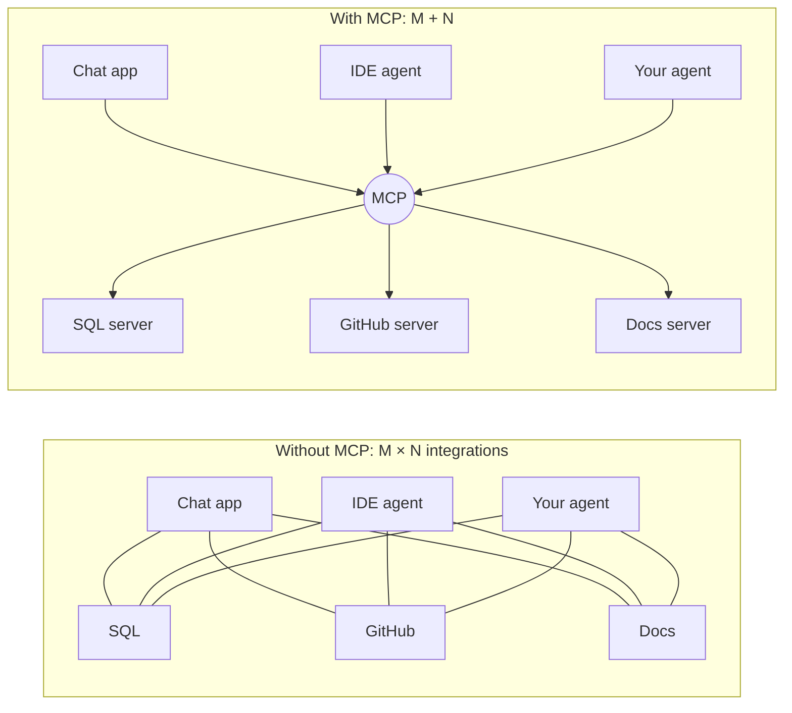
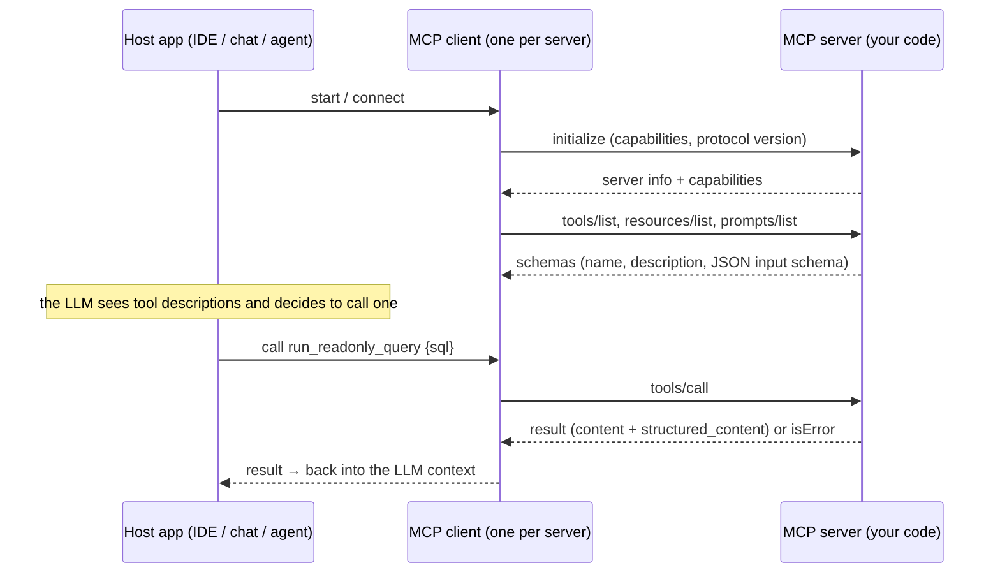

# Deep Dive 6 · MCP Hands-on — Build, Test and Connect a Model Context Protocol Server

> **Code:** [`src/ailearn/mcp_server.py`](../../src/ailearn/mcp_server.py) — a warehouse + docs MCP server · **Tests:** [`test_mcp_judge_stream.py`](../../tests/test_mcp_judge_stream.py) (in-memory client: list/call tools, read resources, guardrails)
> Targets the **MCP Python SDK 2.x** (`pip install "mcp[cli]"`). In 2.x, `FastMCP` was renamed **`MCPServer`** (`from mcp.server.mcpserver import MCPServer`). Tutorials written for 1.x use `from mcp.server.fastmcp import FastMCP`. The decorators look the same, but check the [migration guide](https://py.sdk.modelcontextprotocol.io/v2/migration/).

## Contents
1. [Why MCP exists](#1-why-mcp-exists)
2. [Architecture & primitives](#2-architecture--primitives)
3. [Transports: stdio vs streamable HTTP](#3-transports)
4. [Build the warehouse server, step by step](#4-build-the-warehouse-server)
5. [Test it without any client app](#5-test-it)
6. [Connect it: MCP Inspector, Claude/IDE clients, LangGraph, your own agent](#6-connect-it)
7. [Security for MCP servers](#7-security)
8. [Design guidelines for good tools](#8-design-guidelines)

---

## 1. Why MCP exists

Before MCP, every app × every tool needed its own integration (**M × N**). MCP is a standard protocol, so a tool server is written **once** and any MCP client can use it (**M + N**).



---

## 2. Architecture & primitives



| Primitive | Controlled by | Example in our server |
|---|---|---|
| **Tools** | the **model** decides to call them | `list_tables`, `describe_table`, `run_readonly_query`, `search_docs` |
| **Resources** | the **app/user** attaches them as context | `warehouse://schema` (all CREATE statements) |
| **Prompts** | the **user** picks them (like slash commands) | `analyze_table(table)` |

Clients can also offer capabilities to servers: **sampling** (the server asks the client's LLM to generate), **elicitation** (the server asks the user for input), and **roots** (which folders the server may touch).

The wire format is **JSON-RPC 2.0**, and tool input schemas are generated from your Python type hints.

---

## 3. Transports

| Transport | How | Use when |
|---|---|---|
| **stdio** | host launches your server as a subprocess; messages over stdin/stdout | local tools on the user's machine (desktop apps, IDEs) |
| **Streamable HTTP** | server runs as a web service (single HTTP endpoint, optional streaming) | shared/remote servers, many users, auth, deployment in Azure/Databricks |
| SSE (legacy) | older HTTP transport | only for old clients |

```bash
python -m ailearn.mcp_server            # stdio
python -m ailearn.mcp_server --http     # streamable HTTP (default port 8000)
```
⚠️ With stdio, **never print to stdout** in your server. It corrupts the protocol stream. Log to stderr.

---

## 4. Build the warehouse server

The full file is [`mcp_server.py`](../../src/ailearn/mcp_server.py). Key parts:

```python
from mcp.server.mcpserver import MCPServer

def build_server(conn, rag=None):
    server = MCPServer("data-platform", instructions=(
        "Tools for a read-only analytics warehouse and data-platform docs. "
        "Call list_tables/describe_table before writing SQL."))

    @server.tool(description="List all tables in the warehouse.")
    def list_tables() -> list[str]:
        ...

    @server.tool(description="Run ONE read-only SQL SELECT. Returns at most 100 rows.")
    def run_readonly_query(sql: str) -> list[dict]:
        err = validate_readonly_sql(sql)          # same guard as the LangGraph agent
        if err:
            raise ValueError(err)                 # becomes an isError result the model can read
        ...

    @server.resource("warehouse://schema", mime_type="text/plain")
    def schema() -> str: ...

    @server.prompt()
    def analyze_table(table: str) -> str: ...

    return server
```

What the SDK does for you:
- Builds the JSON input schema from the type hints (`sql: str`, `k: int = 3`).
- Returns **structured content** for typed return values (`list[dict]` → `structured_content={"result": [...]}`) as well as a text version.
- Turns exceptions into **tool error results** (`is_error=True`), so the model sees the message and can correct itself.

---

## 5. Test it

The SDK's `Client` can connect **in-memory** to a server object, with no subprocess or network:
```python
import asyncio
from mcp.client.client import Client
from ailearn.mcp_server import build_server

async def main():
    async with Client(build_server(conn, rag)) as c:
        print([t.name for t in (await c.list_tools()).tools])
        r = await c.call_tool("run_readonly_query", {"sql": "select region, sum(revenue) from gold_daily_sales group by 1"})
        print(r.structured_content)
        bad = await c.call_tool("run_readonly_query", {"sql": "drop table gold_daily_sales"})
        print(bad.is_error)                                    # True — guardrail held
asyncio.run(main())
```
✅ Tests: `test_mcp_lists_tools_resources_prompts`, `test_mcp_tools_work_end_to_end`, `test_mcp_guardrails_return_tool_errors` (DROP, stacked statements, SQL-injection in a table name).

**MCP Inspector** (interactive debugging UI):
```bash
npx @modelcontextprotocol/inspector python -m ailearn.mcp_server
```
Lets you browse tools/resources/prompts and call them by hand. Use it before connecting a real client.

---

## 6. Connect it

### 6.1 Desktop / IDE clients (stdio)
Most MCP hosts take a JSON config like this (exact file location differs per client; see its docs):
```json
{
  "mcpServers": {
    "data-platform": {
      "command": "python",
      "args": ["-m", "ailearn.mcp_server"],
      "env": { "WAREHOUSE_DB": "/path/to/warehouse.db" }
    }
  }
}
```
Then ask in chat: *"Which region had the most revenue? Use the data-platform tools."* The model lists tables, describes one, writes SQL, and calls `run_readonly_query`.

### 6.2 From LangGraph (MCP tools → LangChain tools)
```python
# pip install langchain-mcp-adapters
from langchain_mcp_adapters.client import MultiServerMCPClient
from langgraph.prebuilt import create_react_agent

client = MultiServerMCPClient({
    "data-platform": {"command": "python", "args": ["-m", "ailearn.mcp_server"], "transport": "stdio"},
    # "remote": {"url": "https://mcp.mycompany.com/mcp", "transport": "streamable_http"},
})
tools = await client.get_tools()
agent = create_react_agent(model, tools)
```

### 6.3 Platforms
Databricks offers managed MCP servers (Unity Catalog functions, Vector Search, Genie) and can host custom ones. Azure AI Foundry agents can use MCP servers as tools. Write the server once and reuse it in all of them.

---

## 7. Security

MCP servers are **code that an LLM can trigger**. Treat every tool call as untrusted input.

| Risk | Mitigation (✓ = implemented in our server) |
|---|---|
| Destructive actions | ✓ read-only validation; ✓ row cap; read-only DB credentials; separate servers for write tools, with human approval in the host |
| SQL injection via identifiers | ✓ identifier regex + allow-list in `describe_table` |
| Data exfiltration / over-broad access | per-user auth on HTTP servers (OAuth 2.1 is in the spec), scope data to the caller, audit logs |
| Prompt injection via tool output | tool results are data; hosts should not let text returned by one tool trigger privileged tools without confirmation |
| Malicious / untrusted servers ("tool poisoning") | only install servers you trust; review tool descriptions; pin versions; run in a sandbox/container |
| Secrets | env vars / Key Vault, never in tool outputs or descriptions |
| Path traversal in file resources | the SDK 2.x `ResourceSecurity` rejects traversal/absolute paths by default; validate anyway |

---

## 8. Design guidelines
- **Name tools like an API** (`verb_noun`), and write descriptions for the *model*: when to use the tool, when not to, and what it returns.
- **Fewer, higher-level tools** beat many tiny ones (`run_readonly_query` + `describe_table`, not one tool per table).
- **Return concise, structured results**, and cap sizes (we cap at 100 rows).
- **Actionable errors:** "Unknown table 'x'. Call list_tables first." teaches the model to recover.
- **Idempotent, side-effect-free reads**; keep writes separate, explicit and approvable.
- **Version your server**, and add a `health` / `server_info` check for HTTP deployments.

## ✅ Quiz
<details><summary>1. Tools vs resources vs prompts — who controls each?</summary>Tools: the model decides to call them. Resources: the application/user attaches them as context. Prompts: the user selects them as templates.</details>
<details><summary>2. Why must a stdio server never print to stdout?</summary>stdout carries the JSON-RPC protocol messages. Extra output corrupts the stream. Log to stderr.</details>
<details><summary>3. Your tool raises ValueError. What does the client receive?</summary>A tool result with <code>isError=true</code> and the error text, which the model can read and act on. The connection doesn't crash.</details>
<details><summary>4. stdio or streamable HTTP for a team-wide warehouse server?</summary>Streamable HTTP. It's one shared deployment with central auth, logging and network controls.</details>
<details><summary>5. What changed between MCP Python SDK 1.x and 2.x that breaks old tutorials?</summary><code>FastMCP</code> was renamed <code>MCPServer</code> (import from <code>mcp.server.mcpserver</code>), along with other API changes. See the migration guide.</details>

## 🏋️ Exercises
1. Add a `table_freshness(table)` tool that returns the max timestamp and hours since the last load. Test it with the in-memory client.
2. Add a **write** tool `rerun_pipeline(name)` to a *separate* server and require host-side approval. Explain in the README why it's separate.
3. Run the server over streamable HTTP in Docker and connect from LangGraph via `langchain-mcp-adapters`.
4. Use MCP Inspector to call every tool, and record a short GIF for your portfolio.
5. Wrap `RAGPipeline.ask` as an `answer_question` tool that returns citations, and compare it with the plain `search_docs` tool from an agent's perspective.

## 📚 Links
- 📖 [Model Context Protocol — docs & spec](https://modelcontextprotocol.io/) · [Python SDK docs](https://py.sdk.modelcontextprotocol.io/) · [SDK 2.x migration guide](https://py.sdk.modelcontextprotocol.io/v2/migration/)
- 💻 [MCP Python SDK (GitHub)](https://github.com/modelcontextprotocol/python-sdk) · [Reference servers](https://github.com/modelcontextprotocol/servers) · [MCP Inspector](https://github.com/modelcontextprotocol/inspector)
- 💻 [langchain-mcp-adapters](https://github.com/langchain-ai/langchain-mcp-adapters)
- 🎓 [Hugging Face — MCP course](https://huggingface.co/learn/mcp-course) · [DeepLearning.AI short courses (search "MCP")](https://www.deeplearning.ai/short-courses/)
