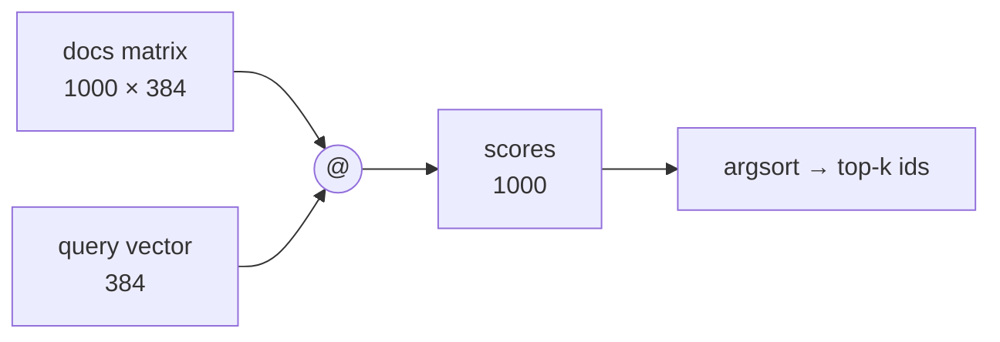

# Deep Dive 7 · Prerequisites — the Math & Python You Actually Need

> **Learning tests:** [`tests/test_math_prereqs.py`](../../tests/test_math_prereqs.py). Every fact on this page is an assertion you can run.
> You **don't** need calculus or a math degree to build LLM apps. You need the ~10 ideas below, used fluently.

## Part A · Math

### A1. Vectors
A vector is a list of numbers, which you can picture as an arrow. An embedding is a vector with hundreds of dimensions.

```python
import numpy as np
q = np.array([1, 2, 0])         # 3-dimensional vector
d = np.array([2, 3, 1])
q + d, 2 * q                    # element-wise add, scale
```

### A2. Dot product: "how aligned are two vectors?"
$$a \cdot b = \sum_i a_i b_i$$
`q · d = 1·2 + 2·3 + 0·1 = 8`. Large and positive means pointing the same way, zero means unrelated (orthogonal), negative means opposite.
```python
q @ d        # 8
```
**Where it shows up:** attention scores (`Q·Kᵀ`), similarity search, every layer of a neural net.

### A3. Length (norm) and cosine similarity
$$\|a\| = \sqrt{\sum_i a_i^2} \qquad \cos(a,b) = \frac{a\cdot b}{\|a\|\,\|b\|}$$
`‖q‖ = √5 ≈ 2.236`, `‖d‖ = √14 ≈ 3.742`, `cos = 8 / (2.236·3.742) ≈ 0.956`.

**Key fact:** if you **normalise** vectors to length 1, then dot product = cosine. That's why vector DBs ask you to normalise and then use the fast dot product. ✅ `test_normalized_vectors_make_dot_equal_cosine`

### A4. Matrices & shapes: how search and attention are computed
A matrix is a stack of vectors. Matrix multiplication = many dot products at once.

```
docs  (1000 × 384)   @   query (384,)   =   scores (1000,)      ← similarity to every chunk in ONE operation
Q (n × d) @ Kᵀ (d × n) = attention scores (n × n)
```
**Shape rule:** `(a × b) @ (b × c) → (a × c)`. The inner dimensions must match. Most bugs in ML code are shape bugs. Print `.shape` constantly. ✅ `test_matrix_multiply_shapes_are_how_search_works`



### A5. Softmax: scores → probabilities
$$\text{softmax}(z)_i = \frac{e^{z_i}}{\sum_j e^{z_j}}$$
`[2.0, 1.0, 0.1] → [0.66, 0.24, 0.10]`: positive, sums to 1, and preserves order. Used in attention weights and next-token probabilities. Temperature divides `z` before softmax. ✅ `test_softmax_turns_scores_into_probabilities`

### A6. Probability you'll use
- **Distribution:** probabilities over outcomes that sum to 1 (the next-token distribution).
- **Sampling:** picking randomly according to those probabilities (temperature, top-k, top-p — [lesson 01](../01-foundations.md#6-generating-text-decoding-strategies)).
- **Log-probabilities:** `log p`. Models output these; summing logs = multiplying probabilities, and it avoids underflow.
- **Perplexity:** `exp(average negative log-prob)`. Lower means the model is less "surprised" by the text.

### A7. Back-of-envelope sizing (super practical)
| Question | Formula | Example |
|---|---|---|
| Raw vector storage | `N × dim × 4 bytes` (float32) | 10M × 1536 × 4 ≈ **61 GB** ✅ `test_memory_math_for_vector_index` |
| int8 quantized | `N × dim × 1 byte` | ≈ 15 GB |
| Model weights | `params × bytes/param` | 8B × 2 (bf16) ≈ 16 GB; 4-bit ≈ 4–5 GB |
| Token cost | `in×price_in + out×price_out` | [lesson 02](../02-working-with-llms.md#5-cost--latency-maths) |
| Requests/min under TPM | `TPM / tokens_per_request` | 30k / 2.5k = 12 RPM |

### A8. Nice-to-have (later)
Gradient descent intuition (how training nudges weights to reduce loss) and the chain rule / backprop. Watch 3Blue1Brown's neural-network series; you don't need to derive anything to build apps.

---

## Part B · Python for LLM engineering

### B1. Type hints & dataclasses
LangGraph state, tool schemas and FastAPI models are all generated from type hints.
```python
from dataclasses import dataclass
from typing import Literal, TypedDict, Optional

class AgentState(TypedDict, total=False):    # dict with known keys (LangGraph state)
    question: str
    route: Literal["sql", "docs", "action"]
    sql_error: Optional[str]

@dataclass
class SearchResult:                          # lightweight record (see vectorstore.py)
    id: str
    score: float
```

### B2. Pydantic: validation everywhere
Pydantic is the backbone of structured LLM output, FastAPI request models, MCP/tool schemas and settings.
```python
from pydantic import BaseModel, Field, field_validator, ValidationError

class TableDoc(BaseModel):
    table: str = Field(pattern=r"^[a-z_]+\.[a-z_]+$")
    owner: str
    sla_hours: int = Field(gt=0, le=168)
    pii_columns: list[str] = []

    @field_validator("pii_columns")
    @classmethod
    def lowercase(cls, v): return [c.lower() for c in v]

TableDoc.model_validate({"table": "gold.sales", "owner": "alam", "sla_hours": "24"})  # "24" → 24
TableDoc.model_validate_json('{"table": "x", ...}')       # parse straight from LLM JSON
TableDoc.model_json_schema()                              # JSON Schema to give the LLM / tool definitions
doc.model_dump()                                          # → dict
```
| You need | Pydantic feature |
|---|---|
| constrain values | `Field(ge=, le=, pattern=, min_length=)`, `Literal[...]`, `Enum` |
| custom rules | `@field_validator`, `@model_validator` |
| nested objects | fields typed as other models, `list[Model]` |
| JSON in/out | `model_validate_json`, `model_dump_json` |
| schema for LLMs | `model_json_schema()` |
| config from env | `pydantic-settings` `BaseSettings` |

✅ `test_pydantic_validates_coerces_and_rejects`

### B3. Generators: streaming is just `yield`
```python
def stream_words(text):
    for w in text.split():
        yield w                   # produced lazily, one at a time
for w in stream_words("tokens arrive one by one"): print(w)
```
FastAPI's `StreamingResponse`, LangGraph's `.stream()` and OpenAI's `stream=True` are all iterators or generators.

### B4. Async/await
See [Deep Dive 3 §1](03-shipping-apps.md#1-async-python-in-15-minutes): `async def`, `await`, `asyncio.gather`, `Semaphore`, and never block the event loop.

### B5. Decorators & closures
`@retry(...)`, `@server.tool()`, `@observe()`, `@app.post(...)` are all decorators. Read [`resilience.py`](../../src/ailearn/resilience.py)'s `retry` to see how one is built.

### B6. Testing with pytest
| Technique | Example in repo |
|---|---|
| fixtures | `docs` in `conftest.py`, `conn`, `server` |
| parametrize | `test_safe_calculator`, `test_extract_json` |
| fakes instead of real LLMs | `ScriptedLLM`, `MockLLM` |
| fake time | `FakeClock` in `test_resilience_structured.py` (instant backoff tests) |
| `pytest.raises` | guardrail tests |
| `importorskip` | optional deps (langgraph, mcp, fastapi) |

### B7. Tooling you should be comfortable with
`venv`/`uv` · `pip install -e ".[extras]"` · `.env` + `python-dotenv` · `git` branching & PRs · `ruff` (lint/format) · Jupyter/Databricks notebooks for exploration, and **modules + tests** for anything you keep.

---

## ✅ Self-check (do these without running code, then verify with numpy)
<details><summary>1. cos([1,0],[1,1])?</summary>1 / (1·√2) ≈ 0.707</details>
<details><summary>2. Shapes: (32 × 768) @ (768 × 1000)?</summary>(32 × 1000) — 32 queries scored against 1000 docs.</details>
<details><summary>3. softmax([0,0,0])?</summary>[1/3, 1/3, 1/3]</details>
<details><summary>4. Why does dividing logits by T=0.5 make output more deterministic?</summary>It doubles the gaps between logits, so softmax concentrates probability on the top token.</details>
<details><summary>5. Pydantic: `Field(ge=1, le=5)` and the LLM returns 9. What happens?</summary><code>ValidationError</code>. In <code>generate_structured</code>, the error is fed back to the LLM for a retry.</details>

## 📚 Links
- 🎥 [3Blue1Brown — Essence of Linear Algebra](https://www.youtube.com/playlist?list=PLZHQObOWTQDPD3MizzM2xVFitgF8hE_ab) (watch chapters 1–4 and 9) · [Neural Networks series](https://www.youtube.com/playlist?list=PLZHQObOWTQDNU6R1_67000Dx_ZCJB-3pi)
- 📖 [NumPy: the absolute basics for beginners](https://numpy.org/doc/stable/user/absolute_beginners.html)
- 🎓 [Khan Academy — Vectors](https://www.khanacademy.org/math/linear-algebra/vectors-and-spaces)
- 📖 [Pydantic docs](https://docs.pydantic.dev/latest/) · [Python typing cheat sheet (mypy)](https://mypy.readthedocs.io/en/stable/cheat_sheet_py3.html) · [pytest getting started](https://docs.pytest.org/en/stable/getting-started.html)
- 📖 [Real Python — Async IO in Python](https://realpython.com/async-io-python/)
