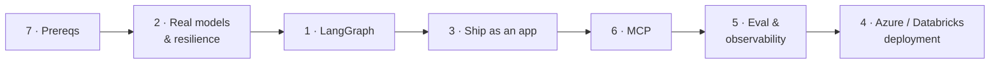

# 🔬 Deep Dives: the skills that turn learning into shipping

Lessons 01–10 teach how LLMs, RAG and agents work. These seven deep dives cover what you still need in order to **build and ship real agentic AI projects**. Each guide has diagrams, worked examples, runnable code with tests, a quiz, exercises and curated links.

| # | Deep dive | Why it matters | Runnable code & tests |
|---|---|---|---|
| 1 | [LangGraph in depth](01-langgraph-in-depth.md) | the most in-demand agent framework: state, reducers, routing, parallelism, interrupts, streaming, memory, subgraphs | [`test_langgraph_concepts.py`](../../tests/test_langgraph_concepts.py) (7 learning tests), [`graph_agent.py`](../../src/ailearn/graph_agent.py) |
| 2 | [Real models & embeddings in production](02-real-models-and-embeddings.md) | Azure OpenAI / Ollama / sentence-transformers, rate limits, retries, timeouts, fallbacks, messy PDFs, structured output | [`resilience.py`](../../src/ailearn/resilience.py), [`structured.py`](../../src/ailearn/structured.py) · [`test_resilience_structured.py`](../../tests/test_resilience_structured.py) (20 tests) |
| 3 | [Shipping it as an app](03-shipping-apps.md) | async Python, FastAPI, streaming (SSE), Streamlit/Chainlit UIs, Docker, config & secrets | [`api.py`](../../src/ailearn/api.py) `/ask/stream`, [`apps/streamlit_app.py`](../../apps/streamlit_app.py), [`Dockerfile`](../../Dockerfile), [`docker-compose.yml`](../../docker-compose.yml) |
| 4 | [Your cloud stack: Azure AI Foundry & Azure AI Search (+ Databricks recap)](04-azure-ai-foundry-and-ai-search.md) | enterprise RAG and agents on the platforms you use at work | code walkthroughs (needs an Azure subscription) |
| 5 | [Evaluation & observability in practice](05-evaluation-and-observability.md) | LLM-as-judge, RAGAS, DeepEval, Langfuse, eval gates in CI | [`llm_judge.py`](../../src/ailearn/llm_judge.py) · [`test_mcp_judge_stream.py`](../../tests/test_mcp_judge_stream.py) |
| 6 | [MCP hands-on](06-mcp-hands-on.md) | build a real MCP server (tools, resources, prompts), test it, connect it to clients and agents | [`mcp_server.py`](../../src/ailearn/mcp_server.py) · in-memory client tests |
| 7 | [Prerequisites: the math & Python you actually need](07-prerequisites-math-and-python.md) | vectors, dot products, matrices, softmax, probability; Pydantic, typing, async, pytest | [`test_math_prereqs.py`](../../tests/test_math_prereqs.py) |

**Suggested order:** 7 (if rusty) → 2 → 1 → 3 → 6 → 5 → 4. Interleave them with projects P3/P4/P5 from [`projects/`](../../projects/README.md).

