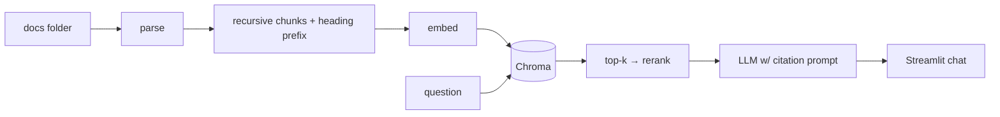
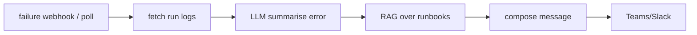

# 🛠️ Projects — Basic → Medium → Advanced

Each project lists **goal, skills, architecture, steps, acceptance tests, and stretch goals**. Build them in order or pick by role: 👩‍💻 = software dev, 🧱 = data engineer, ⭐ = both.

| # | Project | Level | For | Builds on |
|---|---|---|---|---|
| P1 | CLI chatbot with memory & cost tracking | 🟢 Basic | ⭐ | 02 |
| P2 | Semantic search over table/column docs | 🟢 Basic | 🧱 | 03 |
| P3 | "Chat with your docs" RAG bot with citations | 🟢→🟡 | ⭐ | 04 |
| P4 | Text-to-SQL agent with evaluation | 🟡 Medium | 🧱 | 05, 08 |
| P5 | RAG ingestion pipeline as medallion (Delta + Vector Search) | 🟡 Medium | 🧱 | 04, 08 |
| P6 | Pull-request review bot | 🟡 Medium | 👩‍💻 | 07 |
| P7 | Pipeline-failure triage bot (ADF/Databricks) | 🟡 Medium | 🧱 | 05, 08 |
| P8 | Log & incident triage agent | 🟡 Medium | 👩‍💻 | 05 |
| P9 | LLM enrichment of a Delta table (batch classification/extraction) | 🟡 Medium | 🧱 | 02, 08 |
| P10 | MCP server for your service/warehouse | 🔴 Advanced | ⭐ | 05 |
| P11 | Data-catalog copilot (lineage-aware GraphRAG) | 🔴 Advanced | 🧱 | 06 |
| P12 | Production RAG with evals in CI, tracing, guardrails | 🔴 Advanced | ⭐ | 06 |

---

## P1 · CLI chatbot with memory & cost tracking 🟢
**Goal:** a terminal chat that keeps history, trims it to fit the context window and prints tokens & cost per turn.
**Steps:** loop `input()` → append to messages → call API → print reply + `usage` → when history > N tokens, summarise older turns.
**Acceptance:** unit test with `ScriptedLLM` that history is trimmed; switching provider is a one-line change.
**Stretch:** streaming output; `/system` command to change persona; run against Ollama.

## P2 · Semantic search over table documentation 🟢🧱
**Goal:** "which table has customer churn flags?" → ranked tables.
**Data:** export `information_schema` / Unity Catalog table & column comments to a CSV.
**Steps:** one document per table (name + description + columns) → embed → `FlatIndex` or Chroma → CLI/Streamlit search.
**Acceptance:** 10 golden queries, hit-rate@3 ≥ 0.8; compare `HashingEmbedder` vs sentence-transformers.
**Stretch:** hybrid search for exact column names; filter by catalog/schema.

## P3 · Chat with your docs (RAG with citations) 🟢→🟡⭐
**Goal:** Q&A over a folder of Markdown/PDF (runbooks, Confluence export, your notes).
**Start from:** `examples/03_real_rag_chroma_openai.py`.

**Acceptance:** answers cite sources; returns "I don't know" for out-of-scope questions; 20-question eval with hit-rate@5 and groundedness reported in README.
**Stretch:** hybrid + reranker; conversation-aware query rewriting; incremental re-indexing by file hash.

## P4 · Text-to-SQL agent with evaluation 🟡🧱
**Goal:** ask business questions in English over a warehouse (start with SQLite/DuckDB using a public dataset such as TPC-H or NYC taxi, then Databricks SQL).
**Start from:** `examples/02_text_to_sql_agent.py` + `make_sql_tool`.
**Steps:** schema tool → (RAG over table docs if many tables) → SQL generation → validation (read-only, `LIMIT`, `EXPLAIN`) → execute → summarise; on error feed the error back (max 3 retries).
**Eval:** 30 questions with gold SQL; metric = **execution accuracy** (result sets equal).
**Acceptance:** ≥ 70% execution accuracy; zero non-SELECT statements possible (test it).
**Stretch:** semantic-layer definitions ("revenue = sum(amount) where status='paid'"); charts; few-shot retrieval of similar past questions.

## P5 · RAG ingestion medallion pipeline 🟡🧱
**Goal:** production-style ingestion: ADLS/Volumes → bronze (raw) → silver (parsed text + metadata) → gold (chunks + embeddings) → Vector Search Delta-Sync index; incremental.
**Follow:** [docs/08 §1](../docs/08-for-data-engineers.md#1-use-case-rag-ingestion-pipeline-as-a-medallion-pyspark).
**Acceptance:** re-running with one changed file re-embeds only that file's chunks; deleted files disappear from the index; data-quality checks (empty text, oversized chunks) as expectations.
**Stretch:** ADF/Databricks Workflows orchestration; ACL column propagated to the index and used as a filter; cost report per run.

## P6 · Pull-request review bot 🟡👩‍💻
**Goal:** GitHub Action that reviews a PR diff against `CONTRIBUTING.md` guidelines and posts JSON-structured comments.
**Acceptance:** comments reference file + line; noise filter (only severity ≥ medium); unit tests with recorded diffs and `ScriptedLLM`.
**Stretch:** RAG over past review comments; auto-suggest test cases.

## P7 · Pipeline-failure triage bot 🟡🧱
**Goal:** when an ADF/Databricks job fails, post probable cause + runbook link + fix to Teams/Slack.

**Acceptance:** tested with 10 historical failure logs; correct runbook in top-3 for ≥ 8.
**Stretch:** agent can check upstream table freshness and recent schema changes; auto-create ticket with approval.

## P8 · Log & incident triage agent 🟡👩‍💻
Tools: `search_logs`, `recent_deploys`, `search_runbooks`, `create_ticket` (approval). Measure trajectory quality on 10 synthetic incidents.

## P9 · LLM enrichment of a Delta table 🟡🧱
**Goal:** classify & extract fields from 100k support tickets / product reviews in batch.
**Steps:** Pydantic schema → `ai_query` / pandas UDF with batching & retries → validation column → gold table; track cost.
**Acceptance:** 200 human-labelled rows; report accuracy/F1; re-runs are idempotent.
**Stretch:** compare a large vs small model (quality vs cost table); fine-tune a small model (LoRA) on the large model's outputs.

## P10 · MCP server for your service/warehouse 🔴⭐
Expose `list_tables`, `describe_table`, `run_readonly_query`, `search_docs` (wrap `RAGPipeline`) via MCP; use it from an MCP-capable client. Add auth and audit logging.

## P11 · Data-catalog copilot with lineage (GraphRAG) 🔴🧱
Load lineage (Unity Catalog / OpenLineage) into a graph (NetworkX/Neo4j) + embeddings of table docs. Answer: "If `bronze_orders` is late, which dashboards break and who owns them?" Compare against plain vector RAG on 20 multi-hop questions.

## P12 · Production RAG with evals in CI 🔴⭐
Take P3/P5 and add: golden set + RAGAS/DeepEval in GitHub Actions (fail on regression), Langfuse/Phoenix tracing, prompt-injection test docs, ACL filters, semantic cache, cost dashboard, Docker deploy.

---

## More project ideas & examples online
- [Shubhamsaboo/awesome-llm-apps](https://github.com/Shubhamsaboo/awesome-llm-apps) — 100+ RAG & agent apps
- [NirDiamant/RAG_Techniques](https://github.com/NirDiamant/RAG_Techniques) · [NirDiamant/GenAI_Agents](https://github.com/NirDiamant/GenAI_Agents)
- [LlamaIndex examples](https://docs.llamaindex.ai/en/stable/examples/) · [LangGraph tutorials](https://langchain-ai.github.io/langgraph/tutorials/)
- [Microsoft generative-ai-for-beginners](https://github.com/microsoft/generative-ai-for-beginners) · [ai-agents-for-beginners](https://github.com/microsoft/ai-agents-for-beginners)
- [Databricks demos (dbdemos — includes LLM/RAG chatbot)](https://www.databricks.com/resources/demos)
- [OpenAI Cookbook](https://cookbook.openai.com/) · [Anthropic Cookbook](https://github.com/anthropics/anthropic-cookbook)
